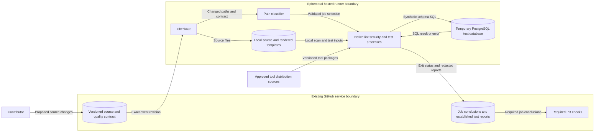

# BigRAE rename and quality design

Issue: #2555. Requirement: GEN-002. Design date: 2026-10-25.

This document describes the target source and CI design.
It does not state that the target is complete.
The user directs that no deployments exist.
Cloud discovery, cloud changes, and live migration are outside this design.

## Architecture and contracts

BigRAE is the product name.
The [identifier inventory](bigrae-rename-inventory.md) defines each name's disposition.
The [architecture handbook](../technical/architecture.md) defines the application boundaries.
The [rename preflight](bigrae-product-repository-rename-preflight-2555.md) defines the compatibility constraints.
These documents supply the application design for this change.

Each configuration alias enters through its existing parser.
Different values for equivalent old and new inputs cause failure before use.
SDK aliases use the existing types and worker boundary.
The application does not import executable adapter code.
Plugin input uses exactly one supported key from the bound Secret.

Webhook signature aliases contain the same signature over the same bytes.
Supported CTF formats keep their version checks.
Database names, resource names, metric identities, and historical records keep their existing identities.

The repository rename keeps the GitHub repository ID and owner ID.
Repository-name checks also require those IDs.
Future cloud templates use one exact configured repository.
The [cutover procedure](../how-to/bigrae-rename-cutover.md) defines source and repository verification.
No live cloud trust overlap is necessary.

## CI components and interfaces

The quality contract is `.github/quality-path-filters.yaml`.
Its existing parser and classifier select the jobs in `.github/workflows/_quality.yml`.
Unknown production paths cause failure before job selection.
Each production path needs blocking lint, security, and test coverage.
A job can supply two categories when its commands enforce both.

The design uses existing jobs before it adds a job.
It does not add another workflow parser or policy registry.

| Component | Existing interface | Target behavior |
| --- | --- | --- |
| Path classifier | Changed paths to GitHub job-selection outputs | Reject unknown paths. Keep full coverage for workflow and contract changes. |
| Ownership guard | Contract, tracked paths, and parsed workflow to violations | Require reachable blocking jobs for all three categories. |
| Native tools | Source or rendered inputs to process exit status | Return failure for prohibited inputs. Do not discard the failure. |
| Test jobs | Synthetic fixtures and process boundaries to assertions | Prove behavior and failure propagation. Do not require cloud credentials. |
| ADR registry | Accepted rules and dated exceptions to conformance results | Keep the rules. Remove each expired exception after the repair passes. |
| Required PR checks | Job conclusions to merge eligibility | Keep the existing required-check boundary. |

The guard's workflow model proves routing and declared ownership.
It does not prove that a scanner covers each language in a mixed directory.
Native negative fixtures supply that evidence.
Missing tools, invalid configuration, and scanner failures cause a failing job.

## Quality coverage

This scope includes the failures already tracked by #1698.
That issue's active worktree remains separate.
Only reviewed, compatible changes can enter this branch.

| Surface | Lint and security design | Behavior evidence |
| --- | --- | --- |
| Three AWS inspection scripts | Credit their existing blocking Ruff jobs, which enable security rules. | Prove that a security-rule violation returns failure. |
| MCP packages | Make existing ESLint security warnings fail with `--max-warnings 0`. Repair findings at their owning functions. | Run package tests. Include the existing shared-package tests in the test matrix. |
| ADR and ownership tooling | Add blocking Ruff coverage with security rules for both existing directories. | Retain ownership, routing, and self-bypass negative tests. |
| Stack smoke scripts | Use Ruff for Python and ShellCheck for shell. | Retain the existing smoke-contract tests. |
| Kubernetes manifests | Credit the existing blocking kube-linter job after its native security failure probe passes. | Keep schema, kube-linter, admission, and routing tests. |
| Helm chart | Add Helm lint for the neutral and supported provider profiles to the existing chart contract job. | Its security assertions and lint run independently of the optional test-skip flag. |
| Container inputs | Use Hadolint, ShellCheck, and a blocking configuration security scan. | Keep authority tests. Add a bounded, credential-free guacd image smoke test. |
| CloudFormation | Remove the two unused vendor installer templates under the user's explicit decision. | Remove their obsolete ownership entry and identifier exception. Keep historical evidence in Git. |
| Root branding assets | Current references occur in a hook filter and deprecated documentation. No current runtime or build consumer was found. | Remove unused legacy assets with their obsolete ownership record after a final consumer search. Keep historical evidence in Git history. |
| Bootstrap tests | Replace the expired exception's internal orchestration mocks with process or cloud-client boundary fixtures. | Assert commands, results, errors, and absence of unintended effects. Reduce the legacy baseline. |

The repair does not renew the expired exceptions.
An advisory job cannot satisfy security ownership.
Lint and security jobs do not depend on `skip_tests`.
Scanner rules are not disabled to obtain a passing result.
An exact false positive needs the repository's existing documented disposition.

## Data flows and trust boundaries

Contributor code is untrusted at the runner boundary.
Quality jobs use `contents: read` and existing hosted-runner patterns.
They have no cloud credentials or deployment authority.
Action references use immutable commit IDs.
Binary tools use the existing version and integrity controls.

Tests use synthetic data and temporary local files.
Only established GitHub report paths receive results.
There is no new external service or application data store.

A temporary PostgreSQL container tests SQL failure behavior.
Its network is disabled.
It has no host ports or real credentials.
The test removes the container and its temporary inputs.

| Threat and boundary | Control | Verification |
| --- | --- | --- |
| Unclassified source bypasses checks at the classifier boundary. | Reject unknown paths before outputs exist. | Existing unknown-path and renamed-path negative tests. |
| A declared owner does not enforce its category. | Inspect actual command coverage. Reject advisory and swallowed failures. | Native negative inputs and workflow-model tests. |
| A test flag bypasses security checks. | Keep lint and security independent of `skip_tests`. | Routing and self-bypass tests. |
| Changed names widen repository authority. | Bind exact names to repository and owner IDs. | Wrong-owner, wrong-ID, and fork-origin negative tests. |
| Alias ambiguity changes execution input. | Reject conflicting values at the owning parser. | Configuration, protocol, and Secret-binding negative tests. |
| A tool or test exposes confidential data. | Use synthetic inputs, read-only job permissions, and established report paths. | Review job permissions, commands, fixtures, and report content. |

Static tools cannot prove complete runtime security.
Local checks cannot prove hosted CI success or repository cutover.
Those limits remain explicit in the acceptance evidence.

## Policy and decision records

GEN-002 requires executable rules, dated exceptions, local checks, and CI checks.
The existing ADR registry and guard supply those interfaces.
ADR-004-R24 supplies path ownership.
ADR-019-R1 supplies the boundary-mock rule.
Their rules remain in force.

ADR-004-R11 keeps Checkov's Kubernetes recommendations advisory.
The existing kube-linter job supplies blocking Kubernetes security policy.
Its controls reject privileged containers, unsafe capabilities, and writable root filesystems.
The repair removes the five expired entries only after the corresponding checks pass.
The enforcement guide records the resulting owners and commands.
No new ADR is necessary because these repairs enforce accepted decisions.

The application DFD in the handbook remains applicable.
CI does not add a runtime service, application data flow, or persistent schema.
The DFD above supplies the additional CI boundary.
No deployment diagram is necessary because this change creates no deployment.

## Acceptance and references

The issue plan owns implementation steps and validation commands.
The identifier inventory owns naming coverage and compatibility evidence.
The cutover procedure owns repository identity and automation verification.
This document owns architecture and security coverage for the expanded quality repair.
The required CI-level ADR check must pass before readiness is claimed.

| Source | Version and section | Use |
| --- | --- | --- |
| [GitHub secure-use reference](https://docs.github.com/en/actions/reference/security/secure-use) | Read 2026-10-25. Writing workflows; third-party actions. | Read-only permissions, untrusted-code boundary, and immutable action references. |
| [AWS CI/CD reference pattern](https://docs.aws.amazon.com/prescriptive-guidance/latest/aws-caf-platform-perspective/ci-cd.html) | Read 2026-10-25. Create CI/CD pipelines; automated testing; documentation. | Reuse the existing pipeline and native tools. Keep configuration and evidence versioned. |
| [NIST SSDF](https://nvlpubs.nist.gov/nistpubs/SpecialPublications/NIST.SP.800-218.pdf) | Version 1.1. PO.3, PW.7, and PW.8. | Connect tools, security analysis, behavior tests, and recorded findings. |
| [Ruff settings](https://docs.astral.sh/ruff/settings/) | Repository tool requirement: 0.15.13 or later. Lint selection and flake8-bandit. | Enable security rules through committed configuration. |
| [ESLint CLI](https://eslint.org/docs/latest/use/command-line-interface) | Repository dependency: 10.3 or later. Handle warnings; exit codes. | Make security warnings fail the existing lint job. |
| [Checkov CLI](https://www.checkov.io/2.Basics/CLI%20Command%20Reference.html) | Existing pinned Checkov action. Hard and soft fail. | Require blocking policy results for the covered inputs. |
| [ASD-STE100](https://www.asd-ste100.org/assets/files/ASD-STE100_ISSUE9.pdf) | Issue 9. Part 1 sections 1, 3, 4, 5, 6, and 9; Part 2. | Review words, sentence length, technical terms, and document purpose. |

The prose review uses the official standard and its dictionary.
Project names, paths, scanner names, and CI terms are technical nouns.
Commands and program identifiers retain their required spelling.
Descriptions use short sentences with one main fact.

Tables and diagrams describe contracts and controls.
Implementation procedures remain in the issue plan.
