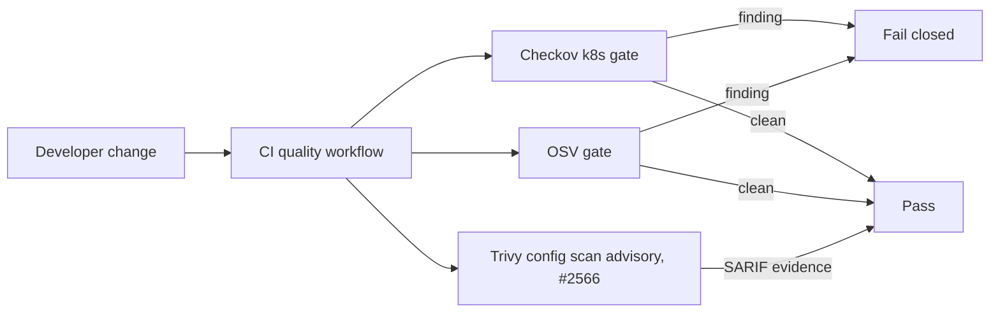

# Blocking configuration security scans: design (#2558)

Status: implementation design. Date: 2026-10-28.

This design records the decisions for issue #2558. It builds on the preflight
guidance in
[`blocking-config-security-preflight-2558.md`](./blocking-config-security-preflight-2558.md).
The preflight note holds the full boundary analysis. This note records the
chosen approach and its reasons. ADR-004, ADR-006, ADR-007, ADR-017, ADR-020,
ADR-037, ADR-043, and ADR-044 already supply the architecture. The work adds no
new ADR.

## Architecture

The change makes the Kubernetes Checkov scan a blocking policy surface and
resolves its findings. The scan runs in `.github/workflows/_quality.yml`. It
stays separate from the Terraform Checkov policy and the exact-release image
scan. Making the Trivy configuration scan blocking is deferred to issue #2566,
because that scan surfaces about 40 findings across 11 rule types, which is a
larger body of work. The OSV dependency scan already fails closed; this change
fixes its two open findings.

The Kubernetes Checkov scan keeps its pinned action, its scan root, and its
least-privilege permissions. The job removes `soft_fail` and `continue-on-error`,
so it fails closed on any finding.

The repository runtime identity moves from UID 1000 to UID 10001. The move is one
coordinated change across the first-party container images, the runtime profiles,
the Helm chart, the admission policies, the bootstrap job generators, and the
Kubernetes manifests. The Cloud SQL proxy keeps its separate 65532 identity. The
portal, provisioner, and preparation images set the 10001 user and file
ownership. The Guacd and Guacamole client containers run the upstream image as
UID 10001 with `HOME` set to a writable volume, because the upstream image has no
passwd entry for an arbitrary user and regenerates its home at start.

Worker readiness reuses the existing heartbeat files. Each worker already writes a
heartbeat that its liveness probe reads. The readiness probe reads the same
heartbeat with bounded staleness. Readiness does not add an HTTP service or a
second heartbeat schema. One-shot provisioner containers get no readiness probe,
because their admission profile forbids it.

The Guacamole client still reads its database credentials through `envFrom`
(CKV_K8S_35). The file-delivery change is deferred to issue #2565, because the
pinned Guacamole 1.6.0 image has a confirmed file-secret regression
(GUACAMOLE-2119) and loads the PostgreSQL extension through an
environment-variable framework. A correct fix must fork the image entrypoint,
which carries remote-access risk. A scoped, time-boxed exception in
`docs/adr/exceptions.yaml`, with a resource annotation, records the finding until
#2565 lands.

## Systems security engineering

| Asset | Threat | Control | Verification |
| --- | --- | --- | --- |
| CI policy posture | A real misconfiguration ships because the Kubernetes scan is advisory | Kubernetes Checkov blocks on findings; no soft-fail, no continue-on-error | Checkov reports zero failures on the manifests; the job fails on a seeded finding |
| Container host boundary | A low UID collides with a host or namespace identity | UID 10001 across image, profile, admission, and manifests | Admission accepts the generated workload and rejects an altered identity; renders prove the effective UID/GID/fsGroup |
| Database credentials | Credentials leak through argv, child environment, Helm history, or logs | Deferred to #2565; a scoped, time-boxed exception records the current env delivery until the file-delivery fork lands | The exception names the rule, owner, expiry, and path; the annotation points back to it |
| Rollout health | A broken worker reports ready | Readiness reads the real heartbeat with bounded staleness | A stale heartbeat fails readiness; a live heartbeat passes |
| Provisioner launcher API access | A general workload gains the Kubernetes API | CKV_K8S_38 rationale keeps the exact launcher SA, RBAC, namespace, and network boundary; other workloads keep automount disabled | ADR-006-R4 boundary tests pass |

## Data flow

Trust boundaries: the CI runner is a separate boundary from the deployed cluster.
The scanner artifacts carry only first-party source diagnostics. The Trivy
configuration scan stays advisory until #2566.

## Diagrams

The data flow diagram above is the only new diagram. The component structure
reuses the existing chart, manifests, and workflow. No new deployment or state
model exists.

## Policy as code

- The Kubernetes Checkov job removes `soft_fail` and `continue-on-error`.
- `scripts/adr_guard/_guard/checks/quality_ownership.py` reclassifies
  `security-k8s` as a blocking job. The Trivy configuration job stays advisory
  until #2566.
- The admission policies move the pinned identity to 10001.
- CKV_K8S_43 and CKV_K8S_38 use resource `checkov.io/skipN` annotations with a
  factual rationale and matching `docs/adr/exceptions.yaml` entries.

## Architecture as code

- The portal, provisioner, and preparation Dockerfiles set the 10001 identity and
  file ownership. The Guacd and Guacamole client manifests run the upstream image
  as 10001 with `HOME` on a writable volume.
- The Helm chart security values carry the new identity.
- `shifter/shifter_platform/shared/cloud/kubernetes/_profile.py` and the
  preparation runtime and installation renderers emit the new identity and
  `fsGroup`.
- The bootstrap job generators in `scripts/bootstrap/aws_eks.py` and the
  `gcp_migrations` renderer emit the new identity.
- The CTFd Terraform module and its wiring are removed, because the platform does
  not use the standalone CTFd instance.
- The OSV dependency fixes move `qs` to 6.16.1 (CVE-2026-110816) and `msgpack` to
  the latest 1.2.x (CVE-2026-114613).
- The Packer grant scoping (GCP-0007) and the Cloud SQL `log_temp_files` change
  (GCP-0014) move to the Trivy follow-up #2566.

## ADR changes

No new ADR is added. ADR-004-R11 in `docs/adr/index.yaml` and
`docs/technical/dev/adr-enforcement.md` change the Kubernetes Checkov description
from advisory to blocking. The Terraform Checkov policy and its invocation-parity
checker stay unchanged.

This change adds three scoped, documented entries to `docs/adr/exceptions.yaml`
(rule id `ADR-004-R11`, owner, expiry, and paths):

- CKV_K8S_43: verified false positive. Every deploy path rewrites the placeholder
  image to an attested digest (ADR-037).
- CKV_K8S_38: verified false positive. The dedicated provisioner launcher needs
  Kubernetes API access under ADR-006-R4; other workloads keep automount disabled.
- CKV_K8S_35: time-boxed acceptance. The Guacamole file-secret fork is tracked in
  #2565.

The deferred work keeps its own issues: the Trivy configuration flip and its
findings in #2566, the egress refactor in #2563, and the GCS and S3 CMEK work in
#2564.

## Document review

This document uses ASD-STE100 Simplified Technical English. Each sentence states
one fact. Procedures stay within 20 words and descriptions within 25. The
document describes the system and its decisions. Implementation tasks stay in the
issue plan.
