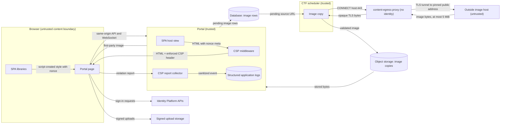

# Browser CSP enforcement design (#2090)

Design, 2026-10-27. The maintainer moved the open #2085 enforcement work into
#2090. This note applies ADR-036. The
[#1520 preflight](browser-security-policy-preflight-1520.md) remains the policy
and collector design. This note records only the enforcement decisions.

## Decision

The portal enforces the reviewed ADR-036 candidate by default.
`BROWSER_CSP_MODE=report-only` stays a valid mode. It is a degraded-security
state and requires an ADR-036 exception. The policy stays code-owned in
`config/_browser_security.py`. No source list, header authority or middleware is
added.

One change to the candidate is necessary. `style-src` adds Django's per-response
`CSP.NONCE`. The SPA libraries that draw dialogs and the terminal create `<style>`
elements at run time. Extraction to a static file is not possible for that
content. ADR-036-R2 permits a nonce in this condition.

## Observed state

| Surface | Observation in enforce mode |
| --- | --- |
| SPA journeys and accessibility matrix | 34 of 35 hermetic tests passed |
| SPA dialog | Blocked: `react-remove-scroll` inserts a `<style>` element |
| SPA terminal | xterm 6 inserts four `<style>` elements; no nonce option |
| Live Django pages | Only the privacy notice has inline CSS (a `<style>` block) |
| Django admin | One optional width rule in `change_list.html`; cosmetic only |
| Documentation Mermaid bundle | No page loads it; the documentation app was removed |
| Organizer images | The event logo and Markdown images from other hosts are blocked |
| Unrouted legacy templates | Inline handlers and scripts, but no URL reaches them |

## Components

| Component | Responsibility |
| --- | --- |
| `config/_browser_security.py` | Candidate, `style-src` nonce sentinel, default mode `enforce` |
| Django `ContentSecurityPolicyMiddleware` | Sends the header; adds the nonce only when a template reads it |
| `django.template.context_processors.csp` | Gives templates the lazy `csp_nonce` |
| SPA host view and template | Puts the nonce in `<meta property="csp-nonce">`; sends `Cache-Control: no-store` |
| SPA `csp-nonce` module | Reads the meta nonce once; stamps it on script-created `<style>` elements |
| `static/css/privacy.css` | Replaces the privacy notice `<style>` block |
| Playwright CSP guard | Fails each journey and scan on any `securitypolicyviolation` event |

The SPA module runs before the application modules. It wraps the document's
`createElement` for the `style` tag only. Library code then
gets a nonce-bearing element and needs no change. React inline `style` props and
xterm sizing use CSSOM writes, which CSP does not block.

## Systems security engineering

| Item | Content |
| --- | --- |
| Assets | Session cookies, CSRF tokens, terminal data, MFA enrollment secrets, page content |
| Protection needs | Integrity and confidentiality of authenticated pages |
| Trust boundary | Browser page versus injected markup from content, scenario data or a defect |
| Threat T1 | Injected `<script>` or inline handler runs in the portal origin |
| Threat T2 | Injected `<style>` or style attribute exfiltrates page data |
| Threat T3 | Script sends data to an outside origin |
| Threat T4 | A reused nonce lets an attacker predict the value |
| Control C1 (T1) | `script-src 'self'` plus the Firebase origin; `script-src-attr 'none'` |
| Control C2 (T2) | `style-src 'self'` plus the nonce; `style-src-attr 'none'`; the parser never stamps injected markup |
| Control C3 (T3) | `connect-src 'self'` plus exact identity and storage origins |
| Control C4 (T4) | Django generates the nonce per response; nonce-bearing pages send `no-store` |

Residual risks:

- A script that already runs can create a nonce-bearing `<style>`. C1 is the
  barrier for that script. The OWASP warning about universal nonces applies to
  server-side stamping of injected markup. This design does not do that.
- A header-level `report-only` rollback removes C1 to C3 until a reviewed change
  restores `enforce`.
- Hermetic tests use Chromium and synthetic `dev_login`. The live Identity
  Platform, MFA and range terminal paths need deployed qualification under #2117.

Verification:

| Control | Test |
| --- | --- |
| C1 | Playwright: injected `<script>` and `onerror` do not run; violations name `script-src-elem` and `script-src-attr` |
| C2 | Playwright: dialogs open with no violation; Vitest: only `style` elements get the nonce |
| C3 | Playwright: same-origin WebSocket allowed; off-origin WebSocket and `fetch` blocked |
| C4 | Pytest: the SPA host header contains the template nonce and `no-store`; pages that do not read it send no nonce |
| All | Every journey, accessibility scan and live Django page fails on a violation |

## Organizer images

`img-src 'self' data:` blocks images from other hosts. Organizers can put external
image URLs in the event logo and in Markdown: event rules, challenge descriptions
and solutions, event pages and announcements. The platform therefore copies each
external image into its own storage when the organizer saves the content. This
is the pattern of Discourse "download remote images to local". The policy keeps
`img-src 'self' data:`.

### Components

| Component | Responsibility |
| --- | --- |
| `CTFContentImage` model | One row for each event and source URL: state, failure code, storage key, type, size, SHA-256 |
| `ctf.content_images` | Finds image URLs in Markdown with a CommonMark parser (markdown-it-py) |
| Save receivers in `ctf.signals` | After commit, sync the image rows of the event whose content changed |
| `ctf.services.content_images` | Sync rows, copy pending images, give the image map, read an image |
| Pinned HTTPS helper in `ctf.validators._ssrf` | The one SSRF-guarded request path; webhooks also use it |
| `content-egress` proxy (`ctf.egress_proxy`) | Credential-less CONNECT proxy; the only platform pod with public HTTPS egress |
| CTF scheduler | Copies a bounded batch of pending images after the due tasks in each cycle |
| Image view `/api/v1/ctf/content-images/<id>/` | Sends verified stored bytes from the portal origin to authorized users |
| Image map endpoints | Participant `me/content-images/` (with a pending count) and organizer `events/<id>/content-images/`; the SPA polls only while copies are pending |
| SPA `MarkdownContent` and event home | Show a mapped first-party image, or a link when no copy is ready |

The organizer's text is not changed. The original URL stays in the content and in
the row as provenance. A data migration creates rows for existing content, and
the scheduler then copies those images.

Syncs for one event run one at a time. Each sync locks the event row
(`FOR NO KEY UPDATE`) and then reads the content, so the last sync sees the
latest committed content. A stored copy is deleted after its row deletion commits.

Deployed platform pods have no public egress. The CTF scheduler and the portal
reach organizer-chosen hosts through the `content-egress` CONNECT proxy, the same
pattern as `model-provider-egress`. TLS runs end to end inside the tunnel, so the
proxy relays opaque bytes. CTF webhooks use the same proxy.

### Copy rules

| Rule | Value | Reason |
| --- | --- | --- |
| Scheme | HTTPS only | The pinned helper uses TLS; the OWASP SSRF guidance allows a scheme list |
| Destination | Every resolved address public; the proxy dials a validated, pinned address | OWASP SSRF guidance; blocks DNS rebinding |
| Redirects | Not followed | OWASP SSRF guidance |
| Timeout | 10 s for connect, TLS handshake and send; every receive ends by a 15 s deadline per copy; 20 s batch budget; no upload starts after the deadline | Camo default; bounds scheduler delay |
| Size | 5 MiB, counted while reading | Camo default; a missing `Content-Length` cannot bypass it |
| Types | PNG, JPEG, GIF, WebP; header and magic bytes must agree | Camo type allowlist; SVG can carry script |
| Retries | 3 attempts with backoff for transient failures | Matches the scheduler retry policy |

A failed or pending image shows as a link to its original URL. The organizer
image map shows the state and failure code of each image. The participant map
lists only images in content the participant can read now: the logo and rules,
generic pages, sent announcements, readable challenges, and solutions after the
event ends. The image view applies the same rule and checks the stored SHA-256.

### Security

| Item | Content |
| --- | --- |
| New trust boundary | The scheduler fetches organizer-chosen URLs from outside hosts |
| Threat T5 | An organizer URL reaches internal services or cloud metadata (SSRF) |
| Threat T6 | A fetched file is HTML, SVG or script presented as an image |
| Threat T7 | A large or slow response exhausts scheduler time, memory or storage |
| Threat T8 | A user reads another event's images, or an image from unreleased content |
| Threat T9 | Participant browsers reveal their addresses to outside image hosts |
| Control C5 (T5) | HTTPS only; no URL credentials; public addresses only; no redirects; the egress proxy repeats the address check, pins the address, and is the only pod with public egress (ADR-006-R3) |
| Control C6 (T6) | Type allowlist with magic-byte check; served with the stored type and `nosniff` |
| Control C7 (T7) | 5 MiB counted limit; per-copy elapsed deadline; bounded batch after due tasks; heartbeat after each copy; storage writes limited to the `ctf-content-images/` prefix |
| Control C8 (T8) | Staff with the challenges capability (owners, co-organizers, platform admins) read every image of the event; a participant reads an image only while it is in content they can read |
| Control C9 (T9) | Browsers load only the first-party copy |

Residual risks: copies use storage until the organizer removes the URL from the
content. The platform does not decode images; browsers apply their own decode
limits. The proxy can reach any public HTTPS host; its clients are limited to the
portal and the CTF scheduler, and it holds no credentials to misuse.

| Control | Test |
| --- | --- |
| C5 | Pytest: HTTP, credentials, blocked addresses and redirect responses fail; the proxy refuses IP literals and nonglobal answers; chart and guard tests pin the proxy-only egress policy |
| C6 | Pytest: SVG, HTML and a type that disagrees with the magic bytes fail |
| C7 | Pytest: a response over 5 MiB fails while reading; a silent or trickling status line, header or body stops at the deadline; no upload starts late; Terraform test pins the prefix-scoped storage grant |
| C8 | Pytest: other users, anonymous users, moderator and judge roles, and images from hidden or unreleased content are refused |
| C9 | Vitest: unmapped external images render as links; mapped images use the first-party URL |

## Data flows



```mermaid
sequenceDiagram
    participant B as Browser
    participant D as Django
    participant S as SPA module
    participant L as Library
    B->>D: GET /mission-control
    D->>D: Render template; read csp_nonce
    D-->>B: HTML, CSP header with nonce, no-store
    B->>S: Load SPA bundle
    S->>S: Read meta nonce; wrap createElement
    L->>S: createElement("style")
    S-->>L: style element with nonce
    L->>B: Insert style; browser allows it
```

## Policy, architecture and ADR changes

- ADR-036 decision and R2 record enforcement as the default, the style nonce for
  script-created elements, `report-only` as a degraded state, and first-party
  copies of organizer images.
- No exception entry is added. The admin `change_list.html` rule is cosmetic, and
  the policy does not weaken for it.
- ADR-006-R3 records the designated egress proxy exception, and the
  `k8s-network-policy-coverage` check enforces its exact shape.
- The CTF scheduler's Google identity can create, read and delete objects only
  under `ctf-content-images/` in the assets bucket (IAM condition). The GCP
  release verifier includes the `content-egress` workload.
- The quality-path contract needs no change. Existing frontend, platform, chart
  and guard units own the changed paths.
- [RB024](../runbooks/rb024-browser-csp-violation.md) gives the bounded rollback.

## Non-goals

- No change to script sources, `img-src`, `connect-src` origins or the report
  collector.
- No Trusted Types, `strict-dynamic` or nonce for scripts.
- No rewrite of the unrouted legacy templates. They are not served.
- No multi-browser or deployed scan. #2117 owns those tiers.
