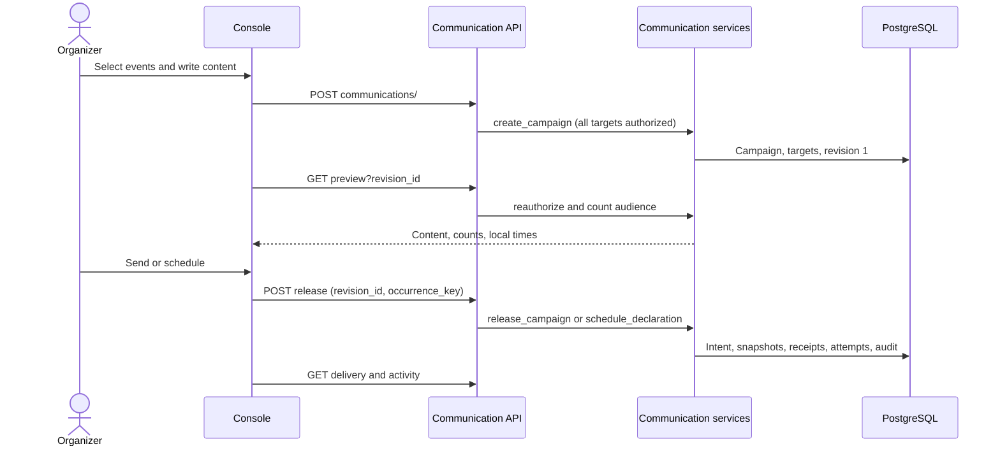
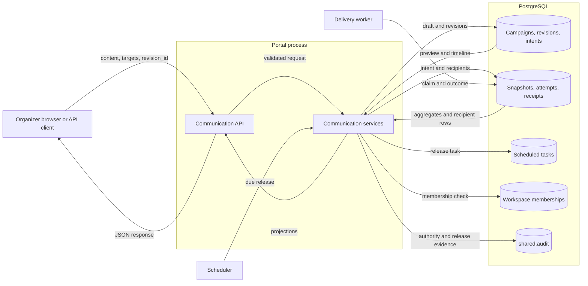

# CTF communications console design (#2052)

Design for the multi-event communications API additions and console. The
preflight notes record the boundaries:
[console boundaries](../design/ctf-communications-console-boundaries-2052.md),
[API integration](ctf-api-integration-preflight-2052.md), and
[scheduling](ctf-multi-event-communications-preflight-2052.md). ADR-051 governs.
Application paths are relative to `shifter/shifter_platform/`.

## Scope

| Item | Decision |
| --- | --- |
| Campaign scope | One campaign has one workspace. A campaign targets one or more events in that workspace. Cross-workspace sends are out of scope. |
| Admission | Create and release are atomic across all targets and channels. One denied target denies the full request. |
| Preview | Preview reads one immutable revision and the campaign policy. Preview writes no row and calls no transport. |
| Delivery state | Reports are aggregates of existing snapshots, delivery attempts, and receipts. |
| Audit trail | The console shows a body-free timeline from ledger rows. Strict `shared.audit` stays the investigator record. |
| Channels | In-app only. Email stays unavailable until #1525. |
| Authorization | Existing legacy event authority. ADR-066 S8 is not activated. |

## Architecture

### Components

| Component | Location | Function |
| --- | --- | --- |
| Communication API | `ctf/api/organizer/communication.py` | Adds the target, preview, delivery, recipient, and activity reads. |
| Projections | `ctf/api/serializers/communication.py` | Closed read-only serializers. Summary adds targets, latest revision, and trigger. |
| Read services | `ctf/services/communication/reporting.py` | Target discovery, preview counts, delivery aggregates, recipient rows, and the timeline. |
| Audience resolver | `ctf/services/communication/audience.py` | Adds `recipient_queryset`. Release and preview use the same predicate. |
| Ledger attribution | `ctf/models/communication.py` | Revision author fields. Campaign cancellation actor and time. |
| Event scheduling | `ctf/services/event/scheduling.py` | Event-time changes cancel only event-derived tasks. |
| Console | `frontend/src/features/ctf/admin/communications/` | Compose, preview, send or schedule, list, report, timeline, and cancel. |
| Client | `frontend/src/api/ctfCommunications.ts` | One parameterized submit operation for the console and the event announcement dialog. |

### API contract

Routes are relative to `/api/v1/ctf/`. All routes keep bearer-first
authentication, session CSRF on unsafe methods, and exact scopes.

| Route | Method | Scope | Effect |
| --- | --- | --- | --- |
| `communications/targets/` | GET | `ctf:communication:read` | Lists workspaces and events where the actor can send. |
| `communications/<id>/preview/?revision_id=` | GET | `ctf:communication:read` | Returns revision content, policy, and current per-event counts. |
| `communications/<id>/delivery/` | GET | `ctf:communication:read` | Returns per-occurrence, per-event, per-channel aggregates. |
| `communications/<id>/recipients/?intent_id=&event_id=` | GET | `ctf:communication:read` | Returns minimal recipient rows for one event. |
| `communications/<id>/activity/` | GET | `ctf:communication:read` | Returns the campaign timeline. |
| Existing create, revise, release, and cancel routes | POST | `ctf:communication:write` | No contract change. The console sends `revision_id` on release. |

Every campaign read authorizes the complete persisted target set through
`admission.reauthorize`. Target discovery uses `authorized_workspace_ids`,
`authorize_bound_workspace`, and `events_with_capability`. The recipient read
also requires the `participants` capability on the selected event.

### Failure behavior

| Condition | Result |
| --- | --- |
| Missing, deleted, cross-workspace, or unauthorized target | Opaque `404` or `403` through `ctf_error_response`. No per-target detail. |
| Revision not in the campaign | Opaque `404`. |
| Release replay with a different revision | `409` `CTF_COMMUNICATION_DECLARATION_CONFLICT`. |
| Requested channel unavailable | `503` dependency error. No queued work. |
| Audience above the cap | Preview shows `exceeds_audience_cap`. Release refuses. |
| Delivery after admission | Each attempt keeps its own status. Partial failure stays visible. |

### Preview

Preview counts use `recipient_queryset` with `values("event_id")` and
`Count`. The query does not load recipients. Counts are estimates at
`observed_at`. Release resolves the final audience. Preview returns the due
instant in UTC and in each event's `event_timezone`. The console enables
release only after a successful preview of the same campaign and revision.

### Delivery report

The service groups `DeliveryAttempt` rows by intent, event, channel, and
status. It counts snapshots and receipts in a separate query. Separate queries
prevent join multiplication. A scheduled intent also shows its release task
status, so a failed task differs from a healthy schedule. The console pages
occurrences and target events. It refreshes the report every 15 seconds while
work is pending. The campaign summary selects the latest revision identity with
a subquery and loads no revision body.

### Activity timeline

| Entry | Source |
| --- | --- |
| Created | `CommunicationCampaign.created_at`, `created_by`, `actor_token_id` |
| Revised | `MessageRevision.created_at`, `actor_user_id`, `actor_token_id`, `revision_number`, `content_digest` |
| Scheduled or released | `CommunicationIntent` actor, origin, `due_at`, `released_at`, `status` |
| Cancelled | `CommunicationCampaign.cancelled_at`, `cancelled_by_user_id`, `cancelled_by_token_id` |

Entries carry no subject, body, or recipient. Actor labels are usernames.

### Time

One campaign has one UTC instant. The console converts a wall time in a
selected IANA zone to UTC with `Intl.DateTimeFormat`. It refuses a wall time
that does not exist or that occurs twice in the zone. The console shows the UTC
instant and each event's local time before send.

### Event-time changes

`_reschedule_event_tasks` cancels only the task types it recreates:
`spin_up_ranges`, `event_start`, `event_end`, `cleanup_ranges`,
`cleanup_warning`, `send_reminder`, and `release_challenge`. A
`release_communication` task stays pending with its authored due time.

### Sequence

## Systems security

| Asset | Threat | Control | Verification |
| --- | --- | --- | --- |
| Participant roster | An organizer enumerates another event's participants | Complete-target `reauthorize` on every read; opaque denial | Cross-event and cross-workspace tests |
| Participant roster | A notifications-only actor reads recipient rows | `participants` capability check on the selected event | Judge and removed-staff tests |
| Delivery coordinate | Email leaks through a report | Projections omit coordinates; no decryption | Serializer field tests |
| Message content | Preview or a timeline leaks content to another tenant | Same authorization as detail; timeline carries no body | Cross-tenant preview test |
| Delivery ledger | Preview creates delivery work | Preview is a GET with no writes | Row-count test before and after preview |
| Reviewed content | Another tab's edit is sent | Console sends the reviewed `revision_id` | Stale revision test |
| Scheduled declaration | An event-time change strands a release | Reschedule cancels only event-derived tasks | Reschedule test |
| Token principal | A read token writes, or a write token reads | Exact scopes with `require_scope` | Scope tests |
| Browser session | Cross-site request writes | Session CSRF on POST; reads are GET without effect | Existing CSRF tests |

Residual risks:

- Preview counts can change before release, because membership can change.
- Usernames of co-staff are visible in the timeline to actors with authority on every target.
- Strict `shared.audit` rows have no organizer read surface.

## Data flow

Trust boundaries are between the actor and the portal, and between the portal
and the database. The worker and the scheduler run as separate processes with
their own fences.

## Policy, architecture as code, and ADRs

- Policy as code: `shared/api_tokens/scopes.py` keeps the exact scopes.
  `ctf/api/operation_policy.py` registers each new operation. Closed serializers
  and `communication_contracts` keep the input and output shapes.
- Architecture as code: `.importlinter` and
  `scripts/check_layer_imports/layer_imports.yaml` need no change. CTF uses only
  the public `workspaces.services` edge.
- ADRs: ADR-051-R12 records the preflight obligations. This document joins the
  ADR-051 evidence list. No new ADR, because the work applies existing decisions.
