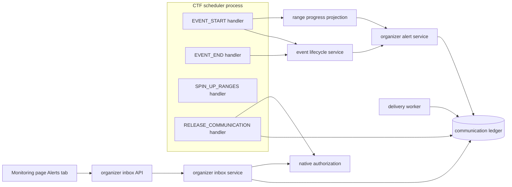
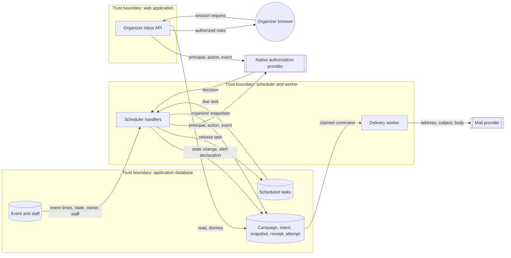
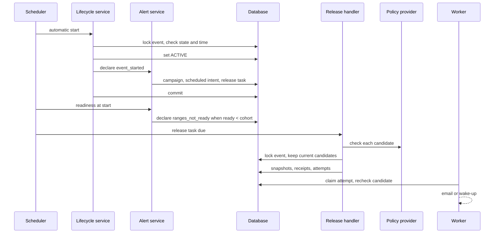
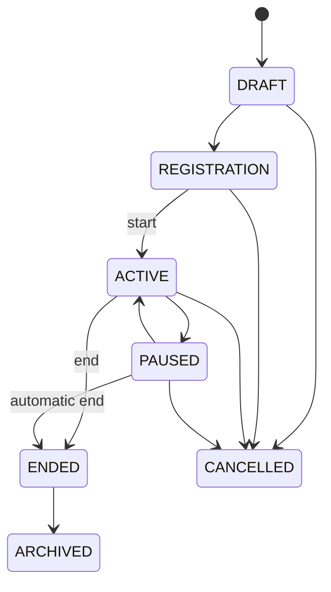

# Organizer alerts design (#528)

Design, 2026-10-30. Scope: CTF-1002 late-range alerts and CTF-1004 automatic
start and end alerts. The [preflight](ctf-organizer-alerts-preflight-528.md)
gives the boundaries. [ADR-065](../adr/065-retire-legacy-ctf-notification-writes.md)
records the decision.

## Maintainer decisions

| Subject | Decision |
| --- | --- |
| Delivery contract | An organizer recipient kind in the existing communication ledger. |
| Recipients | The event owner and live co-organizers. Moderators and judges are not recipients. |
| Channels | The in-app organizer inbox. Email also, when the deployment has email delivery. |
| Refused automatic start | The start task retries in its retry budget. Organizers get one alert. |
| Paused at end time | The automatic end ends a paused event. |

## Architecture

The design extends the participant ledger. It adds no outbox, worker,
notification store or recipient framework.

| Component | Contract |
| --- | --- |
| Organizer alert service | Declares one alert for each event, alert kind and schedule occurrence. It creates a system campaign and a scheduled declaration in the caller's transaction. |
| Audience contract | An internal `event_organizers` selector with one event and one closed policy action. Only the system origin can use it. The public audience vocabulary does not change. |
| Recipient snapshot | A `recipient_kind` of `participant` or `organizer`. An organizer row has a principal UUID and no participant identity. Database constraints enforce the field combination and uniqueness. |
| Recipient receipt | The participant receipt model becomes `RecipientReceipt`. Its table does not change. One receipt row records read and dismiss state for each in-app snapshot. |
| Release | Resolves organizer candidates and checks live policy before it takes locks. Under the event lock, it keeps only candidates that are still current. |
| Delivery worker | Rechecks live native policy for the pinned action outside SQL locks, and the current candidate set under the claim lock, before transport. A denial suppresses the command. An evaluator outage keeps it retriable without I/O. Email uses the frozen, encrypted coordinate. In-app wake-ups carry identifiers only. |
| Organizer inbox | Session-only list, detail, read and dismiss routes for one event. Each request checks the live policy action of each alert. |
| Range progress projection | Counts the eligible participant cohort. A range is ready only with a current assignment and a `ready` status. |
| Scheduler | A spin-up yields when other due work is pending. It resumes after that work, so event start and alert release do not wait for a long spin-up. |

### Alert kinds

| Kind | Trigger | Policy action | Occurrence |
| --- | --- | --- | --- |
| `event_started` | Automatic activation commits | `event.read` | Scheduled start |
| `event_start_refused` | Automatic activation is refused after start time | `event.read` | Scheduled start |
| `ranges_not_ready` | Ready count is less than the cohort at start | `event.manage_ranges` | Scheduled start |
| `event_ended` | Automatic end commits | `event.read` | Scheduled end |

Alert text contains counts and fixed sentences only. It contains no
participant names, addresses, errors or provider data.

### Failure behavior

- A start or end alert commits in the same transaction as its state change.
  A crash after commit cannot lose the alert.
- If the declaration is refused, the claimed scheduler task records the pending
  alert in that same transaction. The task retries it with its existing backoff.
- Alert declaration does not use the shared system authoring rate budget.
  Alerts are server-authored and bounded by the schedule. Release-time
  admission backpressure still applies.
- The release task is durable. A restart releases it again with the same
  identity. A second release returns the first intent.
- A policy outage at release makes the release fail and retry. It never
  becomes an empty or a wider audience.
- If no channel accepts the alert, the intent records a truthful
  disposition. Provisioning and lifecycle work continue.
- A release past the grace window expires. It never delivers late.

## Systems security engineering

| Asset | Protection need |
| --- | --- |
| Range readiness counts | Confidential to people with range authority on the event |
| Organizer email address | Confidential; encrypted at rest; decrypted only by the email adapter |
| Alert content and receipts | Visible only to the recipient organizer |
| Lifecycle integrity | Automatic transitions follow the schedule and the state machine |

| Threat | Control | Verification |
| --- | --- | --- |
| A participant reads organizer alerts | Participant inbox queries select participant rows only. Organizer rows have no participant identity. | Participant inbox test with an organizer row for the same user |
| A moderator or removed co-organizer reads alerts | Candidate check plus live native policy on each inbox request and at release | Inbox tests for revoked staff and denied policy |
| An API client targets organizers | The public serializer and service validation reject the internal selector | Contract test on the public create path |
| A console user reads organizer alerts | The communications console and campaign reads exclude organizer campaigns | Campaign list and read tests |
| A stale delivery reaches a former organizer | Worker pre-flight candidate check; erased coordinate on removal | Worker test after staff revocation |
| Queued range counts reach an organizer whose range authority is denied | Worker rechecks the pinned action before transport | Worker test with a policy denial after release |
| A policy outage widens the audience | Fail closed; release retries | Release test with an unavailable provider |
| Address or content leaks to logs | Reference-only commands, closed reasons and counts only | Log assertions in alert tests |
| A replay sends duplicates | Stable campaign identity and intent idempotency key | Replay tests |

Residual risks: email is at-least-once, so a worker crash after provider
acceptance can send a duplicate. An accepted email cannot be recalled.

## Data flow

## Sequences

## Event lifecycle states

The `PAUSED` to `ENDED` transition is new. `SCHEDULED_END_TRANSITIONS` in
`ctf.enums` holds it next to the ordinary transition table. Only the automatic
end at or after the end time uses it, with the same end effects. A manual end
still needs an active event. CTF-701 records the transition.

The automatic start and end take the event lock. They recheck the state and the
schedule under that lock before they change state. The automatic start never
activates an event after its end time. A refused start keeps the
event in `REGISTRATION`. Its task retries with the existing backoff.
Submissions close at the end time: the access gate rejects `now >= event_end`.

## Policy, architecture-as-code and ADRs

- ADR-065 gets revision R4 for the organizer recipient contract.
- No new import contract is necessary. The change stays in the `ctf` layer and
  uses the existing `management`, `workspaces` and `shared` ports.
- The OpenAPI contract gains the organizer inbox routes. The compatibility
  oracle accepts new independent operations under ADR-040-R3.
- The expired ADR-040-R3 exception for #1924 is removed. ADR-065 already
  retired the `resend-invite` operation, so the exception has no remaining use.
- No configuration, deployment or network change is necessary.
