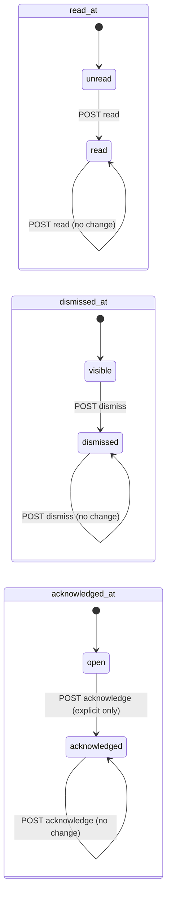
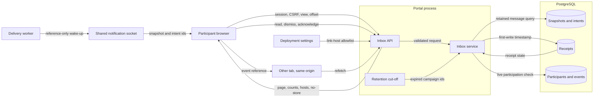

# CTF participant inbox design (#2053)

Design for the participant inbox and safe rich-content presentation. The
[participant inbox boundary note](../design/ctf-participant-inbox-boundaries-2053.md)
records the preflight constraints. ADR-051, ADR-036, ADR-040 and ADR-055 govern.
Application paths are relative to `shifter/shifter_platform/`.

## Scope

| Item | Decision |
| --- | --- |
| Message identity | The recipient snapshot UUID is the message identity. A retry of one occurrence converges on one snapshot. Two occurrences are two messages. |
| Receipt state | Read, dismiss and acknowledgement are three independent first-write timestamps on `ParticipantReceipt`. |
| Obligation | The pinned policy defines the obligation. `read` needs a read. `explicit` needs an acknowledgement. `none` needs nothing. |
| Views | `inbox` hides dismissed messages that have no open obligation. `action_required` lists open obligations. `dismissed` lists dismissed messages. |
| Content | Admission rejects images, raw HTML, unsafe links and oversized rendered output. The browser renders only the closed communication profile. |
| Freshness | The authenticated API is the source of truth. Socket frames, focus, reconnect, a poll interval and a cross-tab signal only start a refetch. |
| Out of scope | Campaign authoring, delivery, email, localization, ADR-066 activation and organizer authority. |

## Architecture

### Components

| Component | Location | Function |
| --- | --- | --- |
| Receipt model | `ctf/models/communication_delivery.py` | Adds nullable `dismissed_at`. |
| Receipt action | `ctf/enums_communication.py` | Closed `ReceiptAction`: `read`, `dismiss`, `acknowledge`. |
| Inbox filter | `ctf/enums_communication.py` | Closed `InboxFilter`: `inbox`, `action_required`, `dismissed`. |
| Inbox service | `ctf/services/communication/inbox.py` | View filters, counts, retention cut-off and one receipt-action function. |
| Retention | `ctf/services/communication/retention.py` | One expired-campaign query for purge and for inbox reads. |
| Content contract | `ctf/communication_contracts.py` | Token-based image, HTML and link checks with `markdown-it-py`. Rendered-byte bound. |
| Link-host setting | `config/_ctf_communication_settings.py` | Rejects `localhost` and IP literals at startup. |
| Inbox API | `ctf/api/communication_inbox.py` | `view` query, counts, link hosts, dismiss route, opaque errors, no-store headers. |
| Preview API | `ctf/api/serializers/communication_console.py` | Adds `allowed_link_hosts` to the organizer preview. |
| Client | `frontend/src/api/ctfInbox.ts` | Principal- and event-qualified queries, receipt mutation and cross-tab signal. |
| Inbox page | `frontend/src/features/ctf/inbox/` | List, message body, actions, views and offline state. |
| Workspace shell | `frontend/src/features/ctf/CtfWorkspaceLayout.tsx` | Current socket protocol and the non-modal action notice. |
| Renderer | `frontend/src/features/ctf/MarkdownContent.tsx` | Neutralized links render as text in the communication profile. |
| E2E seed | `ctf/management/commands/seed_e2e_ctf.py` | Dev/test-only event, participant and messages for the browser lane. |

### API contract

Routes are relative to `/api/v1/ctf/me/events/<event_id>/communications/`.
All routes need a browser session. Unsafe methods need CSRF. Bearer tokens get
`403`.

| Route | Method | Change |
| --- | --- | --- |
| `?view=&limit=&offset=` | GET | Adds `view`, `unread_count`, `action_required_count` and `allowed_link_hosts`. Items add `dismissed_at` and `action_required`. |
| `<message_id>/` | GET | Item adds `dismissed_at` and `action_required`. |
| `<message_id>/read/` | POST | Unchanged. |
| `<message_id>/acknowledge/` | POST | Unchanged. |
| `<message_id>/dismiss/` | POST | New. Sets `dismissed_at` once. |

The changes add fields and one route. They do not remove or rename a field, so
the ADR-040 breaking-change gate passes. Offset pagination stays. The client
refetches all loaded pages from offset zero on each reconciliation. This
prevents stale continuations from skipping or repeating a message.

### Failure behavior

| Condition | Result |
| --- | --- |
| No live participation, wrong event, purged or expired message | Opaque `404` from `CTF_COMMUNICATION_PARTICIPANT_DENIED` or `CTF_COMMUNICATION_NOT_FOUND`. |
| Invalid, unknown or repeated query field | Opaque `400` `invalid`. The response does not repeat the input. |
| Acknowledge on a non-`explicit` message | `409` `CTF_COMMUNICATION_ACK_POLICY`. |
| Concurrent receipt actions | Event, participant and receipt rows lock in order. The first timestamp stays. |
| Socket unavailable | No effect on the inbox. Focus, reconnect and the poll interval refetch. |
| Browser offline | The page shows that data can be old. Mutations fail at once and keep the retry. |
| Unknown content profile | The browser shows a notice, no body, and no read or acknowledge action. |
| Read request fails | The message shows the failure and a retry. The next open also retries the read. |
| An action removes the open message from the view | The message stays open in place. The detail API refreshes and reauthorizes it until it closes. |

### Receipt state



The three regions are independent. No action changes another region. A GET,
a socket frame or a toast changes no region.

### Sequence

```mermaid
sequenceDiagram
  participant W as Delivery worker
  participant S as Shared socket
  participant B as Participant browser
  participant T as Other tab
  participant A as Inbox API
  participant D as PostgreSQL
  W->>S: Reference-only wake-up (snapshot, intent)
  S-->>B: notification frame, kind communication
  B->>A: GET inbox pages from offset 0
  A->>D: Live participation and retained messages
  A-->>B: Page, counts, link hosts (no-store)
  B->>A: POST read when the participant opens a message
  A->>D: Lock event, participant, receipt; set read_at once
  A-->>B: Updated item
  B-)T: BroadcastChannel event reference
  T->>A: GET inbox pages from offset 0
```

## Systems security

| Asset | Threat | Control | Verification |
| --- | --- | --- | --- |
| Another recipient's message | A participant reads another participant's or event's inbox | Event, live participant identity and user match on every list, page, detail and action | Two-event, other-recipient, removal and rejoin tests |
| Message content | Retained content stays visible after the retention window | Inbox reads exclude campaigns past the retention cut-off before purge | Retention cut-off test |
| Message content | A shared or browser cache stores private content | `Cache-Control: no-store, private` on every inbox response, errors included | Header test |
| Participant browser | Stored XSS through an organizer body | Admission rejects HTML, images and unsafe links; renderer has no raw HTML and a closed URL policy; CSP is enforced | Contract tests, renderer fixtures, browser journey with a stored hostile row |
| Participant browser | Reflected XSS through query or path input | Opaque validation errors; React text output; CSP is enforced | API reflection test, browser journey |
| Participant browser | Link to an untrusted host | Same-origin path, fragment or allowlisted HTTPS host only; the server projects the allowlist | Contract and renderer tests |
| Link-host policy | A setting admits `localhost` or an IP host | Startup validation rejects them | Settings test |
| Receipt integrity | A socket write, prefetch or GET marks a message read | Only explicit POST actions change receipts | GET read-only and socket tests |
| Receipt integrity | Cross-site request changes a receipt | Session CSRF on POST; tokens are refused | CSRF and token tests |
| Participant navigation | A required acknowledgement traps the participant | The notice is a non-modal status region; no focus move; all navigation stays available | Layout test, browser journey |
| Socket channel | A frame carries content or grants access | Frames carry references only and only start an authorized refetch | Shell protocol tests |

Residual risks:

- Content already shown in a disconnected browser stays visible until the next refresh.
- The poll interval bounds how long a removed participant sees old content.
- `markdown-it-py` and the browser Markdown parser can differ. The browser renderer stays a second control.

## Data flow



Trust boundaries are between the browser and the portal, between the portal
and the database, and between the socket and the browser. The cross-tab
channel stays inside one origin and carries only an event reference.

## Policy, architecture as code, and ADRs

- Policy as code: `ctf/api/operation_policy.py` registers the dismiss operation
  and the `participant_inbox` page route. Closed serializers, `ClosedJSONParser`
  and `communication_contracts` keep the input and output shapes.
- Architecture as code: `.importlinter` and
  `scripts/check_layer_imports/layer_imports.yaml` need no change. The seed
  command lives in `ctf` and uses only allowed edges.
- ADRs: ADR-051-R11 and ADR-051-R13 record the preflight obligations. This
  document joins the ADR-051 evidence list. No new ADR, because the work
  applies existing decisions.
- OpenAPI: `openapi/v1.json` and `frontend/src/api/schema.d.ts` are regenerated.
