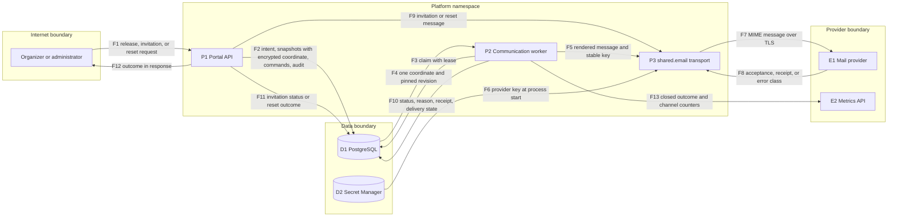
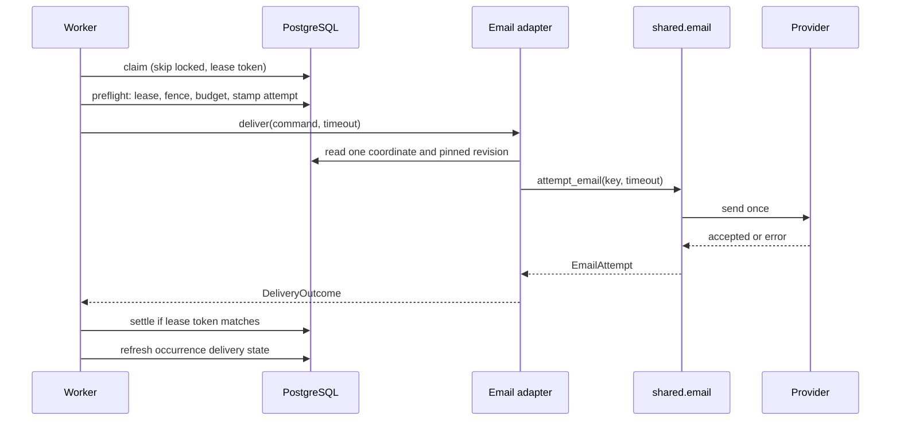
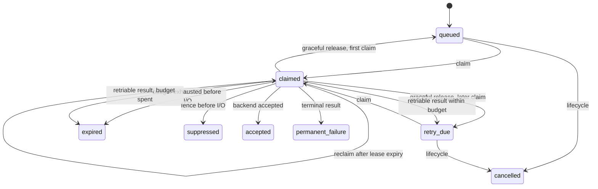
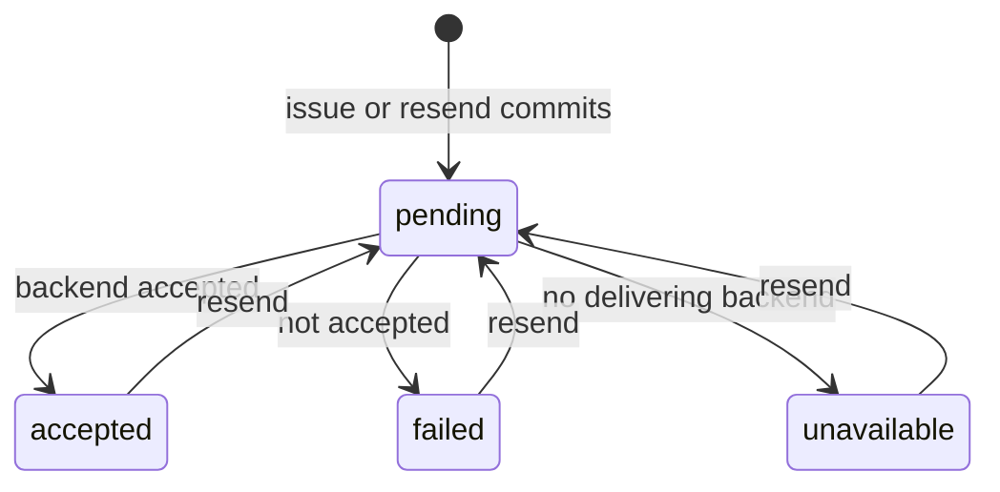

# Email delivery design (#1525, ADR-071)

Status: implementation design. Date: 2026-10-29.

This design records the decisions for issue #1525. Email outcomes are observed
and persisted. No path reports success before a mail backend accepts a message.
[ADR-071](../adr/071-observed-email-delivery-outcomes.md) records the binding
decisions. ADR-051-R14 and the
[email preflight](ctf-email-durable-delivery-preflight-1525.md) constrain the
CTF channel.

## Context

Before this change, three paths sent email:

| Path | Mechanism before this change | Defect |
| --- | --- | --- |
| CTF communications | The ledger had no email adapter. Email work stayed queued and unavailable. | The channel did not exist. |
| Workspace invitations | `send_email_async` put the send in an in-process thread pool after commit. | A restart lost the send. The API could not report the outcome. |
| Administrator password reset | Django `PasswordResetForm` sent after commit and logged a failure. | The administrator saw success for a failed send. |

`shared.email.send_email()` returned one boolean. It ignored the sent count and
logged full tracebacks. A console backend printed message bodies, which include
signed invitation and reset links, to process logs.

## Decision summary

1. CTF email is a `ChannelAdapter` on the existing communication ledger. The
   `DeliveryAttempt` row is the durable outbox command. The existing worker is
   the only retry owner.
2. Invitation and reset messages use one bounded synchronous attempt after
   commit. The outcome is persisted or returned. Resend is the retry. There is
   no second outbox.
3. `shared.email.attempt_email()` is the one transport seam. It returns a closed
   outcome, a closed reason, and an optional provider receipt.
4. A console, file, or dummy backend is unavailable outside development and
   test runtimes. Unavailable email is never sent, printed, or reported as sent.
5. Idempotency is at the ledger level. One command exists for each recipient and
   channel. A stable Message-ID goes with each command. A crash after provider
   acceptance and before settlement can send a duplicate.

## Architecture

### Components

| Component | Responsibility | Interface |
| --- | --- | --- |
| `config/_email.py` | Selects the backend. Derives `EMAIL_DELIVERY_AVAILABLE`. Disables django-ses automatic throttling. | Django settings |
| `shared/email.py` | Builds the MIME message, applies one attempt deadline, sends once, and classifies the result. Holds no CTF or workspace knowledge. | `attempt_email()`, `delivery_available()`, `render_template()` |
| `ctf/services/communication/adapters/email.py` | Reads the one captured coordinate and the pinned revision. Renders the trusted wrapper. Maps the transport result to `DeliveryOutcome`. | `ChannelAdapter.deliver()`, `available()` |
| `ctf/services/communication/delivery.py` | Claims, fences, enforces the retry budget before I/O, settles, and releases unattempted claims on shutdown. | `run_once()` |
| `ctf/services/communication/disposition.py` | Derives and persists the occurrence delivery state. | `refresh_delivery_state()`, `reconcile_delivery_states()` |
| `workspaces/services/_invitations.py` | Sends after commit. Records the outcome for the current generation only. | Invitation projection `delivery_status` |
| `management/password_reset.py` | Sends after commit. Raises `reset_delivery_failed` when the backend does not accept the message. | `request_password_reset()` |

### Transport seam

`attempt_email()` makes exactly one backend call. It returns `EmailAttempt`
with one of four outcomes:

| Outcome | Meaning |
| --- | --- |
| `accepted` | The backend returned a sent count of one. This is not mailbox delivery or a read. |
| `retriable` | A transient or deployment fault. Examples: deadline reached, 5xx, 429, a 4xx recipient deferral, rejected credentials, missing key. |
| `terminal` | The provider rejected this recipient or message. Examples: 5xx recipient refusal, invalid address, 4xx HTTP content rejection. |
| `unavailable` | `EMAIL_DELIVERY_AVAILABLE` is false. The function makes no backend call. |

Reasons are a closed set. A log line carries the outcome, the reason, and the
exception class name only. It never carries the recipient, the body, provider
text, or a traceback.

The timeout is one wall-clock deadline for the whole attempt. A per-operation
socket timeout restarts on every read, so it cannot bound a slow peer. A socket
proxy re-arms the real socket with the time left before each read or write. When
no time is left, the attempt stops with `retriable` and `transport_timeout`.

| Backend | Deadline hook |
| --- | --- |
| Django SMTP | The connection class wraps its socket, and wraps it again after STARTTLS. |
| django-anymail (SendGrid, Mailgun) | The requests session gets an adapter whose urllib3 connections are wrapped after setup. |
| django-ses | A botocore `before-send` handler sends the signed request through the same adapter. botocore keeps signing and parsing. |

Connection setup uses the remaining time as the limit for each step: TCP
connect and each TLS handshake read. DNS lookup uses the system resolver
timeout. SDK retries are off (`total_max_attempts: 1`, adapter `max_retries=0`).
Local development and test backends do no network I/O.

The message carries `Message-ID: <sha256(key)@sender-domain>` when the caller
supplies a stable key. A provider can replace that header. The receipt is the
provider message ID when the backend exposes one. The seam accepts a receipt
only when it is 1 to 255 printable ASCII characters.

### CTF channel

The adapter receives a reference-only `DeliveryCommand`. The command now
carries the existing row `idempotency_key`. The adapter reads only the
snapshot coordinate for that command. Other code paths defer the encrypted
column, so they never decrypt it.

| Condition | Outcome and reason |
| --- | --- |
| Snapshot missing | `terminal`, `snapshot_unavailable` |
| Coordinate empty or erased | `terminal`, `coordinate_unavailable` |
| Decryption key missing or token unreadable | `retriable`, `coordinate_unreadable` |
| Transport result | Mapped from `EmailAttempt` |

The body is the pinned Markdown source. The trusted template
`ctf/email/communication` escapes it and converts line breaks. It does not
render Markdown to HTML. The subject comes from the pinned revision with line
breaks removed. The HTML `lang` attribute is the pinned revision locale.

`registered_channels()` returns only channels whose adapter reports
`available()`. Release, preview, cutover, and system notices therefore see
email only when the backend can send it. Web and worker processes read the same
settings, so they agree.

### Worker

The worker keeps its claim, lease, fence, and backoff design. This change adds
four behaviors:

1. Before I/O, a claim whose attempt number exceeds the attempt ceiling, or
   whose elapsed time reaches the elapsed ceiling, becomes `expired` with reason
   `budget_exhausted`.
2. On SIGTERM, the worker finishes only the attempt in flight. It releases each
   other claimed command that has no attempt boundary. The release restores the
   attempt number and the claimable status.
3. After a transport settlement, the worker refreshes the occurrence delivery
   state in a separate transaction when no transport command of that occurrence
   is outstanding. An indexed existence check skips the full count until then.
   In-app wake-ups never change the state. Each cycle also reconciles pending
   occurrences that have no outstanding commands. This recovers a crash between
   the settlement and the refresh.
4. Run counters carry a channel. The `WorkerOutcome` metric has `Outcome` and
   `Channel` dimensions. `BacklogDepth` reports zero for an empty channel.
   `reclaimed` counts expired leases that a claim recovers.

The in-flight attempt stops at the transport deadline, 10 seconds by default.
Settings validation keeps that deadline below the lease. The Kubernetes default
grace period is 30 seconds. A forced kill leaves the claim to lease recovery.

### Occurrence delivery state

`CommunicationIntent.delivery_state` is separate from `status`. The worker,
release, and lifecycle code write it only through `refresh_delivery_state()`.
That function locks the intent row and derives the state from committed rows.

| State | Rule |
| --- | --- |
| `not_released` | The intent has no release time. |
| `empty` | The release produced no recipients. |
| `pending` | At least one transport command is queued, claimed, or due for retry. |
| `accepted` | Every recipient and channel is accepted. |
| `partial` | Some recipient channels are accepted and some are not. |
| `failed` | None is accepted, and at least one failed or expired. |
| `withdrawn` | None is accepted, and all were cancelled or suppressed. |

In-app success is the committed inbox receipt, not the wake-up command. A
transport channel uses its `DeliveryAttempt` status. `delivery_state_changed_at`
records the last transition. The delivery report returns `delivery_state`.

### Interactive messages

Invitation issue and resend commit the invitation and audit first. An
`on_commit` callback then rereads the invitation. It sends only when the
generation is unchanged and the invitation is current. It records
`delivery_status` with a compare on the generation. A later resend or revoke
fences an earlier send.

| `delivery_status` | Meaning |
| --- | --- |
| `pending` | Committed. The send has not reported. |
| `accepted` | The backend accepted the message. |
| `failed` | The backend did not accept it. `delivery_reason` holds the closed reason. |
| `unavailable` | No delivering backend is configured. Nothing was sent. |
| `unknown` | The invitation predates this change. |

Password reset checks availability before it writes audit. After commit, the
form sends through `attempt_email()`. A non-accepted outcome raises
`reset_delivery_failed`, which the API returns as 503. The reset request and
its audit stay committed. Django reset tokens are stateless, so a failed send
leaves no live credential record.

## Systems security engineering

| Asset | Threat | Control | Verification |
| --- | --- | --- | --- |
| Recipient coordinate | Disclosure through logs, metrics, reports, or a bulk load | Decrypt only in the email adapter; defer the column elsewhere; closed metric labels; no recipient in logs | Tests inspect logs and metric labels; report and preflight queries defer the column |
| Signed invitation and reset links | Disclosure through a console backend in production | `EMAIL_DELIVERY_AVAILABLE` is false for console, file, and dummy backends outside development and test | Tests prove no send and an `unavailable` outcome |
| Message headers | Header injection through a subject | Line breaks removed from subjects; Django header validation; invalid message is `terminal` | Tests send a subject with line breaks |
| Mail provider | Retry storm, duplicated retry layers, or a slow peer that holds a worker past its lease | One retry owner; SDK retries off; throttling sleep off; one attempt deadline on every socket operation; bounded backoff and ceilings before I/O | Tests check pre-I/O expiry, and local SMTP and HTTP peers that answer slowly stop at the deadline |
| Delivery truth | A stale worker or crash overwrites a newer state | Lease token fence; generation compare for invitations; locked derivation for the occurrence state | Postgres tests cover stale settlement, crash, and restart |
| Provider credential | Key leakage | Existing entrypoint hydration; the key stays in the process environment | No change; worker identity already reads the email secret |
| Recipients | Duplicate mail after an uncertain send | Stable Message-ID; no resend after recorded acceptance | Residual risk, documented |
| Batch | One poison coordinate blocks other work | Per-command classification; adapter exceptions become `retriable` | Tests with an unreadable coordinate |

Trust boundaries:

1. The browser and API clients reach the portal over HTTPS.
2. Portal and worker pods reach PostgreSQL through the database proxy.
3. Portal and worker pods reach the mail provider over TLS on port 443.
4. The worker publishes metrics to the cloud metrics API.

Residual risks:

- A crash after provider acceptance and before settlement can send a duplicate.
- A provider can replace the Message-ID header.
- AWS EKS renders the console backend, so email is unavailable there until SES
  is provisioned.
- Provider acceptance does not prove mailbox delivery.
- A deadline reached after the provider received the message is indeterminate.
  A retry can then send a duplicate.
- DNS lookup is outside the attempt deadline.

## Data flow

## Diagrams

### CTF attempt sequence

### Delivery command states

### Invitation delivery states

## Policy as code

No new adr_guard check is needed. Existing gates apply:

- import-linter keeps `shared` free of domain imports, and keeps `config` out of
  domain models.
- The API contract drift and compatibility gates check the additive response
  fields.
- The SPA type gate checks the regenerated `schema.d.ts`.
- Tests prove the closed reason set, the backend options, and the absence of
  recipient data in logs.

## Architecture as code

| Artifact | Change |
| --- | --- |
| `ctf/migrations` | `delivery_state` and `delivery_state_changed_at` on the intent, with a backfill |
| `workspaces/migrations` | `delivery_status`, `delivery_reason`, and `delivery_observed_at` on the invitation |
| `openapi/v1.json`, `openapi/account-admin-prepared.json` | Additive response fields |
| `platform/charts/shifter` | No change. The worker already uses the shared entrypoint, the email secret, and port 443 egress. |
| Terraform | No change. The `workers` identity already reads the runtime email secret. |

## ADR changes

| ADR | Change |
| --- | --- |
| ADR-071 (new) | Observed email delivery outcomes for CTF, invitation, and reset messages |
| ADR-051-R14 | Points at this design and the delivery state values |
| PLAT-103 | Statement amended for durable CTF delivery and bounded interactive delivery |

## Document review

The review checked STE sentence length, one word for one meaning, and that each
statement matches the code. Architecture text describes the system. ADR-071
holds the decisions. The issue plan holds the tasks.
