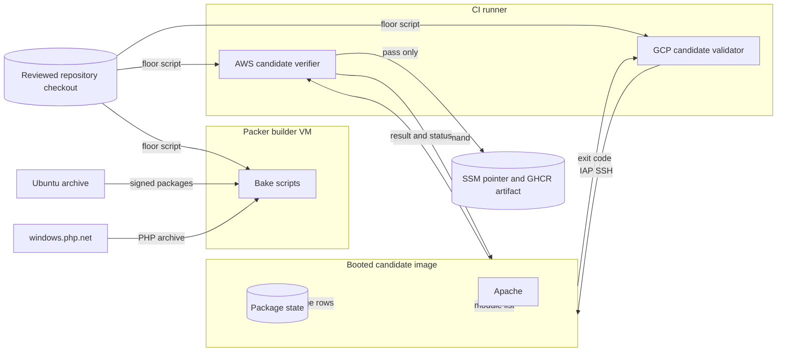

# PHP security floor for victim images (#2556)

Design for the image-build and candidate-validation checks that keep a
php2shell-vulnerable PHP out of published victim images. The
[preflight note](ubuntu-php-security-refresh-preflight-2556.md) records the
boundaries. This document records the design.

## Scope

| Image | PHP source | Floor | Fix reference |
| --- | --- | --- | --- |
| Ubuntu 22.04 victim (AWS and GCE) | Ubuntu `php8.1` source package | `8.1.2-1ubuntu2.28` | Ubuntu tracker for CVE-2026-109618 (USN-8948-1) |
| Windows victim (AWS and GCE) | Official PHP Windows build in XAMPP | `8.2.35` | PHP 8.2.35 release |

Live hosts are out of scope. The maintainer patches running hosts.

## Architecture

| Component | Location | Function |
| --- | --- | --- |
| Ubuntu floor check | `shifter/packer/scripts/ubuntu/php-security-floor.sh` | Reads the installed package state and fails below the floor. |
| Ubuntu bake | `shifter/packer/ubuntu.pkr.hcl`, `shifter/packer/gcp/ubuntu.pkr.hcl` | Runs the floor check after `services.sh`. |
| Windows replacement | `shifter/packer/scripts/windows/services.ps1` | Replaces the XAMPP PHP directory with the verified official build. |
| AWS candidate verifier | `shifter/packer/scripts/bake/base-image-verify.sh` | Runs the floor check on the booted candidate before the SSM pointer changes. |
| GCP candidate validator | `shifter/packer/gcp/scripts/validate/gather-evidence.sh` | Runs the floor check on the booted Ubuntu candidate in the qualification workflow, before promotion. The build workflow publishes the family image and GHCR artifact before that qualification. |

The Ubuntu check is one script. The bake and both validators run the same
reviewed file. The policy data is three values: release, source package, and
floor. A new advisory changes these values only.

The check fails closed. These conditions stop the build or the validation:

- The OS release is not `jammy`.
- `libapache2-mod-php8.1` is not installed and configured.
- A present package comes from a PHP source other than `php8.1`.
- A present `php8.1` package is held, selected for removal, not configured, or below the floor.
- The package query fails.
- Apache does not load `php_module`.

The check reads the current-state character of `${db:Status-Abbrev}`. Held and
removal-selected packages count as present. It compares versions with
`dpkg --compare-versions`.

The Windows replacement downloads the Thread Safe x64 build, because the Apache
module requires a Thread Safe build. The SHA-256 of the archive is pinned. The
build keeps XAMPP's `php.ini`, moves the bundled tree aside, and installs the
clean tree. It removes the bundled tree only after the PHP and Apache checks
pass. The native checks use `Start-Process` with file redirection, because
Packer runs the script over WinRM.

## Systems security

| Asset | Threat | Control | Verification |
| --- | --- | --- | --- |
| Published victim image | A vulnerable PHP ships (stale mirror or skipped upgrade) | Floor check in the bake | Behavior tests with a fake `dpkg-query`; real `jammy` container run |
| Published victim image | The builder passes, but the captured image differs | Floor check on the booted candidate (AWS and GCP) | Fake AWS CLI tests; fake SSH tests |
| Ubuntu package state | A held or partly configured package hides a stale binary | Current-state classification, exact `ii ` state | Held, removal, and unconfigured tests; real held-package run |
| Floor check result | A failed query or a caller override changes the result | Synchronous query capture; fixed `/etc/os-release` | Failed-query test; test that the script has no override |
| Windows PHP archive | A changed or replaced download | Pinned SHA-256 from the release checksum file | Archive hash and content check |

Residual risks:

- The GCE Windows image has no candidate validator. The bake checks remain.
- The guest reports the AWS result through the SSM agent, as the existing DNS check does.

## Data flow

Trust boundaries are between the runner and the candidate, between the builder
and the package and PHP sources, and around the publication pointer.

## Policy, architecture as code, and ADRs

- Policy as code: the floor script and the Windows floor value are the policy.
  The AWS verifier keeps the Windows floor equal to the bake value, and a test
  checks that they match.
- Architecture as code: the two Ubuntu Packer templates run the check.
- ADRs: no change. The work applies ADR-037 (pinned downloads) and the existing
  image validation and publication gates.
