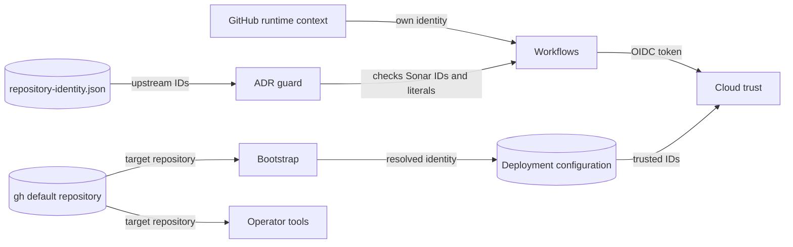

# Repository identity design (#1698, ADR-069)

This design applies [ADR-069](../adr/069-repository-identity.md) to every place
that uses the repository identity.

## Identity sources

| Source | Holds | Used by |
| --- | --- | --- |
| GitHub Actions runtime context | `github.repository`, `github.repository_owner`, `github.repository_id`, `github.repository_owner_id`, `github.server_url` | Workflows that refer to their own repository (ADR-069 rule 1) |
| `docs/adr/repository-identity.json` | The upstream name, owner, immutable IDs, and former names | Upstream-only job guards and the ADR guard (rules 2 and 6) |
| `.ground-control.yaml` `github_repo` | The upstream name for agent tooling | Ground Control tools. The ADR guard checks that it equals the declaration. |
| Deployment configuration | Terraform variables, bootstrap-resolved values, deployment environment values | Cloud trust and deployed validators (rule 3) |
| `gh` default repository | Per-clone target, stored in git config as `remote.<name>.gh-resolved` | Operator scripts, bootstrap, and the ops MCP server (rule 4) |

## Architecture

### Workflows

| Place | Change |
| --- | --- |
| `gh attestation verify` in `_gcp-dev.yml`, `_shifter-engine.yml`, `_shifter-platform.yml` | `--repo "${GITHUB_REPOSITORY}" --signer-repo "${GITHUB_REPOSITORY}"`. The images come from the same repository run, and a reusable workflow signs them. |
| Sonar gate in `_quality.yml` | Compare `github.repository_id` and `github.repository_owner_id` only. The guard checks that both values equal the declaration. |
| Image source labels in the Dockerfiles | A build argument carries `${github.server_url}/${github.repository}`. Local builds leave the label empty. No workflow builds the preparation image; images derived from it pass the argument. |
| GHCR namespace in `packer-gcp.yml` | No change. It already uses `${GITHUB_REPOSITORY_OWNER,,}`. |

### ADR guard

- The workflow expression model reads the canonical name and IDs from the
  declaration. The `_DW_CANONICAL_REPOSITORY` literal is removed.
- The new `repository-identity-literals` check reads the declaration. It
  searches tracked executable and configuration files for the current and
  former `owner/repo` names, the two IDs, and the lowercase GHCR owner
  namespace, without regard to case.
- These are allowed: the declaration; the Sonar gate IDs when they equal the
  declaration; Markdown; `mkdocs.yml`; `CITATION`-style metadata; package
  metadata; historical issue and pull request links; and provenance records in
  the pack manifests. Each allowed path has a reason in the check.
- The check also fails when `.ground-control.yaml` `github_repo` differs from
  the declaration.

### Terraform

| Root or module | Change |
| --- | --- |
| `global/iam` | Remove the `github_org`, `github_repo`, `github_repository_id`, and `github_owner_id` defaults. The root requires them from its tfvars or from bootstrap. |
| `gcp/global/cicd-oidc`, `gcp/modules/cicd-oidc-identity` | Remove the `github_repository_id` and `github_owner_id` defaults (the binding anchor). Keep the `github_org`/`github_repo` default, because the mandatory CKV_GCP_125 static trust-grammar check must resolve the name and checkov scans without deployment variables. Real deployments set the name through per-environment tfvars. |
| `global/github-runner` | Remove `github_org` and `github_repo`. The root did not use them. |
| `global/iam/dev.tfvars`, `global/iam/prod.tfvars` | Add `github_repository_id` and `github_owner_id`. The values do not change, so the plans show no change to live trust. |

### Bootstrap

- `BootstrapConfig` has no default identity. Bootstrap reads the target with
  `gh repo set-default --view`. It reads the IDs with `gh api repos/<owner>/<repo>`.
  It prints the resolved identity before any write, and commands that have a
  confirmation prompt show it there. Without a `gh` default, it stops with a
  clear message.
- The AWS teardown reads the identity from the committed `global/iam` tfvars,
  because a CI checkout has no `gh` default.
- The current `gh repo view` call is replaced. Without a default, `gh repo view`
  selects the upstream remote in a clone that has one.
- `gcp_base_images` derives the GHCR owner from the resolved owner in
  lowercase. The `GHCR_OWNER` literal is removed.
- `gcp-foundation.example.tfvars.json` uses a synthetic `example-org/example-repo`.

### Provisioner

`config/_gdc.py` keeps the shape, role, and digest checks for the GDC VM disk
reference. It drops the literal owner. Bootstrap writes the reference from
deployment configuration, and that reference is the trust anchor.

### Operator tooling

| Place | Change |
| --- | --- |
| `Makefile` `devmain` | Read `gh repo set-default --view`, stop when it is empty, and pass the value to `gh pr create --repo`. |
| `scripts/ami.sh` | Read `GH_REPO`, else the `gh` default, and stop without one. |
| `scripts/sync-deploy-secrets.sh` | Read `--repo`, else the `gh` default, and stop without one. It no longer uses `gh repo view`, which could select the upstream remote. |
| `mcp/ops` | `DEFAULT_GITHUB_REPO` is removed. The server reads `GH_REPO` or the `gh` default on each image-tool call and stops without one. |
| `.cursor/mcp.json` | `GH_REPO` is removed. Ground Control takes the repository from the checkout. |
| Runbooks and READMEs | Commands read `REPO="$(gh repo set-default --view)"` and use `$REPO`. |

### Agent configuration

`.gc/plan-rules.md` and `AGENTS.md` refer to `.ground-control.yaml` and
ADR-069 instead of repeating the name. The Sonar rule in the plan rules uses the
immutable IDs.

### Tests

Tests use the synthetic identity `example-org/example-repo` with synthetic IDs,
or they read the declaration when they test the guard itself.

## Systems security

| Asset | Threat | Control | Verification |
| --- | --- | --- | --- |
| Deploy image trust | An image from another repository passes verification | `--signer-repo` and `--repo` equal the running repository, and the cloud trust admits only that repository | Workflow model tests; deploy run |
| Cloud trust | A rename or a fork changes which repository can assume a role | Trust binds the immutable IDs from deployment configuration; no module default | Terraform tests; plan with no live change |
| Upstream secrets (Sonar) | A fork run receives or needs upstream secrets | The ID-only guard skips the job in forks | Workflow model test with fork and rename scenarios |
| Operator actions | A script acts on the upstream remote instead of the deployment repository | `gh` default resolution that stops when unset | Tool tests with an unset default |
| Identity policy | A new literal enters executable code | The `repository-identity-literals` check | Guard tests with positive and negative fixtures |

Residual risks:

- The Sonar job result is reported by the job itself. The ID guard decides only
  whether it runs.
- An operator can set a wrong `gh` default. Bootstrap shows the resolved identity
  before it writes.

## Data flow

Trust boundaries are between GitHub and the cloud trust, between the operator
clone and GitHub, and between the deployment configuration and the deployed
services.

## Policy and architecture as code

- Policy as code: ADR-069 rule 6 and the `repository-identity-literals` check.
- Architecture as code: the Terraform variable contracts with no identity default, except the GCP WIF trust module keeps a repository-name default for the mandatory CKV_GCP_125 static check (ADR-069).
- ADRs: ADR-069 is new. The ADR-037 attestation rule text and the Sonar plan rule
  change to match it.
