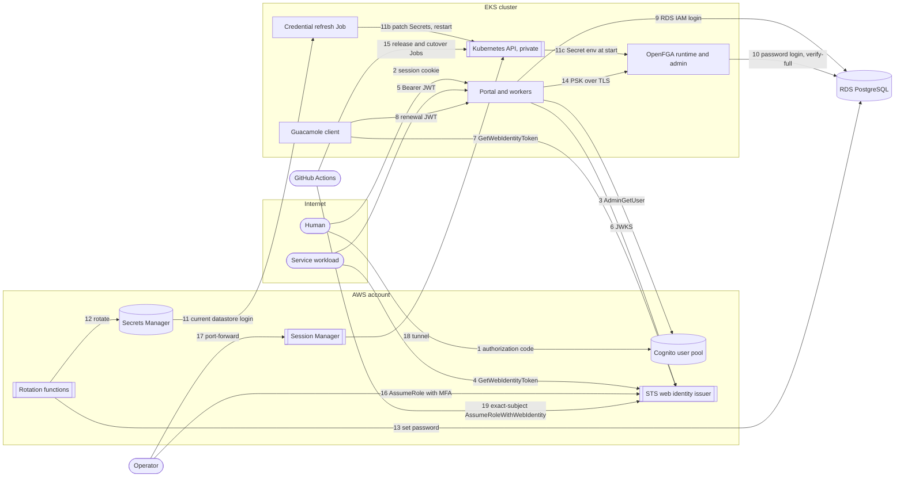
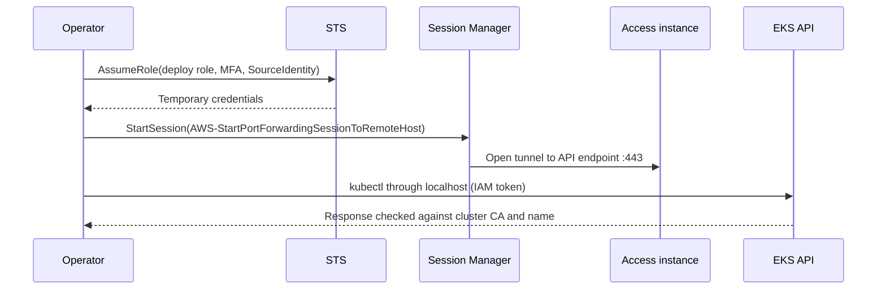
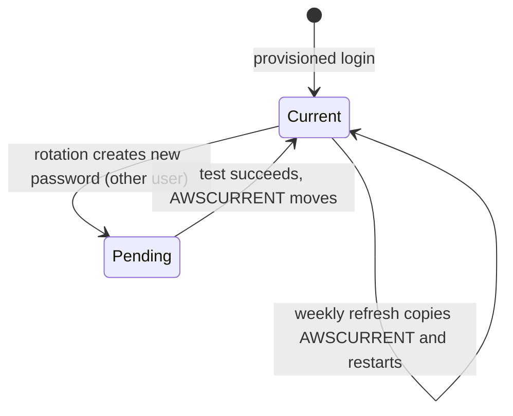

# AWS native identity integration (#2313)

Status: approved design for source implementation. Live AWS qualification is
not part of this source delivery. The
[AWS conformance preflight](../architecture/aws-identity-conformance-preflight-2313.md)
records the assessed gaps. [ADR-066](../adr/066-account-principal-resource-scope.md)
is the binding model.

## Scope

AWS keeps the #2308 Account/Principal model, the OpenFGA action catalog and
the shared credential contract. This design changes only provider bindings,
deployment wiring and AWS operator access. It adds no second identity model,
policy engine or token format.

Owner decisions on 2026-10-29:

| Decision | Choice |
| --- | --- |
| Service principal proof | AWS STS `GetWebIdentityToken` JWT. |
| Cognito revocation | Idle and absolute session limits, plus an `AdminGetUser` recheck at the existing interval. |
| OpenFGA datastore authentication | Password logins in Secrets Manager, rotated by an in-repo function that follows the documented Secrets Manager rotation steps. |
| OpenFGA restart after rotation | A weekly Job copies the current credentials into named Secrets and restarts only the two OpenFGA Deployments. |
| Operator access | Named principals assume the deploy role. Access goes through a Session Manager tunnel to the private EKS API. |
| CI deploy trust | Exact deploy Environments and protected refs. The `aws-dev` Environment allows only the `aws-dev` branch. |
| Legacy admin users | Remove `platform/terraform/global/se-admins`. Each account that applied it destroys its users and confirms their absence with the ops guide procedure. |

The AWS-provided rotation templates create a Lambda role without the CI
permissions boundary that this repository requires. The owner approved the
in-repo function instead of weakening that boundary.

## Architecture

### Components

| Component | AWS binding | Incumbent it extends |
| --- | --- | --- |
| Human sign-in | Cognito authorization-code flow and `ShifterOIDCBackend`. | `config.oidc`, `VerifiedIdentity`, `ProviderBinding`. |
| Human session assurance | Cognito issuer pin, idle and absolute limits, `AdminGetUser` recheck. | `config.session_credentials`. |
| Service principal proof | STS web identity JWT, verified with the account issuer's JWKS. | `shared.credentials` verifier port, `ServiceCredentialAdmission`. |
| Service proof profile | The issuer, audience and subject rule bound at composition. | `config.apps` composition root. |
| Service client | `ServiceClient.from_aws` with botocore credential renewal. | `shifter_client.ServiceClient`. |
| Gateway renewal | Guacamole requests an STS web identity JWT through its IRSA role. | Guacamole authority extension, `guacamole_control`. |
| Application SQL | RDS IAM login for each workload. Each login is a member of the `portal_runtime` duty role. | `config.db_backends.rds_iam`, migration-owned duty roles. |
| Policy datastore | Separate `openfga` database with migration, runtime and admin password logins. | Chart OpenFGA templates, `openfga-duties.sql`. |
| Policy credentials | Deployment publishes the PSK, TLS and datastore Secrets. A weekly Job refreshes the datastore Secrets. | Chart, `installation.openfga_bundles`. |
| Identity activation | The chart-derived cutover Job runs in the AWS deploy flow. | `installation.gcp_identity_cutover`, `identity_cutover` commands. |
| Operator access | Exact named principals assume the deploy role. An EKS access entry and a Session Manager tunnel complete the path. | `global/iam`, `modules/portal/eks`. |

### Service principal proof

The account enables IAM outbound web identity federation once, through
`aws_iam_outbound_web_identity_federation`. Its `issuer_identifier` is the only
trusted issuer. Deployment configuration supplies it; a caller never does.

The verifier requires all of these:

- an RS256 or ES384 signature from the issuer's `/.well-known/jwks.json` key set;
- `iss` equal to the configured issuer;
- `aud` equal to the configured installation audience;
- `sub` that is an IAM role ARN in the configured account;
- the namespaced `aws_account` claim equal to the configured account;
- `exp`, `iat` and `jti`, with a lifetime of 3600 seconds or less.

The binding is `(issuer, role ARN)`. `ServiceCredentialAdmission` and the
credential ceiling apply unchanged. IAM user ARNs are refused, because IAM
users have long-term credentials. A role ARN with a long path can exceed 255
characters, so `ProviderBinding.subject` holds up to 2048 characters, the IAM
ARN maximum.

Deviation: the role ARN is not immutable. A role that is deleted and created
again with the same name keeps the same ARN. Only a principal with
`iam:CreateRole` in the installation account can do this. That principal
already controls the account. The owner accepted this deviation.

The confused-deputy exposure is equal to GCP. The audience binds the token to
one installation. The account-specific issuer binds it to one account. STS
sets `sub` to the caller's own role. Each role that may mint a token gets
`sts:GetWebIdentityToken` with `sts:IdentityTokenAudience` set to the installation
audience.

### Human session assurance

Cognito login stores issuer, subject and `auth_time` in the session. It never
stores the token. Each request checks the binding and the idle and absolute
limits. At `IDENTITY_SESSION_RECHECK_SECONDS`, the portal calls `AdminGetUser`.
Workers, the CTF scheduler and the provisioner launcher do the same check
before delayed work uses a stored session credential.
A disabled, deleted or unconfirmed user ends the session. A Shifter revocation
is local and immediate.

Disclosed gap: Cognito has no revocation timestamp. A global sign-out made
only in Cognito takes effect at the absolute session limit. The owner accepted
this gap. AWS documents that offline token verification does not detect
[revocation](https://docs.aws.amazon.com/cognito/latest/developerguide/token-revocation.html).

### Datastores

Runtime pods use RDS IAM authentication from container start. They get no
master credential. Each long-running workload has its own login:
`portal_web`, `portal_workers`, `ctf_scheduler` and `provisioner_launcher`.
Each login has `rds_iam` and membership in the `portal_runtime` duty role.
The migrator keeps the master credential. It runs migrations and reconciles
the logins. The provisioner keeps `provisioner_lambda`. Guacamole keeps its
password duty.

OpenFGA cannot create RDS IAM tokens. This is an unavoidable deviation from the
GCP native login. Each OpenFGA duty has a password login:

| Login | Duty | Rotation |
| --- | --- | --- |
| `openfga_migrator` | Owns the `openfga` database schema. | Single-user rotation. Only deploy Jobs use it. |
| `openfga_runtime` | Member of `shifter_openfga_runtime`. | Alternating-users rotation. |
| `openfga_admin` | Member of `shifter_openfga_admin`. | Alternating-users rotation. |

The alternating-users strategy creates `<login>_clone` as a member of the
original login. The previous credential stays valid until the next rotation.
The rotation interval is 30 days. A weekly Job reads the three current
credentials through its own IRSA role. It patches the named
`openfga-<duty>-datastore` Secrets and restarts the runtime and admin
Deployments. Its Role permits only `patch` on those three Secrets and two
Deployments. A fail-closed admission policy lets its Deployment patches set
only the restart annotation. The OpenFGA servers get no cloud identity.

All datastore connections use `sslmode=verify-full` with the region's RDS CA
bundle. Deployment downloads the bundle from the AWS trust store. The portal
RDS logs every statement, so passwords reach the server only as SCRAM-SHA-256
verifiers.

The status probe connects as the portal login before migrations run. The
pre-chart provisioning Job therefore creates the runtime IAM logins, the
OpenFGA database and its base logins. The migration Job then reconciles all
duties. Catalog content follows identity activation, as on GCP.

### Operator access

The deploy role trusts exact operator principal ARNs, in addition to exact
GitHub subjects:

- an IAM user requires `aws:MultiFactorAuthPresent` and `sts:SourceIdentity`
  equal to `${aws:username}`;
- an IAM role, for example a federated workforce role, needs only its exact
  ARN. Its identity provider enforces MFA.

The existing EKS access entry gives the deploy role cluster administration.
A small private instance in the EKS VPC runs only the Session Manager agent.
It has no public address and no inbound rule. The deploy role may start
`AWS-StartPortForwardingSessionToRemoteHost` only on that instance. Operator
credentials stay on the operator's machine. `kubectl` connects through the
local port and checks the server name against the cluster certificate.

The CI trust changes from `repo:<id>:*` to an exact list: the deploy
Environments and the protected `dev` and `main` refs. Plan jobs bind the deploy
Environment.

## Systems security engineering

### Assets and protection needs

| Asset | Need |
| --- | --- |
| Application authority (OpenFGA tuples, credential ceilings) | Integrity, availability. |
| Service and human credentials | Confidentiality, short lifetime, revocability. |
| Master and OpenFGA database credentials | Confidentiality, exact readers, rotation. |
| Cloud administration (deploy role) | Exact principals, MFA, audit. |
| Kubernetes API | Private network path, IAM authentication. |

### Trust boundaries

1. Internet to ALB/WAF to portal.
2. Portal to Cognito, STS key set and AWS APIs.
3. Pod to RDS, OpenFGA and Secrets Manager.
4. Operator workstation to STS, Session Manager and the EKS private endpoint.
5. GitHub Actions to STS.

### Threats and controls

| Threat | Control | Verification |
| --- | --- | --- |
| Token replay to another installation | Exact `aud` and account issuer. | Verifier unit tests for wrong audience, issuer and account. |
| A role mints tokens for Shifter without intent | Audience-conditioned `sts:GetWebIdentityToken`. Admission is still required. | Terraform tests. Admission tests. |
| A forged or downgraded token | JWKS signature, closed algorithms, required claims, lifetime limit. | Verifier tests with a synthetic key set. |
| An IAM user ARN as service identity | The subject must be a role ARN. | Admission and verifier tests. |
| A disabled Cognito user keeps a session | `AdminGetUser` recheck, idle and absolute limits. | Session tests. |
| A provider outage extends a session | Recheck failure denies the session. | Session tests. |
| A runtime pod reads the master DB password | Remove `database` from runtime readers. Use IAM-only startup. | Terraform tests. Entrypoint tests. |
| One workload uses another workload's SQL login | One `rds-db:connect` user per role. | Terraform tests. |
| OpenFGA admin powers in the runtime | Separate logins, listeners, keys and duty roles. | Released-server tests (existing). |
| Policy secrets leak to unrelated pods | Only the refresh and provisioning roles read datastore secrets. Named Kubernetes Secrets. | Terraform tests. Chart tests. |
| A modified rotation package is deployed | AWS Signer signs each package; the code signing configuration refuses unsigned code. | Terraform tests. |
| A secret writer redirects master-backed rotation to another login | Function configuration binds each secret ARN to its base login and names the master secret. | Rotation function tests. Terraform test. |
| Refresh Job gains broad access | Role limited to `patch` on three named Secrets and two Deployments. Admission allows only the restart annotation on those Deployments. | Chart render. Refresh admission tests. |
| Statement logs capture passwords | SCRAM-SHA-256 verifiers only. | Provisioning and rotation tests. |
| Any branch assumes the deploy role | Exact GitHub subject list. | Terraform tests. |
| A stolen operator password gives admin | MFA and source identity for IAM users. | Terraform tests. |
| The Kubernetes API is exposed | Private endpoint. Tunnel by IAM only. No inbound rule. | Terraform tests. |
| Provider errors leak secrets | Bounded error text in `cloud/aws/db_auth.py` and the verifiers. | Regression tests with a synthetic marker. |

### Residual risks

- Role ARN reuse, as stated in the deviation above.
- A Cognito-only global sign-out lasts until the absolute session limit.
- OpenFGA uses passwords. Rotation and exact readers limit exposure.
- The rotation function trusts the RDS CA bundle in its package. Live
  qualification must confirm one rotation after each bundle change.
- Port-forward session content is not logged. CloudTrail records the session
  start. AWS documents this limit for
  [Session Manager](https://docs.aws.amazon.com/systems-manager/latest/userguide/session-manager.html).

## Data flows

| Flow | Data | Protection |
| --- | --- | --- |
| 1–2 | Authorization code, session cookie | TLS, PKCE, CSRF, secure cookie. |
| 3 | User status | IAM, TLS. |
| 4–6 | Signed JWT, public keys | TLS, signature, exact claims. |
| 7–8 | Renewal JWT | TLS, exact role ARN and audience. |
| 9–10 | SQL | TLS with certificate verification. IAM token or rotated password. |
| 11–13 | Datastore credentials | KMS, exact IAM readers, VPC path. |
| 14 | Policy requests | TLS with a private CA, PSK. |
| 11b–11c | Datastore login, restart annotation | Kubernetes RBAC with named resources. |
| 15 | Cutover Jobs from the release manifest | Deploy role, private API path. |
| 16–19 | Temporary AWS credentials | MFA or federation, exact trust, CloudTrail. |

## Other diagrams

## Policy as code and architecture as code

- Terraform tests cover the new IAM, Secrets Manager, rotation and EKS
  resources. They also cover the removal of runtime master-secret reads.
- Chart tests cover the password datastore mode, the named datastore Secrets,
  the refresh Role and CronJob and the AWS render.
- The provisioner Job admission policy requires `DB_SSLMODE` and the RDS CA
  bundle on AWS Jobs. AWS Jobs keep no init container.
- `docs/adr/exceptions.yaml` loses the `se-admins` entry. No new exception is
  added.
- `scripts/check_tf_iam_role_naming` and `check_tf_rds_security` stay
  enforcing.

## References

| Source | Use |
| --- | --- |
| [IAM outbound identity federation](https://docs.aws.amazon.com/IAM/latest/UserGuide/id_roles_providers_outbound.html) | Service proof. |
| [Token claims](https://docs.aws.amazon.com/IAM/latest/UserGuide/id_roles_providers_outbound_token_claims.html) | Verifier claims. |
| [GetWebIdentityToken](https://docs.aws.amazon.com/STS/latest/APIReference/API_GetWebIdentityToken.html) | Lifetime and algorithms. |
| [STS condition keys](https://docs.aws.amazon.com/service-authorization/latest/reference/list_awssecuritytokenservice.html) | Audience condition. |
| [AdminGetUser](https://docs.aws.amazon.com/cognito-user-identity-pools/latest/APIReference/API_AdminGetUser.html) | Session recheck. |
| [RDS IAM authentication](https://docs.aws.amazon.com/AmazonRDS/latest/UserGuide/UsingWithRDS.IAMDBAuth.html) | SQL logins. |
| [Rotation strategies](https://docs.aws.amazon.com/secretsmanager/latest/userguide/rotation-strategy.html) | Alternating users. |
| [Rotation templates](https://docs.aws.amazon.com/secretsmanager/latest/userguide/reference_available-rotation-templates.html) | Template names and secret shape. |
| [HostedRotationLambda](https://docs.aws.amazon.com/AWSCloudFormation/latest/TemplateReference/aws-properties-secretsmanager-rotationschedule-hostedrotationlambda.html) | Why the AWS templates were not used. |
| [IAM best practices](https://docs.aws.amazon.com/IAM/latest/UserGuide/best-practices.html) | Temporary credentials, MFA. |
| [Well-Architected SEC02-BP02](https://docs.aws.amazon.com/wellarchitected/latest/security-pillar/sec_identities_unique.html) | Temporary credentials. |
| [Condition keys](https://docs.aws.amazon.com/IAM/latest/UserGuide/reference_policies_condition-keys.html) | MFA condition limits. |
| [Source identity](https://docs.aws.amazon.com/IAM/latest/UserGuide/id_credentials_temp_control-access_monitor.html) | Operator attribution. |
| [EKS access entries](https://docs.aws.amazon.com/eks/latest/userguide/access-entries.html) | Cluster access. |
| [EKS endpoint access](https://docs.aws.amazon.com/eks/latest/userguide/cluster-endpoint.html) | Private endpoint. |
| [Session Manager best practices](https://docs.aws.amazon.com/systems-manager/latest/userguide/security-best-practices.html) | Tunnel controls. |
| [EKS cluster access management](https://docs.aws.amazon.com/eks/latest/best-practices/cluster-access-management.html) | Roles over users. |
