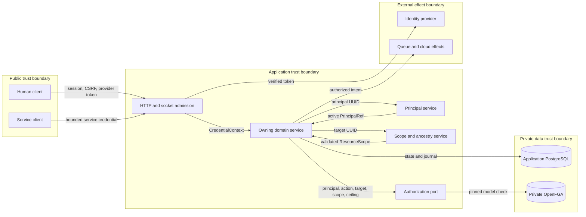
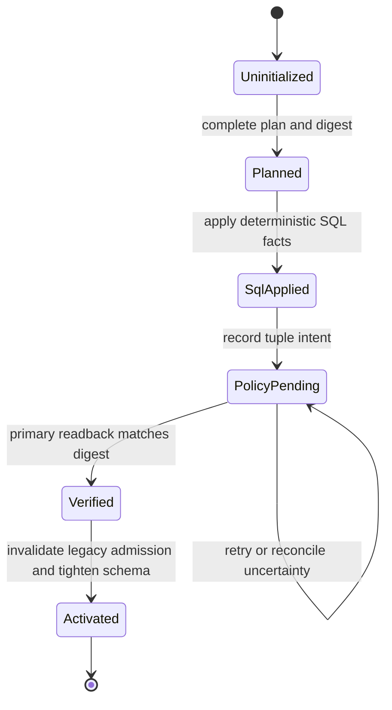
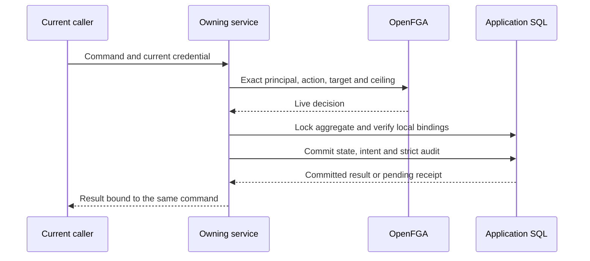

# Integrated identity verification and hard cut: S8 proposal

Status: approved for source implementation on 2026-10-25. The owner selected
one branch and one pull request. This approval covers custom integration C6.
It does not authorize deployment or pull-request merge.

The deployment probe aborts before workload mutation when its status is
inconclusive. Only a confirmed pre-cutover state enters maintenance. Retained
event deletion uses live delete authority and commits native cleanup before
removing records. Owner-handoff recovery reads back an exact admitted revoke
without replaying a write after the initiator loses administrative authority;
the original credential must remain live for that readback path. A current
administrator can separately authorize reconciliation of the original intent.

Scope: issue #2321 on the single branch `2321-identity-hard-cut`. Dependencies
#2314-#2320 are merged. AWS issue #2313 remains separate. There is currently no
live GCP or other Shifter deployment, so this delivery cannot and will not
claim a live cutover or live-cloud acceptance.

## Decision summary

### Integration design review: 2026-10-28

The component design remains suitable, but the integration model was incomplete.
The [integration contracts](../technical/shifter_platform/identity-lifecycle-contracts.md)
now define DFDs, state ownership, phase clocks, lock order and recovery obligations.
This review found integration gaps that earlier checks did not cover.
The corrections below are implemented and have targeted regression evidence.
The issue's publication record identifies the tested candidate and subsequent merge checks.

| ID | Confirmed source gap | Bounded correction | Required verification |
| --- | --- | --- | --- |
| D1 | Claimed warm recovery uses preparation age. | Use `claimed_at`; retain conservative behavior for invalid historical state. | Old ready generation, fresh claim, no retirement; expired claim, native cleanup. |
| D2 | Disabled or removed buckets lose periodic finalization. | Separate configured replenishment from retained-ledger recovery in the existing worker. | Disable/remove a bucket; real cleanup continues and releases only verified capacity. |
| D3 | Unknown cleanup can stop at logical `destroyed`. | Keep a bounded exact-origin retry through the existing lifecycle and result path. | Incomplete provider inventory becomes absent; periodic worker settles without injected receipts. |
| D4 | Launcher and failure handling lock intent before target; cancellation reverses that order. | Share target-before-intent ordering and recheck operation, lease and interruption. Preserve dispatch serialization. | PostgreSQL launcher/cancel and failure/cancel races through actual services. |
| D5 | Warm ceiling checks and reservations are separate. | Use an Engine-owned transaction mutex for global/bucket count and reservation, following the existing local advisory-lock pattern. | Two concurrent reservations at limit one create exactly one admitted generation and draw. |
| A1 | Policy evaluator exceptions become terminal denied operations. | Keep unavailable distinct from explicit denial; preserve retry identity and validate complete delegation before pending publication. | Same credential and command recover after an evaluator outage; explicit denial stays denied. |
| A2 | Ownership-transfer HTTP omits the pending-state error adapter. | Reuse bounded error handling across assign, revoke and transfer. Expose authorized pending status through the existing surface. | Actual HTTP lost-acknowledgement response and same-command retry. |
| A3 | Handoff effects are recomputed from role catalogs with positional keys. | Persist a versioned CTF-owned effect manifest; use semantic step identities and the existing policy journal. | Interrupted handoff survives catalog changes while altered effect plans are refused. |
| V1 | Released-server administration fixtures fabricate credential references. | Use persisted live session/service proofs and the existing released OpenFGA harness. | Run the selected integration module and an actual handoff recovery against released OpenFGA. |

These changes reuse the modular Django services, typed shared contracts and durable journals.
They do not require a new workflow engine or a different permission provider.
CTF owns the handoff effect plan. Workspaces owns policy publication and readback.
Engine owns atomic warm admission, native dispatch and cleanup completion.
CMS owns replenishment choices and invokes Engine through its public facade.

Implement D1-D5 in the existing warm services, launcher and cleanup modules.
Implement A1-A3 in the existing policy journal, CTF transition and HTTP adapter modules.
Add only narrow typed helpers where several callers must enforce the same rule.
Do not create a general retry framework or duplicate the SDK's existing batching.
Any new persistence for A3 requires migration, immutable-plan validation and constraint tests.
Do not reinterpret a pending legacy transition silently; require an explicit safe recovery disposition.

The same immutable-plan recovery rule covers interrupted staff assignment after recipient deactivation.
Settlement requires current administrator delegation and an exact persisted event, kind, subject and effect.
New inactive grants remain denied. No unbound inactive-subject flag is introduced.
Warm preparation also compares the selected compatibility digest with the actual loaded source before any reservation.
Dispatch rechecks the local credential and claimed worker lease immediately before the provider effect.

Verification must observe persisted intermediate state and production recovery entry points.
Provider adapters can be synthetic; the orchestration and domain ownership must remain real.
Run PostgreSQL contention tests, released OpenFGA integration, import contracts and the full ADR guard.
Refresh schema and browser contracts only if the pending-status response changes.
Document checks validate links and Mermaid syntax; they do not prove runtime correctness.

The automated design recorder remains blocked by Ground Control issue #1817.
On 2026-10-28, the owner authorized manual issue records so that this failure does not block implementation.
The [manual design record](https://github.com/Brad-Edwards/bigrae/issues/2321#issuecomment-6473812574)
records the design, open corrections and verification plan before source repairs.
The one-checkout, one-branch, one-PR and user-merge constraints remain unchanged.

### Native-authority boundary corrections

A subsequent call-chain check found live legacy decisions behind mounted routes.
These are hard-cut defects, not exceptions to the native policy model.
The generic `authenticated-platform-contract` inventory description did not prove owning-service authorization.
Replace it with exact decisions and exercise the mounted routes with native policy denial.

| ID | Confirmed gap | Required correction and verification |
| --- | --- | --- |
| M1 | Parked model-access sharing routes still reach legacy authority and selector membership. Selector preview omits the disabled-feature check. | Enforce ADR-068: sharing API and composition/selector entry points report unavailable before reads or effects, even if a runtime setting is enabled. Retain low-level accounting contracts; do not add publisher schema, permissions or broker capability. Prove closure for mounted and direct calls with native and legacy credentials. |
| M2 | Notification candidates use the creator field and a Django organizer group. Notification sockets omit native proof binding, and the subscriber port uses legacy user authority. | Project candidates from current human owner/staff principals. Carry the real credential through subscription, replay and delivery; require current event policy or exact live participation. Register transport only with those topic checks. Prove transfer, revocation, service isolation and temporary-participant confinement. |
| M3 | The participants-only scoreboard admits legacy creator/staff flags and any participant row. | Keep public publication semantics. For restricted projection, require native event read or exact eligible participation. Prove denied administrator flags, banned/inactive participation and unchanged public/hidden behavior. |

These corrections reuse the existing policy provider, credentials, selector owners,
notification registry and explicit unsupported-feature boundary. No new identity
provider, workflow engine or notification service is introduced. Policy I/O
remains outside domain transactions. ADR-068 governs the parked broker: the
initial native-publisher expansion was rejected before implementation because
it would extend an unsupported feature. This delivery closes the exposed sharing
entry points and preserves the supported keyless-direct model path. The original
OpenFGA, Django and PostgreSQL references below apply to the active boundaries.

### Integration verification and remaining limits

PostgreSQL tests exercise real concurrent warm reservations, launch/cancellation
lock order, retained cleanup and credential rotation. Released OpenFGA tests
exercise lost acknowledgements and exact retained staff plans after recipient
deactivation. Notification tests use real PostgreSQL and Redis, including
cross-process delivery, current topic authority and temporary-participant replay.
Revocation at final send must suppress the message and retain its pending receipt.
The regression invokes the real policy callback and revokes the persisted session.

The implementation retains the existing service boundaries and durable journals.
The defects required clearer integration contracts and stronger tests of complete
flows. They did not establish a need to replace the modular control plane.
The DFDs, ownership tables and threat matrix now connect those boundaries to tests.
Passing tests provide evidence for the exercised paths, not a proof of all behavior.

The remaining operational limits are explicit. SQL and OpenFGA do not share a
transaction, so current checks and durable recovery cannot promise instantaneous
global revocation. Provider submission retains a generation lock with a bounded
timeout. Lower warm limits require old workers to stop. Migration 0076 refuses
unfinished legacy staff transitions; operators must settle them before upgrade.
There is no deployed environment on which to verify cloud IAM, network policy,
capacity or a live cutover. The PR records source and local integration evidence.

### Development-branch integration

The development branch adds the multi-event communications console while this
cutover is in progress. Preserve its targets, preview, delivery, recipient and
activity projections. Each owning read must receive the actual credential and
admit every campaign target through current native event authority. Recipient
details also require current `event.manage_participants` for the selected event.
Target discovery must apply authority before pagination and must preserve
credential and provider failures. Do not restore legacy user or workspace roles.
Policy admission occurs before SQL work; local proof checks fence the projection.

The new `communications/target-options/` read returns explicit account,
organization or workspace parents and their currently authorized events.
Its optional parent filter uses the existing campaign field names; only one
parent can be selected. Parent display names are disclosed only for parents
derived from events with current communication authority, through an owning
Workspaces projection. This does not grant directory access. The existing
workspace-only `targets/` response remains a compatibility projection of the
same discovery helper. The console uses the explicit parent for requests,
selection state and cache keys.

Preserve communication attribution without assigning service actions to a human.
Retain both independent migration histories and join their leaves with a merge
migration. Integration verification must exercise mounted console reads, denied
and narrowed credentials, pagination, service attribution and migration graphs.

The development branch also moves GCP deployment into the shared installation
CLI. Keep that single deployment owner. Transfer this cutover's probe, process
termination, migration, policy publication and secret-boundary checks to its
existing phases before removing the superseded workflow scripts. Preserve the
fresh-namespace network prerequisites and fail closed on an inconclusive probe.
Test the canonical CLI orchestration and rendered artifacts without claiming a
live deployment. Do not retain a second deployment implementation in Actions.

### Catalog initialization after activation

Hosted image verification exposed a retained deployment path that creates a
Django staff user and registers shipped content without native custody. The
schema migration Job also invokes that path before policy activation. Both
behaviors conflict with ADR-034, ADR-053 and ADR-066.

Catalog CLI commands must authenticate an actual bearer proof from a bounded,
private file through the existing API-token authenticator. A username, principal
UUID, workload IAM role or maintenance flag is not application authentication.
Registration and conformance reject raw Django users at their owning boundaries.
Shipped content uses explicit installation scope and the ordinary registration,
conformance and publication services. Publication requires its separate current
permission and credential ceiling. No deployment actor is created or granted
permission implicitly.

Preflight the complete manifest before the registration transaction. Commit its
native registrations together, then run conformance and publication outside that
transaction. Failed qualification leaves native pending or unpublished rows for
an exact retry. The shipped-only conformance promotion is removed.

The schema migration Job must not initialize content. The canonical deployment
command performs identity activation and restores the native application before
the catalog phase. An optional `--catalog-credential-file` supplies an actual
current native proof to a bounded post-activation Job through a private Secret
mount. It never enters argv, logs or the deployment input bundle. Missing proof
leaves catalog setup explicitly incomplete and returns actionable instructions;
it does not undo verified activation or stop the application needed for login.

For a fresh installation, the administrator must authenticate after activation
and issue an ordinary native credential, or supply a proof for an explicitly
admitted service identity. Then the same deployment command can resume catalog
setup. Activation revokes pre-cutover personal proofs, so supplying one before
activation cannot substitute for this step. A service proof is not permission:
its binding, admission, ceiling and current policy still apply.

Verification must use the real released policy service, actual credential
issuance and authentication, the production image entrypoint, and native catalog
custody. It must cover absent, expired, revoked and insufficient proof, loss of
publication authority, pending qualification, exact retries and startup before
the catalog phase. No live-cloud acceptance is claimed.

### Approved delivery shape

S8 will replace the legacy identity and application-permission model in one
source delivery. The existing SQL domains remain authoritative for identity,
customer hierarchy, resource ancestry and lifecycle. OpenFGA becomes the sole
application-permission relationship and decision service. Credential ceilings,
domain invariants and cloud IAM remain separate mandatory checks.

The work will use one issue, one branch and one PR. The PR may contain ordered
commits that separate converter/bootstrap work, composition changes, legacy
removal and documentation, but those commits are reviewed and merged together.
This is the least risky fit for both the atomic authority change and Ground
Control's one-issue/one-delivery-PR readiness and finalization record.

## Source assessment before implementation

| Area | Confirmed state |
| --- | --- |
| HTTP contract | `openapi/v1.json` contains 252 operations. The prepared account-administration artifact contains 113 operations and is not the production URL composition. |
| Runtime authority | The incumbent Django-user, staff, role, owner and group paths remain live. Prepared credential/OpenFGA paths coexist as dormant or selectively used seams. |
| Service contracts | Many services accept either a `User` or a `CredentialContext`; browser adapters normally select the legacy branch. Exact counts from the October survey are estimates and must be replaced by a generated inventory in the implementation. |
| Account mapping | Human principals exist, but `plan_legacy_account_mapping` only classifies. It has no authoritative account-type/default fact source and no executor. Synthetic personal organizations/workspaces are still created and consumed. |
| Policy bootstrap | Relationship writers require existing authority. There is no tightly scoped first-installation-administrator grant path independent of Django flags or cloud IAM. |
| Runtime configuration | `OPENFGA_ENABLED` permits selective behavior. Runtime consumers do not yet have one mandatory, uniformly validated store/model binding. |
| Sessions and credentials | Existing sessions cache their authentication backend. Legacy API credentials and session state can survive unless explicitly invalidated. |
| Deployment | There is no live target. The GCP workflow and Kubernetes manifests can be qualified structurally, but live IAM, workload, network, renewal and cutover behavior cannot be evidenced now. |

## Target architecture

### Components and trust boundaries

The edge verifies the credential and creates `CredentialContext`. The owning
service validates the target and lifecycle. `management` resolves the active
principal. `workspaces` resolves customer ancestry. The shared authorization
port applies the credential ceiling and the OpenFGA decision. No downstream
component can reconstruct a broader actor from email, user flags or cloud IAM.

### Data flows

| Flow | Data | Controls | Store or sink |
| --- | --- | --- | --- |
| F1 authentication | Provider token, session key or service credential | Exact issuer, audience and subject; CSRF; revocation; bounded error | Principal reference in request memory |
| F2 authorization | Principal UUID, action, target, scope and ceiling | Closed contracts; SQL ancestry; pinned model; higher consistency | OpenFGA decision |
| F3 domain mutation | Validated command and current decision | Owning-service invariant; row lock; strict audit | Application PostgreSQL |
| F4 policy mutation | Tuple digest and operation identity | Durable journal; transactional write; readback; no hidden retry | OpenFGA relationships and SQL journal |
| F5 cutover facts | Bounded internal IDs and closed fact codes | Mode `0600`; no email, secret or raw tuple; digest binding | Operator input and cutover state |
| F6 delayed effect | Principal, credential reference, ceiling, action, target and generation | Dispatch reauthorization; immutable intent; revocation fence | Existing queue, outbox or connection controller |

Application data crosses the SQL and OpenFGA boundary only as stable opaque
identifiers. Secrets do not enter tuple data, audit details, logs, URLs, command
arguments or browser storage. Provider and OpenFGA error text does not cross the
public error boundary.

### Cutover state

Runtime application processes start only in `Activated`. Migration and
bootstrap commands can run before that state. A failed or uncertain policy
write stays in `PolicyPending`. It does not restore legacy authority.

### Security controls

| Threat | Boundary | Control | Verification |
| --- | --- | --- | --- |
| Identity substitution | Public to application | Exact immutable provider binding and active principal lookup | Provider collision and mutable-email tests |
| Cross-account access | Domain to scope owner | SQL-owned ancestry and target re-resolution | Sibling-account negative tests |
| Credential widening | Admission to policy | Exact `CredentialCeiling` AND live policy | Reduced-ceiling and revoked-credential tests |
| Split authority | Service to policy | Remove legacy fallbacks and require one provider binding | Static inventory and service tests |
| Partial external write | SQL to OpenFGA | Durable journal, digest, idempotent write and readback | Lost-acknowledgement and rerun tests |
| Stale delayed access | Queue or connection boundary | Persisted initiator and ceiling; dispatch reauthorization; native termination | Revocation and continuing-access tests |
| Secret disclosure | Configuration and process boundary | Existing secret references, mounted files and sanitizers | Manifest, argv, log and error-envelope tests |

### Policy and architecture as code

- `shared.authorization.ACTION_CATALOG` and the rendered OpenFGA model remain
  the policy-as-code sources. Coverage tests require every effect to have one
  disposition. The change adds no second action or role list.
- `config/env-manifest.json`, its closed loaders, Helm values and templates,
  the shared installation CLI, Terraform and admission checks remain architecture-as-code.
  Helm is the sole GCP Kubernetes renderer (ADR-070).
  The implementation removes optional policy activation from these surfaces.
- The OpenAPI artifact and generated TypeScript types remain the public
  contract. The implementation regenerates them from mounted DRF routes.
- ADR-066 and its registry entry remain the decision record. No new ADR is
  required unless implementation changes a decision in this document.

### Identity and customer scope

- Preserve one stable internal `Principal` per human or service identity.
- Bind external humans by exact verified `(issuer, subject)` evidence. For
  Identity Platform this corresponds to its immutable user identifier, not a
  mutable email address.
- Keep Account, Organization and Workspace as distinct SQL-owned facts.
  Individual accounts have no fabricated subdivision. Business hierarchy and
  defaults are explicit and validated.
- Keep memberships, ownership, creator attribution, CTF participation and
  application grants distinct. None implies another.

### Application authorization

- Use the existing `shared.authorization` catalog and OpenFGA model. Model
  concrete Shifter resource types and relations; do not add a generic role or
  policy language.
- Resolve actual target and ancestry through the owning SQL service before a
  policy check. Store entity hierarchy and searchable/filterable facts in SQL;
  store application permission relationships in OpenFGA.
- Pin the exact OpenFGA store and immutable authorization-model ID in every
  check, list and write. All application processes validate the same binding at
  startup. Remove `OPENFGA_ENABLED` and every fallback it controls.
- Enforce the decision and credential ceiling inside the owning service so
  HTTP, admin, worker, command and direct callers cannot bypass it. Provider
  outage is explicit unavailable/denied behavior.

### Data and policy conversion

Add one issue-specific `identity_cutover` command with `plan`, `apply` and
`verify` modes. It is a bounded orchestration over existing domain services and
the authorization journal, not a general migration engine.

1. **Expand schema.** Separate additive Django migrations create nullable/new
   facts and the durable cutover-state record. No legacy authority changes yet.
2. **Plan without mutation.** Collect complete principal, provider, account-
   type/default, membership, ownership, CTF, resource, credential, pending-
   operation and audit dispositions. A closed operator facts document supplies
   only facts the database cannot determine. Missing, duplicate or contradictory
   facts block the whole plan with bounded reason codes.
3. **Apply SQL state.** Under an exclusive cutover lease, write deterministic
   IDs and converted SQL facts inside bounded transactions. Record expected
   OpenFGA tuples and their digest before external I/O. Never perform network
   I/O while holding application row locks.
4. **Apply policy state.** Replay the recorded tuple intent to the pinned model
   using idempotent writes, then read it back with higher consistency. The
   cutover stays non-terminal on timeout, partial failure or an uncertain
   result; rerun reconciles the journal instead of duplicating grants.
5. **Bootstrap once.** A deployment-owned command grants
   `installation_administrator` to one exact configured provider subject. It
   refuses if any such grant exists, if the subject is unresolved or inactive,
   or if store/model verification fails. Email and cloud IAM are not keys or
   substitute grants.
6. **Invalidate old admission.** Mark legacy API tokens revoked and requiring
   authorized reissue, clear obsolete verifiers, delete server-side Django
   sessions, and terminate or fence continuing connections. No replacement
   secret is generated during conversion.
7. **Tighten schema.** Separate constraint/removal migrations refuse while any
   legacy-shaped row or incomplete disposition remains. They make required
   account/scope facts non-null and remove obsolete storage only after verify
   passes.
8. **Mark terminal.** The terminal cutover state records the SQL plan digest,
   OpenFGA store/model IDs, expected tuple digest and verification result.
   Post-cutover runtime refuses to start without that state, except on an empty
   fresh installation initialized directly into it.

### Fresh installation and legacy upgrade

There is no current environment to hard-cut. The implementation must therefore
make these paths explicit:

- **Fresh install:** migrations create the post-cutover schema, publish and pin
  the model, create the first principal/account and explicit administrator
  grant, and start only the new runtime. No synthetic personal subdivision,
  legacy credential or legacy authority state is created.
- **Legacy-data upgrade:** the shared GCP deployment command gains only the
  narrow S8 maintenance boundary required by this issue. It controls HPA state,
  suspends CronJobs, stops application deployments and continuing-access
  gateways, waits for already-started Jobs/effects, then runs the sequence
  above. Failure leaves application effects stopped. There is no rollback to
  legacy authority.

Because no cluster exists, the upgrade path is verified through rendered
command and rendered-manifest contract tests and a disposable local Kubernetes test where
available. Those checks do not count as live GCP evidence.

## Runtime activation and legacy removal

An event remains unavailable while its initialization intent is pending,
including after its policy relationships are confirmed. The intent records
the initiating credential reference, selected model sources and the content
digest. Content and model state commit with the ready transition. The
`resume_ctf_event_initialization` operator command resumes that exact intent
using the original credential's current authority by default. A trusted operator
may supply `--credential-reference '<current-reference-json>'` to use a fresh,
currently authorized proof. Recovery rechecks parent creation and every needed
event action; the original owner and pinned content remain unchanged. The
reference contains identifiers and limits, never a bearer token. `--abort`
requires a current proof, parent creation permission and, for another owner,
parent authorization administration. It deletes only a pending declaration with
no participant or spare allocation and writes strict audit evidence.

Staff and ownership recovery also accepts a current authorized administrator.
The exact saved command, scope, model, subject and effect must match. The
original journal attribution remains intact; a fresh administrator must hold
all permissions needed to replay each unresolved effect. An original admitted
command may confirm exact primary readback without replaying a write.

Hierarchy creation returns HTTP 202 with the object UUID and a publication
receipt when SQL has committed but policy publication is pending. Retrying the
same declaration with that receipt resumes the same object. Another declaration
or parent is refused. `reconcile_hierarchy_publications` remains the bounded
operator recovery command over the existing parent-edge journal.

Organization integration discovery uses each integration's organization action
without requiring a parent account read. Event discovery rejects candidate
sets larger than 1,000 before policy I/O; callers must refine the existing
search, status or owner filters. Returned pages remain policy filtered.

- Mount the prepared account, policy, credential, lease and audit operations in
  the production URL configuration and retire colliding legacy endpoints with
  explicit contract dispositions.
- Replace the incumbent admin site with the policy-aware site for retained
  operations; disable stock or custom writes that cannot enter an authorized
  service command.
- Pass `CredentialContext` and exact target/scope into every owning service.
  Remove dual `User` paths and superseded staff, superuser, group, role,
  creator and owner authorization checks while preserving lifecycle, quota,
  participation, competition, model-access, cloud-admission and safety rules.
- Remove personal-workspace creation and readers. Move only unambiguous personal
  rows to individual account scope; archive synthetic subdivisions without
  cascade deletion.
- Drive frontend navigation and route gates from server-returned action
  decisions, never `is_staff`. Client-side gates remain usability hints, not
  enforcement.
- Classify every mounted operation and every Django admin action/inline,
  command, scheduler handler, callback, webhook, queue consumer and socket
  route. A new surface must fail coverage until classified.
- Give portal, workers, scheduler, communications and continuing-access
  processes the same mandatory OpenFGA store/model binding and fail startup on
  missing or mismatched configuration.

## Verification

### Blocking source evidence

- URL-resolver-based coverage for all 252 current HTTP operations plus a
  preserved disposition for the 220-operation historical baseline.
- Explicit inventories for every non-HTTP effect surface and every removed
  legacy enforcement site.
- Real PostgreSQL plus the repository-pinned released OpenFGA server for clean
  install, legacy conversion, ambiguity blockers, partial/uncertain tuple
  writes, rerun, constraint tightening and startup refusal.
- Offline differential fixtures comparing the incumbent expected permission
  matrix with the new model. This provides migration comparison without a
  runtime dual-authority or shadow mode.
- Human and service administrator parity, account isolation, scoped
  delegation, CTF owner/staff/participant separation, temporary-account
  confinement, queued revocation, strict audit and continuing-access
  revocation tests.
- Authentication-backend/session invalidation, legacy-token rejection and
  authorized credential-reissue tests.
- Fresh-install and legacy-upgrade workflow/manifests tested for HPA handling,
  CronJob suspension, already-running Job detection, failure-stays-stopped and
  model/store pinning.
- Repository-native lint, formatting, imports, migrations, ADR guard,
  actionlint, Kubernetes validators, pre-commit, hosted CI and SonarCloud.

### Evidence boundary

No test in this delivery may be described as proof of live GCP IAM, Identity
Platform, GKE networking, workload renewal, database reconnection, connection
termination or a performed hard cut. With no target environment, those issue
acceptance clauses are not applicable to this source delivery rather than
silently passed. The final record must state that fact plainly.

## Risk register

| Risk | Severity | Treatment |
| --- | --- | --- |
| A missed route or direct service retains legacy authority or bypasses policy. | Critical | Resolver/effect inventory is a blocking test; remove dual paths; enforce again at the owning service. |
| Ambiguous mapping grants the wrong customer or administrator access. | Critical | Closed facts input, full dry plan, no inference, bounded blockers, deterministic IDs and negative fixtures. |
| SQL commits but OpenFGA is partial or uncertain. | Critical | Durable global cutover state plus tuple-intent journal, idempotent pinned-model writes, higher-consistency readback, runtime blocked until terminal verify. |
| First-grant bootstrap locks everyone out or grants the wrong identity. | Critical | Exact immutable provider subject, single-use refusal, no email lookup, readback before terminal state, dedicated negative tests. |
| Old sessions, tokens, sockets or queued jobs retain pre-cutover authority. | Critical | Delete sessions, revoke old tokens, stop/fence all effect producers, preserve initiator/ceiling on durable work, reauthorize dispatch and continuing access. |
| OpenFGA outage becomes a platform-wide availability event. | High | Intentional fail-closed behavior, bounded unavailable errors, health/readiness signals and no legacy fallback. |
| Large migration locks or exhausts the database. | High | Plan first, batch bounded data work where necessary, separate schema/data/constraint migrations, PostgreSQL scale fixtures and query/lock review. |
| One large PR is hard to review. | High | One branch/PR but ordered commits, generated inventories, narrowly owned modules, risk-based review checklist and complete automated gates. |
| No live environment hides GCP/workload integration defects. | High | Do not overclaim; maximize hermetic and manifest contract tests. First deployment remains an operational qualification event, not evidence retroactively attributed to this PR. |
| Fresh install accidentally traverses legacy bootstrap code. | High | Fresh-install test begins with an empty database and asserts no legacy/synthetic rows, flags, routes or credentials exist. |
| Credential reissue causes access loss. | Medium | Explicit revoked/reissue state, supported ceremonies only, clear operator/user documentation, no automatic secret creation or privilege widening. |
| Logs or facts files disclose identity or authority data. | High | Internal IDs and bounded codes only in output; mode-0600 temporary inputs; no email, claims, tuple dumps, secrets or private scenario data in public evidence. |

## Alignment with authoritative guidance

The proposal is consistent with the following official guidance, subject to the
documented no-shadow exception:

- [OpenFGA immutable authorization models](https://openfga.dev/docs/getting-started/immutable-models): pin one model ID across services and migration writes.
- [OpenFGA tuple/API best practices](https://openfga.dev/docs/getting-started/tuples-api-best-practices): pin model IDs and keep personal data out of tuples.
- [OpenFGA model design principles](https://openfga.dev/docs/best-practices/modeling-design-principles): model concrete domain resources and built-in relations, not an abstract meta-model.
- [OpenFGA source-of-truth guidance](https://openfga.dev/docs/best-practices/source-of-truth): keep user/entity hierarchy and searchable data in application stores while using OpenFGA for fine-grained permission relationships.
- [OpenFGA adoption patterns](https://openfga.dev/docs/best-practices/adoption-patterns): recognizes service wrappers and recommends shadow comparison for critical migrations; S8 substitutes offline differential tests because ADR-066 forbids mixed runtime authority and there is no live traffic.
- [OpenFGA production guidance](https://openfga.dev/docs/best-practices/running-in-production): authenticated TLS endpoints, released migrations, bounded connections, metrics and tracing remain required.
- [Django 6.0 migrations](https://docs.djangoproject.com/en/6.0/topics/migrations/) and [migration-writing guidance](https://docs.djangoproject.com/en/6.0/howto/writing-migrations/): committed deterministic migrations and expand/populate/constrain sequencing.
- [Django 6.0 authentication backends](https://docs.djangoproject.com/en/6.0/topics/auth/customizing/): authentication backend choice is cached in sessions, so the authority transition clears server-side sessions.
- [Google Identity Platform user schema](https://docs.cloud.google.com/identity-platform/docs/reference/rest/v1/UserInfo): `localId` is immutable while email is not the identity key.
- [Google Workload Identity Federation best practices](https://docs.cloud.google.com/iam/docs/best-practices-for-using-workload-identity-federation): immutable mappings, dedicated identities and least privilege.
- [Google service-account key guidance](https://docs.cloud.google.com/iam/docs/best-practices-for-managing-service-account-keys): prefer keyless credentials and do not introduce long-lived service-account keys.
- [Cloud SQL Auth Proxy requirements](https://docs.cloud.google.com/sql/docs/mysql/sql-proxy): install credential, DNS, API HTTPS and native SQL egress prerequisites before the first connection.
- [Kubernetes Deployment scaling](https://kubernetes.io/docs/tasks/run-application/scale-deployment/) and [CronJob suspension](https://kubernetes.io/docs/concepts/workloads/controllers/cron-jobs/): account for HPA reconciliation and already-started Jobs at a maintenance boundary.
- [OWASP Authorization Cheat Sheet](https://cheatsheetseries.owasp.org/cheatsheets/Authorization_Cheat_Sheet.html): deny by default and validate authorization on every request.

## Non-goals

No generic migration framework, policy language, token format, authentication
protocol, secret broker, customer-specific fork, staged legacy compatibility,
runtime shadow evaluator, deployment rollback to old authority, AWS delivery,
private pack content, live deployment, or PR merge is authorized here.

## Runtime admission and recovery invariants

CTF writes evaluate live policy before SQL aggregate locks. They pass an explicit,
invocation-local event admission to nested native graph writes. Locked writers
recheck local credential lifecycle, exact event ancestry and owner binding;
source changes also compare their expected revision. No admission is accepted
from HTTP, cached between requests, or used to replace a fresh policy check on
another operation. Event source sponsorship and placement are validated before
creation commits. Initialization keeps its content transaction atomic.

Mounted CMS routes carry the authenticated credential to each owning service.
Catalog lists and pack creation use an explicit installation, account,
organization or workspace selector. Existing source details, metadata and
realizability commands derive scope from persisted custody. Image administration
remains installation scoped and uses the registered content actions. No HTTP
route converts a native credential into Django staff or group authority. Owning
commands resolve the current native proof, retain its narrowed ceiling, then
fence local lifecycle before commit. This also applies to issuing and rotating
credentials, lease policy and offboarding. Tests exercise actual mounted routes
and real proof records; the inventory alone is not authorization evidence.
The Scenario Editor discovers permitted content placement through the bounded
`GET /api/v1/cms/content-scopes/` collection. Each result requires its exact
`read_content` action. It returns the permitted leaf name and routing UUIDs;
it does not require or disclose parent metadata. Installation is offered only
with installation content-read authority. The browser selector carries the full
selected ancestry in catalog requests and cache keys. Discovery and catalog
failures remain visible; private content does not depend on a global role.

Mission Control uses that same credential boundary for ranges, devices,
credentials, uploads and remote-access handoffs. Human contact fields are optional
attribution. They do not gate service principals. Resource reads and mutations
derive persisted custody; creation uses the selected account ancestry. Temporary
participant limits follow their native credential kind and ceiling, not groups.

Tenant pack upload commits an exact bucket/key archive and a temporary pending
removal record before storage I/O. The record starts with an unknown upload
outcome and an uploader lease. Registration requires that same unexpired lease,
the exact archive and a current native proof. Its transaction installs the source
and detaches the temporary cleanup record. An expired uploader cannot publish.
The existing removal worker may delete an expired upload's exact key. It retains
the archive and pending record while the outcome is unknown, even after an absent
object read. Bounded retries catch a write that finishes late. A successful
storage return can settle the outcome; an ambiguous exception cannot. A crash may
therefore leave visible pending cleanup metadata. The worker does not claim that
cleanup has finished while a later write is still possible.
Installer finalization uses the same rule for an ambiguous storage copy.
An interrupted copy retains its finalizing state and pending cleanup. The
worker may repeat exact-key deletion, but age and an absent object do not prove
that the copy stopped. A returned copy or pre-copy failure can settle its outcome.
Expired installer records also remain exact-key cleanup tombstones. The existing
bounded worker revisits them to remove late staging writes. It removes installed
bytes only for cancelled uploads or retired installers. Live installed content
keeps its admitted bytes and ownership.
The existing CMS storage-cleanup worker runs both bounded reconciliations on
each pass. Installer cleanup runs even when no pack removal is pending.

Communication admission uses the same prepare/commit boundary. Event, campaign,
intent and replay locks still serialize cancellation and release. Policy-service
outages retain scheduled work and retry only within the existing release grace
window. Confirmed revocation and explicit denial remain terminal and materialize
no recipients.

CTF range creation remains deferred until a participant, spare or recovery row
records the exact range association. The owning service then admits dispatch.
Each launch first commits one CTF intent with a request UUID, the exact subject,
the original credential reference and immutable launch inputs. Participant claims,
spare creation and rebuild preparation retain that intent before calling CMS.
Retries reuse its UUID and inputs. CMS checks a stored input digest before it
reuses a reservation. Concurrent retries serialize native creation through the
existing CMS row lock. They cannot allocate a second range or change the actor.
The CTF association commits before the existing Engine outbox is made runnable.
A retry resumes both sides of that boundary, including an associated range whose
dispatch has not been queued. Native creation also retains a generation-bound
custody receipt so an undispatched range remains eligible for bounded cleanup.
Event cleanup first cancels retained launch intents under the event lock.
CMS reservation and native creation check this same intent under that lock.
An in-flight creator either commits before cancellation or cannot create.
Cleanup includes requests that have no participant pointer yet. It releases a
claim only after no runtime can exist, or verified teardown confirms absence.
Recovery retains native, generation-bound cleanup before replacing an old
participant pointer. Cleanup can finish after the live association changes.
Model lifecycle renewal uses the current admitted caller proof and current
range-management policy. Initial delayed work remains bound to its initiating
proof. Model subjects always use the native range UUID.

Warm and cold reservations acquire Account before Workspace. Warm claims fence
current source and credential state, assign the real lease and commit custody,
model allocation and one activation together. Source-policy reads precede these
locks; the locked claim consumes exact prepared inputs and retained authority.

Account administration discovers readable organizations and workspaces directly,
without requiring a parent account-read grant. Counts and pages contain only
permitted descendants and their routing ancestry. Launch workspace discovery
uses bounded pages and exposes later pages in the browser. Lease commands retain
their published JSON, URL-encoded and multipart formats. JSON values keep strict
native scalar validation; form values use the existing framework field parsers,
with required fields and duplicate rejection before mutation.
The retired communications `workspace_id` query parameter is projected from the
compatibility baseline only for its exact path, method, name and location.

The cutover probe selects the portal container and extracts one explicitly framed
JSON result from its normal entrypoint output. Missing or duplicate results fail
closed. The node-pool labeler mounts only its temporary directory; it receives no
OpenFGA runtime credential or CA mount. Inventory tests compare actual Django
admin registrations and WebSocket routes with the committed surface inventory.

Maintenance captures and validates every workload inventory before changing
workloads. Failed inventory commands stop the cutover. Migration waits for old
application pods to terminate, including their shutdown grace period. Policy
services stay available. Before its first run, the status probe receives the
existing DNS, metadata-server, Google API and native SQL egress grants. A fresh
namespace must support proxy authentication and SQL connection establishment;
migration cannot supply a prerequisite of its own admission probe.
When model access is disabled, old broker processes terminate before the deployment command
restores the broader default egress policy. The maintenance manifest also waits
until old application pods are terminal or absent before it changes their policy.
Kubernetes combines allowed traffic across applicable network policies.

The Workspaces service owns tenancy conversion and verification. Conversion
includes legacy memberships in organizations that already have an account.
Unsupported legacy workspace administrator roles block activation until an
operator records a supported policy disposition. A direct administrator grant
would add owner-transfer permission and is not an equivalent conversion.
Retained legacy spare owners block the field-removal migration until the old
release drains those spares. Conversion does not guess resource custody.

Destination content permission does not grant access to an arbitrary storage
reference. Tenant source registration requires a durable archive record with the
same authorized scope before it creates a source or reads bytes. Generic storage
references require installation authority. Retry keys bind the full explicit
resource scope as well as the original launch declaration.

Spare creation records its cancellable intent before releasing the event lock.
Cancellation prevents later creation. An absent reservation can settle only after
that cancellation fence commits. A realized range requires verified cleanup;
the SQL status alone does not establish absence. Claim release matches the exact
current range generation, so cleanup of an old request cannot clear a recovered
participant's replacement range or capacity draw.

Temporary participant target discovery uses live event participation and the
exact ready assignment. It preserves CMS and Engine bindings without expanding
the credential's event-only action ceiling. Organizer scenario discovery carries
an explicit content scope. Collection discovery excludes individually ineligible
campaign targets while preserving credential and dependency failures. Early
communication release requires a session credential, including at service entry;
a service credential cannot bypass the scheduled publication time.
Scoped scenario discovery replaces the retired unscoped `ctf/scenarios` route
with `ctf/scenario-options`. Its explicit scope is mandatory. Retained page,
webhook and award creation commands preserve their published HTTP 200 success
contract in both runtime responses and generated schemas.

Pending ownership handoffs remain recoverable after recipient deactivation.
Recovery retains the exact admitted intent and current-administrator checks;
new handoffs still require an active recipient. Range replacement also accepts
verified cleanup of its exact old generation before repointing, while cancellation
and unrelated reassignment continue to block the change.
Settlement may publish an uncompleted effect for the retained handoff's inactive
recipient or previous owner only through the exact event-transition contract. It checks
the event, source owner, recipient and effect against that durable declaration
and requires the current administrator's full delegation authority. It does not
admit an inactive actor or enable a general grant to an inactive subject. A
current administrator can then transfer an inactive owner's event onward to an
active recipient through the same exact handoff boundary.

Installation warm generations retain generation-bound cleanup authority from
creation through retirement. Their service ownership does not require a caller
credential for the existing cleanup worker. Cleanup still verifies recorded
origin, exact generation and runtime absence before releasing capacity.
Ordinary pool retirement locks the generation ledger and requires unclaimed
custody. Existing failed or timed-out activation recovery separately rechecks the
current ledger, runtime state and deadline, using the current owner's exact
cleanup receipt. A healthy customer claim cannot be retired through pool policy.
A dispatch failure after native creation retains its capacity draw until that
generation completes verified cleanup.
Warm creation, claim, retirement and result application acquire the generation
ledger before the runtime row. Result processing rechecks the current operation
after locking, so delayed completion cannot reverse custody or deadlock cleanup.

Organizer event lists use bounded pages with complete counts and browser
continuation. Account administration binds each organization subtree to its UUID.
Pending receipts and confirmation state retain their original parent when the
operator changes the selected organization.

The retained browser journeys use the native account-administration controls.
Their synthetic seed creates explicit account hierarchy and policy grants.
Both browser CI jobs reuse the existing local released-server OpenFGA harness,
with isolated PostgreSQL, TLS and runtime database duties. They do not replace
the permission provider with browser-specific authorization logic.

### Admission sequence

The same source references support the recovery changes:

- [Django 6.0 transactions](https://docs.djangoproject.com/en/6.0/topics/db/transactions/): keep transactions short and commit durable intent before external effects.
- [PostgreSQL 16 explicit locking](https://www.postgresql.org/docs/16/explicit-locking.html): use one order when acquiring several resource locks.
- [OpenFGA query consistency](https://openfga.dev/docs/interacting/consistency): bypass query caches when confirming a policy write.
- [AWS transactional outbox reference pattern](https://docs.aws.amazon.com/prescriptive-guidance/latest/cloud-design-patterns/transactional-outbox.html): retain durable intent, expect retries and make the existing consumer idempotent. This applies the pattern to the current SQL journal and Engine outbox; it adds no cloud service.
- [Kubernetes pod termination](https://kubernetes.io/docs/concepts/workloads/pods/pod-lifecycle/): allow old application processes to finish shutdown before migration.
- [Kubernetes bounded deletion wait](https://kubernetes.io/docs/reference/kubectl/generated/kubectl_wait/): check pod deletion with an explicit timeout and fail the cutover if the wait fails.
- [OWASP authorization guidance](https://cheatsheetseries.owasp.org/cheatsheets/Authorization_Cheat_Sheet.html): check each archive's authority on the server, including stored resources, before reading or registering it.

### Migration ordering after integration

Apply the existing communication-attribution migration before native event
authority. These changes rebuild the same SQLite tables. An explicit dependency
preserves the complete historical table state during forward and reverse
migration, including cancellation actors. The PostgreSQL and SQLite migration
checks must both restore the full leaf schema before later tests run.

### First personal-token eligibility

Normal delegation requires the actor to hold the delegated action and forbids
self-grants. Administrator roles do not imply personal-token eligibility. For a
fresh installation, the private cutover facts can explicitly set
`bootstrap_personal_token_eligibility: true`. The default is false. The plan
records this choice and binds it to its digest. Only the existing preactivation
bootstrap can seed that exact action for the selected first administrator.
It checks provider readback and writes a strict audit record before confirming
bootstrap. Activation checks the grants again. No deployment step issues a token;
the operator must authenticate after activation and use ordinary token issuance.

### Modules and validation after quality repair

Public domain facades retain their contracts. Within CTF, staff admission,
immutable transition recording and confirmed SQL projections have separate
modules. Event deletion owns its retained range cleanup. Initialization prepares
provider decisions before the SQL commit helper; launch binding keeps the event
lock ahead of the journal and subject locks. The communication helpers separate
candidate discovery, per-target admission and local proof checks without changing
the order of those checks.

Workspaces separates account views, read queries, policy admission and cutover
state. CMS separates native launch contracts, reservations, dispatch and archive
custody. Engine separates warm-pool reads and mutations, allocation bindings and
transport validation. The [lifecycle contracts](../technical/shifter_platform/identity-lifecycle-contracts.md)
identify each owner and its invariants. The existing service boundaries, policy
journal and outbox remain the integration pattern.

The quality gate requires zero open violations and at least 80% new-code coverage.
A green local type or focused test check is not sufficient for readiness. The
combined branch must pass the configured full CI suites, architecture checks,
Sonar analysis and built-image smoke job. Full test and subsystem suites run only
in CI/CD. Local checks stay focused on changed behavior, types and architecture.
There is no live deployment to qualify.

CMS launch inputs form a closed contract. Event launches require the complete
owner, action and target tuple. Other launch sources reject every member of that
event-only tuple. Validation occurs before a request or range reservation exists;
it does not replace later current-proof, custody or dispatch checks. Tests cover
partial tuples and assert that rejection leaves no reservation or launch intent.

Prepared native dispatch takes the existing ancestry locks before the native
Range lock. First dispatch and exact replay follow the same order. The final
locked checks still validate local proof, membership, ancestry and the retained
creation receipt. The regression observes actual PostgreSQL lock statements
through the public dispatch service; it does not prelock the account in test setup.

Range-history helpers retain creation, scope-transfer and leaf-lifecycle action
selection separately from receipt persistence. Internal range pagination groups
its cursor and page bound in a frozen shared input. Existing query modes, exact
identity rejection and keyset validation remain; this adds no sharing capability.
