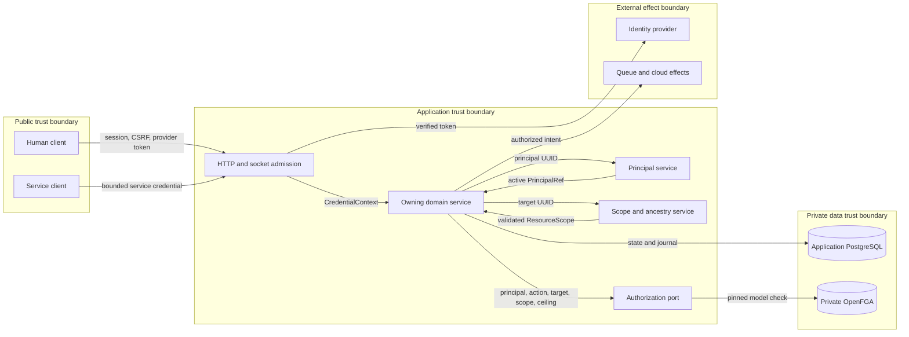
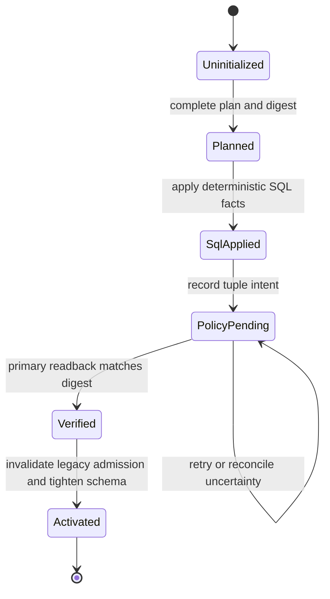

# Integrated identity verification and hard cut: S8 proposal

Status: approved for source implementation on 2026-10-25. The owner selected
one branch and one pull request. This approval covers custom integration C6.
It does not authorize deployment or pull-request merge.

Scope: issue #2321 on the single branch `2321-identity-hard-cut`. Dependencies
#2314-#2320 are merged. AWS issue #2313 remains separate. There is currently no
live GCP or other Shifter deployment, so this delivery cannot and will not
claim a live cutover or live-cloud acceptance.

## Decision summary

S8 will replace the legacy identity and application-permission model in one
source delivery. The existing SQL domains remain authoritative for identity,
customer hierarchy, resource ancestry and lifecycle. OpenFGA becomes the sole
application-permission relationship and decision service. Credential ceilings,
domain invariants and cloud IAM remain separate mandatory checks.

The work will use one issue, one branch and one PR. The PR may contain ordered
commits that separate converter/bootstrap work, composition changes, legacy
removal and documentation, but those commits are reviewed and merged together.
This is the least risky fit for both the atomic authority change and Ground
Control's one-issue/one-delivery-PR readiness and finalization record.

## Current source state

| Area | Confirmed state |
| --- | --- |
| HTTP contract | `openapi/v1.json` contains 252 operations. The prepared account-administration artifact contains 113 operations and is not the production URL composition. |
| Runtime authority | The incumbent Django-user, staff, role, owner and group paths remain live. Prepared credential/OpenFGA paths coexist as dormant or selectively used seams. |
| Service contracts | Many services accept either a `User` or a `CredentialContext`; browser adapters normally select the legacy branch. Exact counts from the October survey are estimates and must be replaced by a generated inventory in the implementation. |
| Account mapping | Human principals exist, but `plan_legacy_account_mapping` only classifies. It has no authoritative account-type/default fact source and no executor. Synthetic personal organizations/workspaces are still created and consumed. |
| Policy bootstrap | Relationship writers require existing authority. There is no tightly scoped first-installation-administrator grant path independent of Django flags or cloud IAM. |
| Runtime configuration | `OPENFGA_ENABLED` permits selective behavior. Runtime consumers do not yet have one mandatory, uniformly validated store/model binding. |
| Sessions and credentials | Existing sessions cache their authentication backend. Legacy API credentials and session state can survive unless explicitly invalidated. |
| Deployment | There is no live target. The GCP workflow and Kubernetes manifests can be qualified structurally, but live IAM, workload, network, renewal and cutover behavior cannot be evidenced now. |

## Target architecture

### Components and trust boundaries

The edge verifies the credential and creates `CredentialContext`. The owning
service validates the target and lifecycle. `management` resolves the active
principal. `workspaces` resolves customer ancestry. The shared authorization
port applies the credential ceiling and the OpenFGA decision. No downstream
component can reconstruct a broader actor from email, user flags or cloud IAM.

### Data flows

| Flow | Data | Controls | Store or sink |
| --- | --- | --- | --- |
| F1 authentication | Provider token, session key or service credential | Exact issuer, audience and subject; CSRF; revocation; bounded error | Principal reference in request memory |
| F2 authorization | Principal UUID, action, target, scope and ceiling | Closed contracts; SQL ancestry; pinned model; higher consistency | OpenFGA decision |
| F3 domain mutation | Validated command and current decision | Owning-service invariant; row lock; strict audit | Application PostgreSQL |
| F4 policy mutation | Tuple digest and operation identity | Durable journal; transactional write; readback; no hidden retry | OpenFGA relationships and SQL journal |
| F5 cutover facts | Bounded internal IDs and closed fact codes | Mode `0600`; no email, secret or raw tuple; digest binding | Operator input and cutover state |
| F6 delayed effect | Principal, credential reference, ceiling, action, target and generation | Dispatch reauthorization; immutable intent; revocation fence | Existing queue, outbox or connection controller |

Application data crosses the SQL and OpenFGA boundary only as stable opaque
identifiers. Secrets do not enter tuple data, audit details, logs, URLs, command
arguments or browser storage. Provider and OpenFGA error text does not cross the
public error boundary.

### Cutover state

Runtime application processes start only in `Activated`. Migration and
bootstrap commands can run before that state. A failed or uncertain policy
write stays in `PolicyPending`. It does not restore legacy authority.

### Security controls

| Threat | Boundary | Control | Verification |
| --- | --- | --- | --- |
| Identity substitution | Public to application | Exact immutable provider binding and active principal lookup | Provider collision and mutable-email tests |
| Cross-account access | Domain to scope owner | SQL-owned ancestry and target re-resolution | Sibling-account negative tests |
| Credential widening | Admission to policy | Exact `CredentialCeiling` AND live policy | Reduced-ceiling and revoked-credential tests |
| Split authority | Service to policy | Remove legacy fallbacks and require one provider binding | Static inventory and service tests |
| Partial external write | SQL to OpenFGA | Durable journal, digest, idempotent write and readback | Lost-acknowledgement and rerun tests |
| Stale delayed access | Queue or connection boundary | Persisted initiator and ceiling; dispatch reauthorization; native termination | Revocation and continuing-access tests |
| Secret disclosure | Configuration and process boundary | Existing secret references, mounted files and sanitizers | Manifest, argv, log and error-envelope tests |

### Policy and architecture as code

- `shared.authorization.ACTION_CATALOG` and the rendered OpenFGA model remain
  the policy-as-code sources. Coverage tests require every effect to have one
  disposition. The change adds no second action or role list.
- `config/env-manifest.json`, its closed loaders, Helm values and templates,
  GCP Kustomize, Terraform and admission checks remain architecture-as-code.
  The implementation removes optional policy activation from these surfaces.
- The OpenAPI artifact and generated TypeScript types remain the public
  contract. The implementation regenerates them from mounted DRF routes.
- ADR-066 and its registry entry remain the decision record. No new ADR is
  required unless implementation changes a decision in this document.

### Identity and customer scope

- Preserve one stable internal `Principal` per human or service identity.
- Bind external humans by exact verified `(issuer, subject)` evidence. For
  Identity Platform this corresponds to its immutable user identifier, not a
  mutable email address.
- Keep Account, Organization and Workspace as distinct SQL-owned facts.
  Individual accounts have no fabricated subdivision. Business hierarchy and
  defaults are explicit and validated.
- Keep memberships, ownership, creator attribution, CTF participation and
  application grants distinct. None implies another.

### Application authorization

- Use the existing `shared.authorization` catalog and OpenFGA model. Model
  concrete Shifter resource types and relations; do not add a generic role or
  policy language.
- Resolve actual target and ancestry through the owning SQL service before a
  policy check. Store entity hierarchy and searchable/filterable facts in SQL;
  store application permission relationships in OpenFGA.
- Pin the exact OpenFGA store and immutable authorization-model ID in every
  check, list and write. All application processes validate the same binding at
  startup. Remove `OPENFGA_ENABLED` and every fallback it controls.
- Enforce the decision and credential ceiling inside the owning service so
  HTTP, admin, worker, command and direct callers cannot bypass it. Provider
  outage is explicit unavailable/denied behavior.

### Data and policy conversion

Add one issue-specific `identity_cutover` command with `plan`, `apply` and
`verify` modes. It is a bounded orchestration over existing domain services and
the authorization journal, not a general migration engine.

1. **Expand schema.** Separate additive Django migrations create nullable/new
   facts and the durable cutover-state record. No legacy authority changes yet.
2. **Plan without mutation.** Collect complete principal, provider, account-
   type/default, membership, ownership, CTF, resource, credential, pending-
   operation and audit dispositions. A closed operator facts document supplies
   only facts the database cannot determine. Missing, duplicate or contradictory
   facts block the whole plan with bounded reason codes.
3. **Apply SQL state.** Under an exclusive cutover lease, write deterministic
   IDs and converted SQL facts inside bounded transactions. Record expected
   OpenFGA tuples and their digest before external I/O. Never perform network
   I/O while holding application row locks.
4. **Apply policy state.** Replay the recorded tuple intent to the pinned model
   using idempotent writes, then read it back with higher consistency. The
   cutover stays non-terminal on timeout, partial failure or an uncertain
   result; rerun reconciles the journal instead of duplicating grants.
5. **Bootstrap once.** A deployment-owned command grants
   `installation_administrator` to one exact configured provider subject. It
   refuses if any such grant exists, if the subject is unresolved or inactive,
   or if store/model verification fails. Email and cloud IAM are not keys or
   substitute grants.
6. **Invalidate old admission.** Mark legacy API tokens revoked and requiring
   authorized reissue, clear obsolete verifiers, delete server-side Django
   sessions, and terminate or fence continuing connections. No replacement
   secret is generated during conversion.
7. **Tighten schema.** Separate constraint/removal migrations refuse while any
   legacy-shaped row or incomplete disposition remains. They make required
   account/scope facts non-null and remove obsolete storage only after verify
   passes.
8. **Mark terminal.** The terminal cutover state records the SQL plan digest,
   OpenFGA store/model IDs, expected tuple digest and verification result.
   Post-cutover runtime refuses to start without that state, except on an empty
   fresh installation initialized directly into it.

### Fresh installation and legacy upgrade

There is no current environment to hard-cut. The implementation must therefore
make these paths explicit:

- **Fresh install:** migrations create the post-cutover schema, publish and pin
  the model, create the first principal/account and explicit administrator
  grant, and start only the new runtime. No synthetic personal subdivision,
  legacy credential or legacy authority state is created.
- **Legacy-data upgrade:** the ordinary GCP deployment workflow gains only the
  narrow S8 maintenance boundary required by this issue. It controls HPA state,
  suspends CronJobs, stops application deployments and continuing-access
  gateways, waits for already-started Jobs/effects, then runs the sequence
  above. Failure leaves application effects stopped. There is no rollback to
  legacy authority.

Because no cluster exists, the upgrade path is verified through rendered
manifest/workflow contract tests and a disposable local Kubernetes test where
available. Those checks do not count as live GCP evidence.

## Runtime activation and legacy removal

- Mount the prepared account, policy, credential, lease and audit operations in
  the production URL configuration and retire colliding legacy endpoints with
  explicit contract dispositions.
- Replace the incumbent admin site with the policy-aware site for retained
  operations; disable stock or custom writes that cannot enter an authorized
  service command.
- Pass `CredentialContext` and exact target/scope into every owning service.
  Remove dual `User` paths and superseded staff, superuser, group, role,
  creator and owner authorization checks while preserving lifecycle, quota,
  participation, competition, model-access, cloud-admission and safety rules.
- Remove personal-workspace creation and readers. Move only unambiguous personal
  rows to individual account scope; archive synthetic subdivisions without
  cascade deletion.
- Drive frontend navigation and route gates from server-returned action
  decisions, never `is_staff`. Client-side gates remain usability hints, not
  enforcement.
- Classify every mounted operation and every Django admin action/inline,
  command, scheduler handler, callback, webhook, queue consumer and socket
  route. A new surface must fail coverage until classified.
- Give portal, workers, scheduler, communications and continuing-access
  processes the same mandatory OpenFGA store/model binding and fail startup on
  missing or mismatched configuration.

## Verification

### Blocking source evidence

- URL-resolver-based coverage for all 252 current HTTP operations plus a
  preserved disposition for the 220-operation historical baseline.
- Explicit inventories for every non-HTTP effect surface and every removed
  legacy enforcement site.
- Real PostgreSQL plus the repository-pinned released OpenFGA server for clean
  install, legacy conversion, ambiguity blockers, partial/uncertain tuple
  writes, rerun, constraint tightening and startup refusal.
- Offline differential fixtures comparing the incumbent expected permission
  matrix with the new model. This provides migration comparison without a
  runtime dual-authority or shadow mode.
- Human and service administrator parity, account isolation, scoped
  delegation, CTF owner/staff/participant separation, temporary-account
  confinement, queued revocation, strict audit and continuing-access
  revocation tests.
- Authentication-backend/session invalidation, legacy-token rejection and
  authorized credential-reissue tests.
- Fresh-install and legacy-upgrade workflow/manifests tested for HPA handling,
  CronJob suspension, already-running Job detection, failure-stays-stopped and
  model/store pinning.
- Repository-native lint, formatting, imports, migrations, ADR guard,
  actionlint, Kubernetes validators, pre-commit, hosted CI and SonarCloud.

### Evidence boundary

No test in this delivery may be described as proof of live GCP IAM, Identity
Platform, GKE networking, workload renewal, database reconnection, connection
termination or a performed hard cut. With no target environment, those issue
acceptance clauses are not applicable to this source delivery rather than
silently passed. The final record must state that fact plainly.

## Risk register

| Risk | Severity | Treatment |
| --- | --- | --- |
| A missed route or direct service retains legacy authority or bypasses policy. | Critical | Resolver/effect inventory is a blocking test; remove dual paths; enforce again at the owning service. |
| Ambiguous mapping grants the wrong customer or administrator access. | Critical | Closed facts input, full dry plan, no inference, bounded blockers, deterministic IDs and negative fixtures. |
| SQL commits but OpenFGA is partial or uncertain. | Critical | Durable global cutover state plus tuple-intent journal, idempotent pinned-model writes, higher-consistency readback, runtime blocked until terminal verify. |
| First-grant bootstrap locks everyone out or grants the wrong identity. | Critical | Exact immutable provider subject, single-use refusal, no email lookup, readback before terminal state, dedicated negative tests. |
| Old sessions, tokens, sockets or queued jobs retain pre-cutover authority. | Critical | Delete sessions, revoke old tokens, stop/fence all effect producers, preserve initiator/ceiling on durable work, reauthorize dispatch and continuing access. |
| OpenFGA outage becomes a platform-wide availability event. | High | Intentional fail-closed behavior, bounded unavailable errors, health/readiness signals and no legacy fallback. |
| Large migration locks or exhausts the database. | High | Plan first, batch bounded data work where necessary, separate schema/data/constraint migrations, PostgreSQL scale fixtures and query/lock review. |
| One large PR is hard to review. | High | One branch/PR but ordered commits, generated inventories, narrowly owned modules, risk-based review checklist and complete automated gates. |
| No live environment hides GCP/workload integration defects. | High | Do not overclaim; maximize hermetic and manifest contract tests. First deployment remains an operational qualification event, not evidence retroactively attributed to this PR. |
| Fresh install accidentally traverses legacy bootstrap code. | High | Fresh-install test begins with an empty database and asserts no legacy/synthetic rows, flags, routes or credentials exist. |
| Credential reissue causes access loss. | Medium | Explicit revoked/reissue state, supported ceremonies only, clear operator/user documentation, no automatic secret creation or privilege widening. |
| Logs or facts files disclose identity or authority data. | High | Internal IDs and bounded codes only in output; mode-0600 temporary inputs; no email, claims, tuple dumps, secrets or private scenario data in public evidence. |

## Alignment with authoritative guidance

The proposal is consistent with the following official guidance, subject to the
documented no-shadow exception:

- [OpenFGA immutable authorization models](https://openfga.dev/docs/getting-started/immutable-models): pin one model ID across services and migration writes.
- [OpenFGA tuple/API best practices](https://openfga.dev/docs/getting-started/tuples-api-best-practices): pin model IDs and keep personal data out of tuples.
- [OpenFGA model design principles](https://openfga.dev/docs/best-practices/modeling-design-principles): model concrete domain resources and built-in relations, not an abstract meta-model.
- [OpenFGA source-of-truth guidance](https://openfga.dev/docs/best-practices/source-of-truth): keep user/entity hierarchy and searchable data in application stores while using OpenFGA for fine-grained permission relationships.
- [OpenFGA adoption patterns](https://openfga.dev/docs/best-practices/adoption-patterns): recognizes service wrappers and recommends shadow comparison for critical migrations; S8 substitutes offline differential tests because ADR-066 forbids mixed runtime authority and there is no live traffic.
- [OpenFGA production guidance](https://openfga.dev/docs/best-practices/running-in-production): authenticated TLS endpoints, released migrations, bounded connections, metrics and tracing remain required.
- [Django 6.0 migrations](https://docs.djangoproject.com/en/6.0/topics/migrations/) and [migration-writing guidance](https://docs.djangoproject.com/en/6.0/howto/writing-migrations/): committed deterministic migrations and expand/populate/constrain sequencing.
- [Django 6.0 authentication backends](https://docs.djangoproject.com/en/6.0/topics/auth/customizing/): authentication backend choice is cached in sessions, so the authority transition clears server-side sessions.
- [Google Identity Platform user schema](https://docs.cloud.google.com/identity-platform/docs/reference/rest/v1/UserInfo): `localId` is immutable while email is not the identity key.
- [Google Workload Identity Federation best practices](https://docs.cloud.google.com/iam/docs/best-practices-for-using-workload-identity-federation): immutable mappings, dedicated identities and least privilege.
- [Google service-account key guidance](https://docs.cloud.google.com/iam/docs/best-practices-for-managing-service-account-keys): prefer keyless credentials and do not introduce long-lived service-account keys.
- [Kubernetes Deployment scaling](https://kubernetes.io/docs/tasks/run-application/scale-deployment/) and [CronJob suspension](https://kubernetes.io/docs/concepts/workloads/controllers/cron-jobs/): account for HPA reconciliation and already-started Jobs at a maintenance boundary.
- [OWASP Authorization Cheat Sheet](https://cheatsheetseries.owasp.org/cheatsheets/Authorization_Cheat_Sheet.html): deny by default and validate authorization on every request.

## Non-goals

No generic migration framework, policy language, token format, authentication
protocol, secret broker, customer-specific fork, staged legacy compatibility,
runtime shadow evaluator, deployment rollback to old authority, AWS delivery,
private pack content, live deployment, or PR merge is authorized here.
