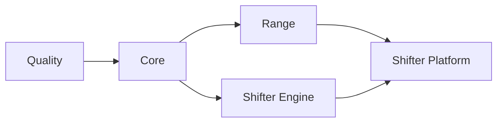

# CI/CD

GitHub Actions with self-hosted runners.

## Workflow Structure

```
.github/workflows/
├── deploy.yml              # Cloud orchestrator (change detection, dependency chain)
├── _quality.yml            # Linting, security scanning
├── _core.yml               # Core infrastructure (ECR, budgets)
├── _range.yml              # Range VPC infrastructure
├── _shifter-engine.yml     # Engine container build and push
├── _shifter-platform.yml   # Portal infrastructure and app deployment
├── _gcp-dev.yml            # GCP validation/deploy workflow
├── packer.yml              # AMI builds (AWS)
└── packer-promote.yml      # AMI promotion to prod (AWS)
```

## Deployment Chain



Jobs run only when relevant files change. `deploy.yml` detects changes and triggers appropriate workflows.

## Change Detection

| Job | Triggers On |
|-----|-------------|
| **core** | `platform/terraform/modules/ecr/**`, `platform/terraform/environments/*/*.tf` |
| **range** | `platform/terraform/modules/range/**`, `platform/terraform/environments/*/range/**` |
| **shifter_engine** | `shifter/engine/provisioner/**`, `platform/terraform/environments/*/eks/**` |
| **shifter_platform** | `platform/terraform/modules/portal/**`, `platform/terraform/environments/*/portal/**` (Terraform only) |
| **portal_image** | `shifter/shifter_platform/**`, `shifter/installation/**` (portal image build/deploy, no Terraform) |

## Environment Targeting

Environment deploys are manual (`workflow_dispatch` with an `environment` input);
push and pull_request run validation only (#730).

- Pull request → Quality only
- Push to `dev` / `main` → Quality only; no deploy
- Manual dispatch `environment=aws-dev` → AWS dev deploy
- Manual dispatch `environment=<gcp-dev|orthanc|sauron|balrog>` → selected GCP deploy

Run a deploy with `gh workflow run deploy.yml --ref <branch> -f environment=<env>`.

## Authentication

OIDC federation per cloud. No long-lived credentials.

| Secret | Purpose |
|--------|---------|
| `AWS_ROLE_ARN` | AWS prod IAM role |
| `AWS_ROLE_ARN_DEV` | AWS dev IAM role |
| `GCP_DEPLOY_SERVICE_ACCOUNT` | Purpose-scoped GCP deploy service account email |
| `GCP_DESTROY_SERVICE_ACCOUNT` | Purpose-scoped GCP destroy service account email |
| `GCP_PACKER_BUILD_SERVICE_ACCOUNT` | Purpose-scoped GCE image build service account email |
| `GCP_PACKER_VALIDATE_SERVICE_ACCOUNT` | Purpose-scoped GCE image validation service account email |
| `GCP_PACKER_PROMOTE_SERVICE_ACCOUNT` | Purpose-scoped GCE image promotion service account email |
| `GCP_WORKLOAD_IDENTITY_PROVIDER` | GCP Workload Identity Federation provider |

AWS roles defined in `platform/terraform/global/iam/github-oidc.tf`. GCP WIF configured in the GCP project.

## GCP Current State

GCP deploys through CI/CD via a manual `workflow_dispatch` with an allowlisted
GCP environment (`gh workflow run deploy.yml --ref <branch> -f environment=<gcp-dev|orthanc|sauron|balrog>`). Branch names
no longer trigger deploys; `dev`/`main` are Quality-only integration branches (#730).
The selected deployment Environment and the purpose-scoped
`gcp-release-scan-<deployment suffix>` Environment provide their own exact WIF
identity variables; the reusable workflow does not reuse the deploy identity for
release scanning. Its prepare preflight is scoped to deploy credentials, while
the isolated scanner performs its own fail-closed identity check inside the
release-scan Environment.

The GCP CI path:

1. validates Terraform and rendered manifests
2. applies GCP Terraform
3. builds and pushes control-plane images
4. renders Helm settings and secret references from Terraform outputs
5. installs or upgrades the Shifter Helm release

Every deploy dispatch runs the quality gate before an apply.
The GCP jobs use one shared Terraform root with selected environment var-files.
Each environment retains its own backend prefix and `TF_DATA_DIR`.
The AWS application lifecycle uses EKS and the shared Helm chart.

The bootstrap path is security-gated and fails closed unless:

- `public_hostname` is set
- `enable_managed_tls = true`
- `gke_master_authorized_cidrs` is empty for Connect Gateway or contains only
  connected RFC1918 networks

`gdc-bootstrap` remains available for first-time bootstrap and controlled recovery, but it is not the normal deployment entrypoint.
