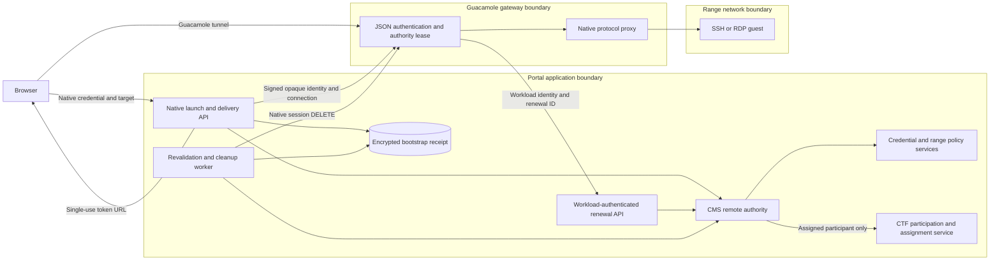
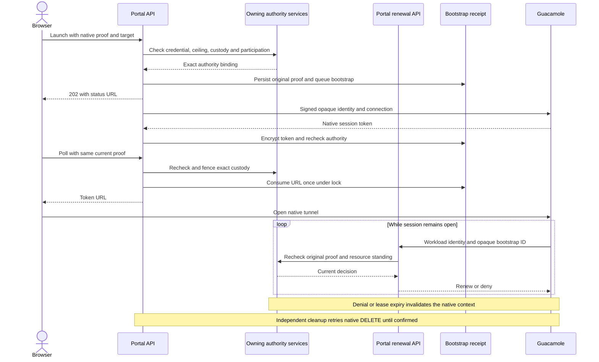

# Guacamole Remote-Desktop Integration

Apache Guacamole provides browser-based RDP and SSH access to range instances and
to NGFW management terminals. The Portal creates signed bootstraps on demand
using the Guacamole JSON-auth extension. The gateway keeps a session open only
while its original native authority remains valid. No connection is
pre-provisioned in the Guacamole database.

This document is the canonical reference for the subsystem. The point-in-time
design notes under `docs/architecture/guacamole-*-preflight-*.md` record the
decisions that produced the current behaviour:

- `docs/architecture/guacamole-first-click-rdp-preflight-395.md` (token-readiness retry)
- `docs/architecture/guacamole-token-affinity-preflight-928.md` (single client replica)
- `docs/architecture/guacamole-token-lifecycle-preflight-939.md` (at-rest token lifecycle)

## Architecture overview

Every mounted launch requires a current native credential. The bootstrap stores
that original proof, its permission ceiling and the exact resource custody.
Historical `user_id` attribution grants no access. The gateway receives a signed
`access-<bootstrap UUID>` identity and a connection projection; it receives no
portal credential.

The data-flow diagram shows the application, gateway and guest trust boundaries.
Credential, policy and CTF checks remain in their owning services. The gateway
uses workload identity only to ask whether the original proof is still valid.

On AWS and GCP, `guacd`, `guacamole-client` and the prune worker run as Kubernetes Deployments.
The shared Helm chart hosts them on EKS or GKE.
Guacamole uses RDS PostgreSQL on AWS and Cloud SQL PostgreSQL on GCP.
The Django integration and JSON-auth flow are shared across clouds.

The BigRAE client image removes the unused upstream CAS, client-certificate SSO,
and Keeper Secrets Manager extensions, including their activation links. Those
extensions bundle vulnerable Bouncy Castle providers; BigRAE's JSON-auth and
PostgreSQL integration does not use them. Enabling any of those upstream
extensions requires a separately reviewed image change with patched dependencies.

## Components

| Component | Location | Purpose |
|-----------|----------|---------|
| **guacamole-client** | Kubernetes Deployment (EKS / GKE) | HTML5 web app; hosts the JSON-auth extension and serves `/guacamole`. |
| **guacd** | Kubernetes Deployment (EKS / GKE) | Protocol proxy; translates the Guacamole protocol to RDP/SSH/VNC and dials the range host. |
| **Guacamole PostgreSQL** | RDS (AWS) / Cloud SQL (GCP) | Database-backed Guacamole configuration; native authentication sessions remain in the client process. |
| **Token broker** | Portal Django, `mission_control/guacamole.py` | Signs the JSON-auth payload, exchanges it at `/api/tokens`, builds the client URL. |
| **Bootstrap runner** | Portal Django, `mission_control/guacamole_bootstrap.py` | Bounded worker pool that runs the blocking token exchange off the request thread and persists a pollable result. |
| **Authority and prune worker** | `manage.py run_guacamole_bootstrap_prune` | Revalidates delivered sessions, retries native termination and prunes receipts only when safe. |
| **`GuacamoleBootstrapRequest`** | Portal/App DB, `mission_control/models.py` | Original proof and resource custody, encrypted single-use URL, and retained native termination receipt. |
| **Gateway authority extension** | `shifter/engine/guacamole/authority-extension/` | Renews the original authority and expires its local lease even when the portal is unavailable. |

## Request flow

The Portal never returns the token URL directly from the launch request. Building
a Guacamole session requires a blocking server-to-server call to
`guacamole-client` `/api/tokens`, so that work runs asynchronously in a bounded
worker pool and the browser polls for the result.

Key points:

- **Launch request body is `{instance_uuid}`** for RDP and range SSH; the NGFW
  SSH route takes the application id in the path. There is no `instance_type`
  field.
- **The launch response is `202 Accepted`** with `{request_id, status,
  status_url, url}`, a `Location` header set to `status_url`, and `Retry-After:
  1`. The `url` field is a compatibility opener page (see Frontend), not the
  token URL.
- **The token URL is delivered by the status endpoint, exactly once** (see Token
  lifecycle). The final URL has the form
  `{GUACAMOLE_BASE_URL}/#/client/{connection_id}?token={authToken}`, where
  `connection_id` is `base64(connection_name + "\0c\0json")` with padding
  stripped.
- **Capacity is bounded.** If every worker slot is busy the launch returns `503`
  with `Retry-After: 1`.

## Token broker (`mission_control/guacamole.py`)

The broker implements the Guacamole JSON-auth extension protocol.

1. **Build the payload.** `create_guacamole_auth_payload(username, connections,
   expires_minutes=5)` returns `{"username", "expires", "connections"}`, where
   `expires` is a millisecond Unix timestamp `expires_minutes` in the future. The
   default JSON admission lifetime is 5 minutes. It does not bound an open
   tunnel; continuing access uses the authority lifecycle below.
2. **Sign and encrypt.** `sign_and_encrypt_payload(payload, secret_key)`:
   - reads `secret_key` as hex; the key must be 16, 24, or 32 bytes (32, 48, or
     64 hex characters), selecting AES-128/192/256. A 64-hex (256-bit) key is the
     configured preference.
   - `signature = HMAC-SHA256(key, json_bytes)`,
   - `signed = signature || json_bytes`, PKCS7-padded to the AES block size,
   - `AES-CBC(key, IV = 0x00 * 16, signed)`, then Base64.

   The signature is prepended to the plaintext and the whole thing is encrypted;
   the guacamole-client JSON-auth extension reverses this with the shared key.
3. **Exchange for a token.** `JsonAuthGuacamoleClient` posts
   `data=<encrypted>` (form-encoded) to
   `{api_base_url}/api/tokens` and returns `authToken` from the JSON response.
   This call uses the **internal** API URL. It retries on transient failures
   (HTTP 408/429/502/503/504 and connection errors) with exponential backoff
   governed by `GUACAMOLE_TOKEN_RETRY_ATTEMPTS` and
   `GUACAMOLE_TOKEN_RETRY_BASE_DELAY_MS`; malformed responses are fatal. The
   retry exists for first-click reliability (issue #395).
4. **Build the client URL.** The `GuacamoleClient` port's `create_rdp_url` and
   `create_ssh_url` methods assemble the connection map, sign/encrypt, exchange
   for `authToken`, and return
   `{public_base_url}/#/client/{connection_id}?token={authToken}` using the
   **public** base URL for the browser.

The public/internal split matters: `GUACAMOLE_API_BASE_URL` is the
server-to-server address used to mint the token, while `GUACAMOLE_BASE_URL` is the
browser-facing path baked into the returned URL.

## Async bootstrap (`mission_control/guacamole_bootstrap.py`)

The token exchange is blocking, so it runs off the request thread:

- **Worker pool.** A process-local `ThreadPoolExecutor` plus a `BoundedSemaphore`
  cap concurrent exchanges at `GUACAMOLE_BOOTSTRAP_WORKERS` (default 4). A launch
  that cannot acquire a slot raises `BootstrapQueueFull`, surfaced as `503`.
- **Enqueue.** `enqueue_guacamole_bootstrap` creates a `PENDING`
  `GuacamoleBootstrapRequest` with `expires_at = now + GUACAMOLE_BOOTSTRAP_TTL_SECONDS`
  (default 300, floor 30) and submits `_run_bootstrap`.
- **Inline mode.** With `GUACAMOLE_BOOTSTRAP_INLINE` true the exchange runs
  synchronously in-request. This is used by tests and single-threaded contexts.
- **Worker.** `_run_bootstrap` marks the row `RUNNING`, calls the per-protocol
  `build_url` callable, and on success stores `result_url` and `SUCCEEDED`. A
  build that raises records a `FAILED` row with a sanitised error and HTTP-ish
  status. A build that finishes after `expires_at` records expiry and **does not
  persist a token URL** (see Token lifecycle).

The mounted polling endpoints live in `mission_control/api/guacamole.py`:

- `GET /api/v1/mission-control/guacamole/bootstrap/<request_id>/` returns the
  current state only after reauthorizing the original native proof and the
  current caller. `PENDING`/`RUNNING` return `Retry-After: 1`;
  `FAILED` returns the recorded status and message; `SUCCEEDED` delivers the URL
  once (then `410` on any later poll); an expired row returns `410`.
- `GET /api/v1/mission-control/guacamole/bootstrap/<request_id>/open/` serves an opener page
  that polls the status endpoint and redirects when the URL is ready, for clients
  that consume the opener `url` directly.

## Continuing authority and native termination

Launch, worker execution, URL delivery, gateway renewal and controller sweeps
reuse the same CMS remote-authority admission. It resolves the original
credential and its exact ceiling, then checks range policy, owner, generation
and scope. Delivery also checks the current caller and locks the exact CMS and
Engine custody before consuming the bootstrap receipt.

For the owner of an assigned CTF range, CMS calls the shared range service port.
CTF checks retained participation, live event standing and the exact range
assignment. The assigned participant needs both `range.access` and current
`event.participate` authority. A banned or deleted participant cannot become a nonparticipant by
losing an active-row filter. Independent operator access to another owner's
range continues under that operator's range permission. Temporary event
credentials retain their event-only ceiling; this check grants no range access.

| Change after delivery | Continuing check | Required result |
| --- | --- | --- |
| Portal logout or credential revocation | Resolve the original stored credential | Deny renewal and terminate the native session. |
| Human user or principal disabled | Resolve current identity state | Deny renewal and terminate the native session. |
| Workspace archived | Resolve current resource ancestry | Deny renewal and terminate the native session. |
| Assigned participant banned, deleted or event ended | CTF-owned standing and assignment | Deny participant renewal and terminate that session. |
| Range owner, scope or generation changed | Compare original custody with the current resource | Terminate the old session without substituting the new owner. |

The Account root has no separate deactivate operation. Identity disable and
workspace archival are the supported state changes above.

The gateway renews every 15 seconds and retains a 90-second monotonic lease.
A failed renewal cannot extend the deadline. Denial or expiry permanently
invalidates the decorated native context. Apache's one-minute eviction cadence
and guest transport shutdown remain part of the disconnect time. The separate
portal worker defaults to a 60-second cycle with at most 500 revalidations per
cycle. Queue load and dependency latency affect that worker's sweep time.

The worker calls native `DELETE /api/session` with the retained token in the
`Guacamole-Token` header and refuses redirects. Apache's
[session endpoint](https://github.com/apache/guacamole-client/blob/1.6.0/guacamole/src/main/java/org/apache/guacamole/rest/session/SessionResource.java)
invalidates the token; its
[session implementation](https://github.com/apache/guacamole-client/blob/1.6.0/guacamole/src/main/java/org/apache/guacamole/GuacamoleSession.java)
closes associated tunnels. A failed or ambiguous termination retains the
receipt for retry. Only success or the pinned endpoint's specific already-absent
response clears the native token. Browser closure and JSON admission expiry do
not prove native teardown.

The [content and range authority guide](../shifter_platform/content-range-authority.md)
records SSH, SFTP and RDP transport qualification, outage cases and timing
limits. Those synthetic fixture results do not establish a loaded deployment
guarantee. Full suites and built-image transport qualification run in CI/CD.

## Token lifecycle and at-rest security

Both `result_url` and `native_session_token` use the existing field-encryption
key. The worker retains the minted native token before its final authority
check, so revocation during the token exchange still leaves cleanup evidence.

1. The first authorized status poll consumes the URL under a database lock,
   sets `delivered_at` and clears `result_url`. Later polls cannot obtain it.
2. An expired or unauthorized handoff never delivers a URL. It requests native
   termination and retains the encrypted token until termination is confirmed.
3. Delivered sessions keep their encrypted native token for continuing
   revalidation and cleanup. Bootstrap URL expiry does not end this lifecycle.
4. Pruning preserves in-flight work and receipts with an unterminated native
   token. It removes expired rows only after those obligations are clear.

## Persistence model (`GuacamoleBootstrapRequest`)

| Field | Purpose |
| --- | --- |
| `id` | Opaque bootstrap UUID, also bound to the gateway identity. |
| `user_id` | Nullable historical attribution; never authorization. |
| `protocol`, `target_id` | Closed transport kind and exact guest or device. |
| `authority_*`, `credential_*`, `initiating_principal_*` | Original action, resource custody, proof reference and ceiling inherited from `RecordedAuthorityFields`. |
| `status`, `error_message`, `error_status_code`, `duration_ms` | Bounded bootstrap outcome and safe failure information. |
| `result_url` | Encrypted single-use URL; cleared on delivery or failed handoff. |
| `native_session_token` | Encrypted native cleanup credential; retained until confirmed termination. |
| `delivered_at` | Single-use handoff receipt. |
| `termination_pending`, `native_terminated_at` | Durable cleanup state. |
| `created_at`, `updated_at`, `expires_at` | Bootstrap lifetime and fair revalidation ordering. |

## Frontend

The SPA hook `useGuacamoleSession` in
`frontend/src/features/mission-control/guacamole.ts` drives every launch. It
POSTs to the launch endpoint to queue the bootstrap and gets a `request_id`. It
then polls the bootstrap status endpoint once per second (up to 60 attempts)
until the response carries `url` or `error`. It opens the URL in a new tab with
`noopener,noreferrer` and stops polling on the first delivered URL, so
single-use delivery is transparent to the happy path.

The Mission Control instance, terminal and NGFW pages and the CTF participant
range page all use this hook. All launches pass through the same status
endpoint as the delivery boundary.

## Settings

Guacamole settings live in `config/_guacamole_settings.py` (re-exported by
`config/settings.py` to keep that module under the 500-line cap); the two retry
knobs live in `config/settings.py`.

| Setting | Default | Controls |
|---------|---------|----------|
| `GUACAMOLE_JSON_AUTH_SECRET` | `""` | Hex HMAC/AES key; must equal guacamole-client `JSON_SECRET_KEY`. Empty means the feature returns `503`. |
| `GUACAMOLE_BASE_URL` | `/guacamole` | Public browser base for the `#/client/...` URL. |
| `GUACAMOLE_API_BASE_URL` | falls back to `GUACAMOLE_BASE_URL` | Internal `/api/tokens` address. |
| `GUACAMOLE_BOOTSTRAP_WORKERS` | `4` | Per-process bounded worker/semaphore count. |
| `GUACAMOLE_BOOTSTRAP_TTL_SECONDS` | `300` | Bootstrap row lifetime (floor 30). |
| `GUACAMOLE_BOOTSTRAP_INLINE` | `False` | Run the exchange synchronously in-request. |
| `GUACAMOLE_BOOTSTRAP_PRUNE_INTERVAL_SECONDS` | `60` | Revalidation and prune cadence. |
| `GUACAMOLE_BOOTSTRAP_PRUNE_BATCH_SIZE` | `500` | Revalidation limit and prune batch size. |
| `GUACAMOLE_CONTROL_AUDIENCE` | `""` | Required workload-token audience for gateway renewal. |
| `GUACAMOLE_CONTROLLER_SERVICE_ACCOUNT_EMAIL` / `ID` | `""` | Exact configured gateway workload identity. Missing identity denies renewal. |
| `GUACAMOLE_TOKEN_RETRY_ATTEMPTS` | `3` | `/api/tokens` retry attempts. |
| `GUACAMOLE_TOKEN_RETRY_BASE_DELAY_MS` | `200` | `/api/tokens` backoff base. |

## Deployment topology

The deployment pins `guacamole-client` to one replica
so the in-memory token minted by `/api/tokens` is consumed by the same instance
that issued it (issue #928); `guacd` scales independently. This is enforced by
`tests/platform/test_guacamole_topology.py`.

The client image starts from a pinned upstream digest. Its build replaces the
bundled Guava, Jackson and PostgreSQL JDBC dependencies with versions and hashes
recorded in `shifter/engine/guacamole/Dockerfile`. It removes unused authentication
extensions and database drivers. The replacement step rejects an archive layout
that lacks an expected dependency. The authority extension pins the same Guava
version. Image build, scan and native session-closure checks run in CI.

### AWS

- The shared chart deploys `guacd`, `guacamole-client` and the prune worker on EKS.
- `guacamoleClient.replicas` remains 1; `guacd` has independent capacity settings.
- The EKS ingress routes `/guacamole` to the client and application traffic to the Portal.
- Workload identities and secret references select the required Secrets Manager payloads.
- Follow the [AWS EKS bundle](aws-eks-bundle.md) for ingress, runtime hydration and deployment checks.

### GCP

- `guacd`, `guacamole-client`, and `guacamole-bootstrap-prune` are Kubernetes
  Deployments (Helm chart `platform/charts/shifter/templates/`, the only GCP
  renderer). `guacamoleClient.replicas` is 1.
- `JSON_SECRET_KEY` and DB credentials reach the client via the
  `guacamole-runtime` Kubernetes Secret. `gcp-deploy` creates that Secret
  **out of band** (`kubectl apply` from GCP Secret Manager, before the Helm
  release). The Helm chart never carries the secret values; it references
  the Secret by name only (`envFrom.secretRef`), so credentials never enter
  chart values or Helm release history. `scripts/gcp/render_runtime_env.py` sets
  `GUACAMOLE_SECRET_ID`, `GUACAMOLE_BASE_URL`, and the in-cluster
  `GUACAMOLE_API_BASE_URL`.
- NetworkPolicies restrict `guacamole-client` to `guacd` on TCP 4822 and admit
  GCLB ingress to the portal and guacamole-client backends on 8000/8080.

### Local

`docker-compose.yml` runs the `guacamole-bootstrap-prune` worker (the Django
broker logic is identical across clouds); `guacd` and `guacamole-client` are
exercised through the AWS or GCP stacks.

### Secret injection

The Portal entrypoint (`entrypoint.sh`) resolves `GUACAMOLE_SECRET_ID` /
`GUACAMOLE_SECRET_ARN` and exports `GUACAMOLE_JSON_AUTH_SECRET` from the secret
store, failing closed if the fetch fails. The guacamole-client container receives
the same key as `JSON_SECRET_KEY`. The two values must match, or every signature
fails validation.

## Configuration reference

### guacamole-client container

| Variable | Source | Notes |
|----------|--------|-------|
| `GUACD_HOSTNAME` / `GUACD_PORT` | deployment | `guacd` service / `4822`. |
| `POSTGRESQL_HOSTNAME` / `PORT` / `DATABASE` | runtime config | Guacamole DB. |
| `POSTGRESQL_USER` / `PASSWORD` | secret store | Guacamole DB creds. |
| `POSTGRESQL_AUTO_CREATE_ACCOUNTS` | deployment | `true`. |
| `JSON_ENABLED` / `OPENID_ENABLED` | deployment | `true` / `false`. |
| `JSON_SECRET_KEY` | secret store | Must equal `GUACAMOLE_JSON_AUTH_SECRET`. |
| `GUACAMOLE_CONTROL_URL` / `GUACAMOLE_CONTROL_AUDIENCE` | runtime config | Administrator-selected HTTPS renewal endpoint and workload-token audience. |

### Secrets

| Secret name pattern | Purpose |
|---------------------|---------|
| `shifter-{env}-guacamole-db` | Guacamole PostgreSQL credentials. |
| `shifter-{env}-guacamole-json-auth` | JSON-auth signing key. |

## Code references

| Area | Path |
|------|------|
| Token broker (crypto, `/api/tokens`, URL) | `shifter/shifter_platform/mission_control/guacamole.py` |
| Launch and polling endpoints | `shifter/shifter_platform/mission_control/api/guacamole.py` |
| Native admission and session orchestration | `shifter/shifter_platform/mission_control/guacamole_session.py` |
| Continuing authority and termination | `shifter/shifter_platform/mission_control/guacamole_authority.py` |
| Workload-authenticated renewal | `shifter/shifter_platform/mission_control/api/guacamole_control.py` |
| Async bootstrap + token lifecycle | `shifter/shifter_platform/mission_control/guacamole_bootstrap.py` |
| Persistence model | `shifter/shifter_platform/mission_control/models.py` |
| Prune service | `shifter/shifter_platform/mission_control/management/commands/run_guacamole_bootstrap_prune.py` |
| Mounted URL routes | `shifter/shifter_platform/mission_control/api/urls.py` |
| Settings | `shifter/shifter_platform/config/_guacamole_settings.py` |
| Frontend | `shifter/shifter_platform/frontend/src/features/mission-control/guacamole.ts` |
| AWS infra | `platform/terraform/modules/guacamole/` |
| GCP infra | `platform/charts/shifter/templates/guac*` |
| Topology invariant test | `shifter/shifter_platform/tests/platform/test_guacamole_topology.py` |

## Troubleshooting

| Symptom | Likely cause | Resolution |
|---------|--------------|------------|
| Launch returns `503` | All bootstrap worker slots busy, or `GUACAMOLE_JSON_AUTH_SECRET` unset | Retry after the `Retry-After` interval; verify the Portal secret. |
| Status poll returns `410` "no longer available" | The URL was already delivered (single-use) | Launch again; the first reader consumes the token. |
| Status poll returns `410` "expired" | Polled after the bootstrap TTL | Launch again. |
| "Invalid signature" in guacamole-client logs | Key mismatch | Ensure `JSON_SECRET_KEY` equals `GUACAMOLE_JSON_AUTH_SECRET`. |
| Connection timeout after the client opens | guacd cannot reach the range host | Verify peering and the range RDP/SSH ingress rules. |
| No RDP button | Instance has no GUI (`os_type == "ubuntu"`) | Expected; use SSH. |
