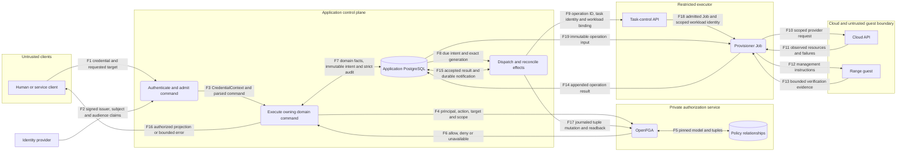
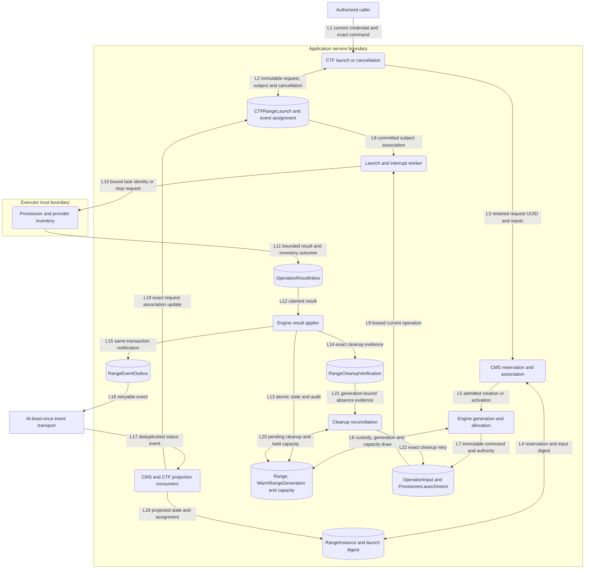
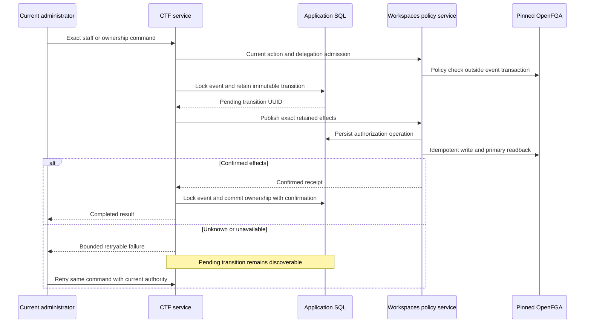
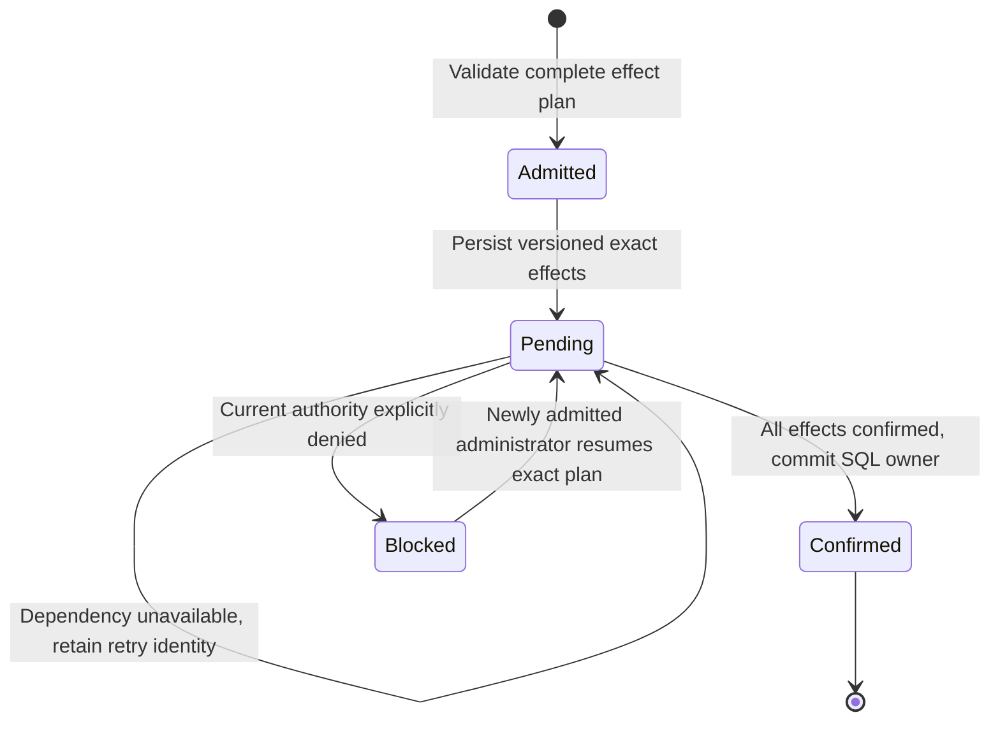
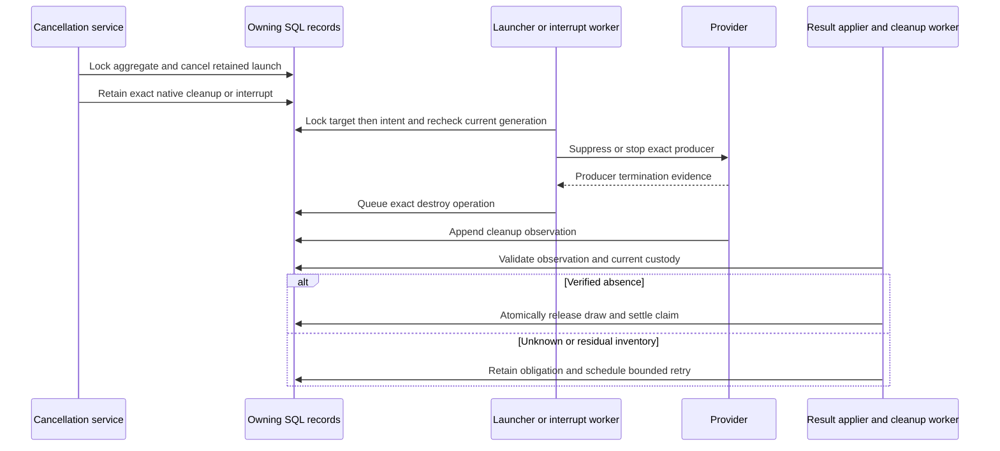
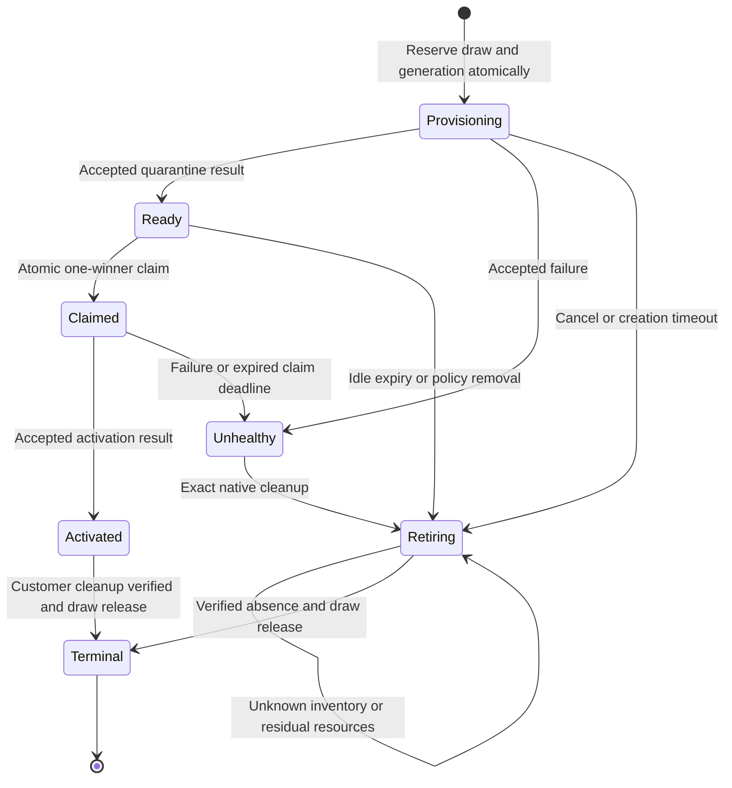

# Identity and range lifecycle contracts

This document defines the integration contracts for the ADR-066 identity cutover.
It covers authority, durable state, external effects and recovery across domains.
The [proposal](../../design/identity-cutover-2321-proposal.md) records implementation gaps and verification status.
Diagrams describe required behavior. They do not certify implementation or deployment.

## Ownership and dependency model

The application remains a modular Django control plane with an independent provisioner.
Domain services share PostgreSQL, but each domain owns its models and invariants.
Public facades exchange typed contracts and identifiers. They do not expose mutable foreign models.

| Owner | Authoritative facts | Reused boundary |
| --- | --- | --- |
| Management | Principal activity, provider binding and credential lifecycle | `management.services`; `shared.credentials` |
| Workspaces | Account ancestry, membership and policy mutation journal | `workspaces.services`; `shared.authorization` |
| CTF | Event, participant assignment, launch and ownership transition | `ctf.services`; `ctf.bridges` |
| CMS | Content custody, launch declaration and desired range state | `cms.services`; `RangeInstance` |
| Engine | Resource generation, allocation, immutable operation and applied result | `engine.services`; `shared.operation_envelope` |
| Provisioner | Provider commands and observed resource inventory | Immutable input and append-only result contracts |
| OpenFGA | Application permission relationships and decisions | Pinned store/model through the authorization port |

The existing facades, journals and outbox remain the implementation primitives.
Recovery belongs beside the state it repairs. It does not belong in HTTP views.
No new workflow engine, permission language or message service is required.

| Identifier | Meaning |
| --- | --- |
| CMS request UUID | Immutable launch declaration and retry identity. |
| `claimed_by_request_id` | Customer launch that claimed a warm allocation. |
| `Range.resource_generation` | Provider resource custody identity. |
| `Range.provisioner_operation_id` | Current lifecycle operation; changes without creating new resource custody. |
| Credential reference and ceiling | Initiator evidence and maximum permissions; distinct from workload identity. |

## DFD 0: system context

Rectangles are external entities. Rounded boxes are processes. Cylinders are durable stores.
Named subgraphs identify trust boundaries. Arrows name the data that crosses each boundary.

F1 carries secrets only to the authenticated edge. Durable intent stores credential references, never bearer tokens.
The authentication process verifies F2. Provider claims are not verified application identity until that check succeeds.
F4 uses SQL ancestry and the credential ceiling. Cloud workload identity cannot replace application authority.
F14 uses separate database duties. The executor cannot declare arbitrary application state or policy grants.
Guest evidence is untrusted input. Engine validates its contract, generation, ownership and ordering before applying it.
The deployment and continuing-access boundaries remain in the [architecture handbook](../architecture.md).

## DFD 1: launch, result and cleanup

These stores are separate ownership groups in application PostgreSQL, not new databases.
The transport is delivery infrastructure. It cannot authorize a launch or establish resource absence.

L8 is a prerequisite, not a queue message. CTF must commit its association before runnable dispatch.
L13 through L15 commit together for an accepted result. Failed application leaves the inbox row retryable.
L21 must match request, CMS UUID, native resource and current generation.
Neither a deleted projection nor `DESTROYED` status alone satisfies L21.
Cleanup retains capacity when inventory is unknown or residual resources remain.

## Admission and policy publication

Admission resolves a current credential, a concrete target and SQL-owned ancestry.
It obtains current policy before the owning transaction, then rechecks local bindings under the domain lock.
An admission object is an in-process value. It is neither a durable credential nor a reusable permission grant.
Dispatch resolves the recorded credential again and preserves its original ceiling.
An external policy check and a later SQL commit are not one atomic revocation boundary.
Current readback reduces stale decisions; it does not cancel an effect already admitted elsewhere.
Local credential fences and continuing-access termination remain separate controls.

OpenFGA and application SQL do not share a transaction.
The owning journal records the exact intended policy change before external publication.
Readback confirms uncertain writes. A timeout never becomes an implicit success or a new grant.

`CTFEventAuthorityTransition` allows one pending transition per event.
New grants require active recipients. Settlement of an admitted staff or ownership plan can use its exact retained inactive recipient.
That exception binds the transition kind, event, subject and effect to the immutable, preflighted plan.
It cannot authorize a new inactive grant or an inactive actor.
Deactivation must not strand the event behind a partially published staff assignment.
The original live caller can confirm an admitted effect without replaying a write.
A replacement administrator must hold current authority for each remaining effect.

These are composite handoff phases. Persisted CTF states remain `pending` and `confirmed`.
Workspaces records each effect as requested, unresolved, denied or confirmed.
Intermediate policy effects can coexist before SQL ownership changes. Pending state must block conflicting domain commands.
Provider unavailability is not a policy denial and must not poison a retry key.
The effect manifest has stable semantic keys, an explicit version and the pinned provider binding.
Changing a role catalog cannot change an already accepted handoff.
CTF supplies its retained transition through the registered shared resolver.
Workspaces consumes that typed contract without importing CTF models.
This runtime callback is part of the dependency model, even though import rules cannot show the call chain.

HTTP adapters must translate pending publication into the same bounded error contract.
Service tests alone do not prove that the HTTP response preserves recovery.
The staff-list API exposes a nullable `pending_transition` receipt. The browser can retry that exact command.
The receipt does not disclose raw tuples or credential material.
Migration `ctf.0076` refuses unfinished legacy transitions without effect plans.
Settle them on the old release first; confirmed history is retained.

## Parked model-access sharing boundary

[ADR-068](../../adr/068-model-access-broker-parked.md) parks the broker and its
sharing controls. The identity cutover does not unpark or extend them.
Mounted sharing routes and their composition/selector entry points must return
an explicit unavailable result before reading membership, publishing, draining
or refreshing a binding. An enabled runtime setting cannot override that
architecture decision. Pure retained Engine contracts and accounting code do
not become supported application entry points.

This closure preserves the existing keyless-direct model path. It does not
disable independently supported source administration or native range controls.
The replacement gateway requires its own qualified design and activation.
Tests must cover the mounted route and direct service boundaries, including
legacy owner/operator flags, current native services and an enabled setting.
They must establish that no selector read or publication effect occurs.

## Notification and scoreboard projection

Notification recipient lists are delivery candidates. They are not permission grants.
Current human owner and staff principals can map to browser recipients; service
principals must not map to a responsible user's browser identity. Candidate
selection performs no remote policy I/O inside a producer transaction.

The subscriber port carries the actual credential and its ceiling. Initial
subscription, replay and delivery each check current event policy or exact live
participant admission. The transport gate alone cannot authorize a topic.
Revoked credentials, denied policy and unavailable dependencies stop delivery.
The participants-only scoreboard uses the same distinction between current
administrator policy and eligible participant facts. Its intentionally public
publication mode remains separate from restricted access; hidden mode remains hidden.

## Launch and cancellation model

The following phases are derived from existing records. They are not a new persisted state enumeration.

| Phase | Durable condition | Recovery owner and rule |
| --- | --- | --- |
| Declared | `CTFRangeLaunch` binds request UUID, subject, credential and inputs | CTF retries that declaration; different inputs are refused. |
| Reserved | CMS input digest and Engine custody receipt exist | CMS resumes the same request; it cannot allocate a replacement silently. |
| Associated | Participant, spare or rebuild points to the exact reservation | CTF can resume dispatch after a crash. |
| Dispatched | Engine launch intent and immutable operation input exist | Launcher rechecks generation, authority, lease and interruption. |
| Realized | Engine accepts the required result steps | Outbox consumers update projections using exact request bindings. |
| Cancelled | Event lock protects the retained launch tombstone | Creation checks the same fence; cleanup includes unassociated requests. |
| Cleanup pending | Exact cleanup origin exists; capacity remains held | Existing interrupt and cleanup workers stop producers and retry cleanup. |
| Settled | Current-generation absence is verified, or creation was fenced before realization | Owning transaction releases capacity and settles the exact claim. |

Recovery can clear an old participant pointer before a replacement commits.
The retained recovery record must still identify the verified old generation.
Old cleanup cannot clear a newer assignment or release its capacity.

## Warm allocation model

Warm allocation state is separate from public range status.
A ready pool generation remains quarantined until a customer claim and activation complete.

| Clock or limit | Required meaning |
| --- | --- |
| `created_at` | Age of initial preparation only. |
| `ready_at` and `idle_deadline` | Quarantined inventory age and expiry. |
| `claimed_at` | Start of the activation recovery window. Previous pool age cannot shorten it. |
| Launcher `next_attempt_at` | Retry or worker lease boundary; stale workers cannot dispatch or record outcomes. |
| Bucket and global ceilings | Count and reserve under one database serialization point. Per-worker counts cannot enforce a limit. |

Pool configuration controls replenishment. Retained ledger rows control outstanding cleanup obligations.
Disabling or removing a bucket must stop new creation while preserving cleanup and capacity settlement.
Healthy customer custody is outside pool retirement. Failed activation recovery rechecks custody and its own deadline under lock.

## Lock and external-effect contracts

This is a partial order per operation. It does not require unrelated commands to acquire every lock.
Sort multiple rows from one ownership group by stable key.

| Boundary | Required order and recheck |
| --- | --- |
| CTF creation and cancellation | Event before retained launch and subject; recheck cancellation and exact assignment. |
| Account quota and workspace placement | Account before Workspace; warm and cold commands use the same order. |
| Warm claim, result and retirement | Warm generation before Range; recheck custody and operation after waiting. |
| Native launch, cancellation and terminal failure | Target before launch intent when both locks are needed; recheck operation and claimed lease. |
| Capacity reservation | Serialize limit observation and durable reservation; provider work follows the committed reservation. |
| Result application | Inbox claim, then owning target locks; state, strict audit and outbox commit together. |

Application policy calls occur outside domain row locks.
The existing launcher holds its generation lock across provider task submission to serialize cancellation.
This is an explicit exception to a blanket claim that external I/O never occurs under locks.
Submission must use a stable task identity and bounded provider timeouts.
Moving it outside the lock requires equivalent durable cancellation and late-submission reconciliation.
A local refactor must not remove that protection accidentally.

## Threat and verification matrix

| Threat | Flow or boundary | Required control | Verification seam |
| --- | --- | --- | --- |
| Identity substitution | F1-F3 | Verified provider binding and live credential | Session and service credential tests |
| Cross-account or privilege escalation | F4, L3-L7 | SQL ancestry, exact target and original ceiling | Native CMS launch and CTF assignment tests |
| Stale or forged asynchronous work | L9-L14 | Immutable input, current generation, workload binding and result validation | Launch outbox and result-applier tests |
| Partial policy change or lost acknowledgement | Policy publication | Durable exact intent and primary readback | Handoff service and mounted HTTP retry tests |
| Orphan resources after cancellation | L20-L22 | Stop producers, retain cleanup origin and verify absence | Native SDK cleanup and cancellation races |
| Premature capacity release | L21 | Exact-generation absence and atomic draw settlement | Unknown, residual and stale-evidence tests |
| Destruction of a healthy customer claim | Warm claim boundary | Claim timestamp, current custody and locked recovery check | Old pool generation followed by fresh claim |
| Resource exhaustion or deadlock | Reservation and dispatch | Atomic ceilings, bounded work and consistent lock order | Real PostgreSQL concurrent service calls |
| Repudiation or secret disclosure | F7, F14-F16 | Strict audit, opaque identifiers and bounded error adapters | Audit rollback and actual API error tests |

Tests must drive production orchestration through each durable boundary.
They may replace the external provider with a deterministic adapter.
They must not inject the final cleanup receipt or pre-acquire the lock whose behavior they claim to verify.
Each asynchronous flow needs crash-before, crash-after, duplicate, stale-generation and denied-authority cases.
Concurrency evidence requires PostgreSQL. SQLite cannot establish row-lock behavior.

## Scale and maintenance constraints

Workers use bounded batches and indexed pending-state queries.
Cleanup must cover retained buckets, even when their configuration disappears.
Large pending sets need deterministic progress; repeatedly selecting the same incomplete rows can starve later obligations.
The deployed `reconcile_warm_pool --loop` worker retains its keyset cursor across passes and wraps after the last page.
One-shot invocation covers one page only. A restart can repeat work but cannot authorize new effects from cursor state.
Global admission can serialize the short count-and-reserve transaction without serializing provider work.
Per-generation locks permit unrelated lifecycle commands to proceed independently.
Warm limits arbitrate workers using the same policy snapshot.
A lower limit does not become installation-wide until workers using the old configuration stop.
Generation fingerprints bind compatibility; they do not order different deployment policy versions.

The verification record must identify the production entry point, persisted intermediate state and observed final state.
Passing a helper test does not establish the surrounding flow.
No local test establishes cloud IAM, live network behavior or deployment capacity.

## Code and verification map

Paths below are relative to `shifter/shifter_platform`.
The proposal records the checks performed. These entry points retain regression coverage.

| Contract | Owning implementation | Verification entry point |
| --- | --- | --- |
| Retained launch and cancellation | `ctf/services/range/launch_intents.py`, `launch_cleanup.py` | `tests/ctf/test_range_launch_crash_recovery.py` |
| Exact old-generation replacement | `ctf/services/range/recovery_steps.py` | `tests/ctf/test_recovery_verified_old_generation.py` |
| Event authority transition | `ctf/services/event/authority_plan.py`, `ctf/services/event/staff.py`, `ctf/migrations/0076_event_authority_effect_plan.py` | `tests/ctf/test_authority_plan.py`, `test_authority_plan_migration.py`, `test_retained_inactive_handoff.py` |
| HTTP recovery response | `ctf/api/organizer/staff.py` | `tests/ctf/test_authority_plan.py`; browser `EventStaffCard.test.tsx`. |
| Policy journal and retry | `workspaces/services/_authorization_policy.py`, `_authorization_journal.py` | `tests/workspaces/test_authorization_policy.py` |
| Warm admission and recovery | `engine/services/_warm_pool_admission.py`, `_warm_pool_sweep.py`, `_range_cleanup_retry.py`, `cms/services/_warm_pool_reconcile.py` | `tests/engine/services/test_warm_reservation_postgres.py`, `test_native_warm_retirement.py`, `tests/cms/test_warm_pool_reconcile.py` |
| Launch and cancellation locks | `engine/launch_target.py`, `engine/management/commands/drain_provisioner_launch_outbox.py`, `engine/services/_principal_cancellation.py` | `tests/engine/test_provisioner_launch_outbox.py`, `test_native_launch_cancellation_postgres.py`. |
| Result and capacity settlement | `engine/services/_operation_apply_domain.py`, `_cleanup_verification.py` | `tests/engine/services/test_native_warm_retirement_postgres.py` |
| Real permission provider | `config/openfga_authorization.py` | `tests/integration/authorization/test_openfga_prepared_administration.py` through the released-server harness. |
| Parked sharing boundary | `shared/model_access/availability.py`, `config/api/model_access.py` | `tests/config/test_model_access_management_api.py`; direct composition and selector tests. |
| Notification and restricted projection | `ctf/services/event_projection.py`, `shared/consumers.py`, `config/session_credentials.py` | `tests/ctf/test_native_notification_authority.py`, `tests/integration/asgi/test_native_ctf_notifications.py`; PostgreSQL and Redis transport tests. |

## Reference basis

The following references inform these choices. They do not certify this implementation.

| Reference and version | Section | Application |
| --- | --- | --- |
| [OWASP Threat Modeling Cheat Sheet](https://cheatsheetseries.owasp.org/cheatsheets/Threat_Modeling_Cheat_Sheet.html), accessed 2026-10-28 | System Modeling; Review and Validation | DFD levels, named trust boundaries and threat-to-test mapping. |
| [Django 6.0 transactions](https://docs.djangoproject.com/en/6.0/topics/db/transactions/) | Atomic transactions; performing actions after commit | Short owning transactions and committed intent before asynchronous effects. |
| [PostgreSQL 16 explicit locking](https://www.postgresql.org/docs/16/explicit-locking.html) | Deadlocks; advisory locks | Consistent lock order and database arbitration of concurrent reservations. |
| [AWS transactional outbox pattern](https://docs.aws.amazon.com/prescriptive-guidance/latest/cloud-design-patterns/transactional-outbox.html), accessed 2026-10-28 | Issues and considerations; relational outbox | Existing SQL outbox and idempotent consumers; no additional AWS service. |
| [OpenFGA source of truth](https://openfga.dev/docs/best-practices/source-of-truth), API v1 guidance | Entity hierarchies; fine-grained permissions | SQL owns hierarchy; OpenFGA owns application permission relationships. |
| [OpenFGA consistency](https://openfga.dev/docs/interacting/consistency), API v1 | Higher consistency | Bypass query caches for current authority and policy reconciliation; account for added latency. |
